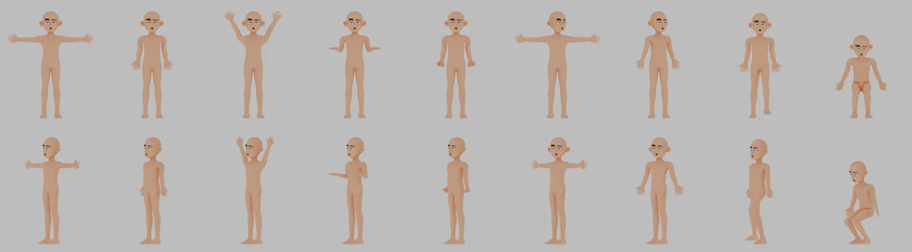

# NAM-002: nhân vật nam trưởng thành

Đây là mô hình chủ repo gửi ngày 14/11/2026. Chủ repo dựng nó trưởng thành hơn bản gốc 001 để gần với nguyên mẫu Nam trong kịch bản. Mô hình đứng chữ T, cao 1,70 m, đầu trọc, mặt hướng −Y, bên trái nhân vật là +X. Trợ lý đã sửa màu và gắn rig thử. Bản này **chưa nghiệm thu diễn hoạt**.



## Tệp

| Tệp | Nội dung |
|---|---|
| `nguon/base_basic_pbr.glb` | File gốc chủ repo gửi, giữ nguyên byte. SHA-256 `ae880aaf…28f1`. |
| `nam-002.glb` | Bản đã sửa. Thân tô theo màu da đầu, mắt sửa lại (viền đều, mí, lòng trắng), lông mày tô đều, hốc miệng được làm phẳng và vẽ miệng chữ O. Cao đúng 1,70 m, normal map giảm còn 0,35. |
| `rig_nam002.py` | Script rig. Đọc `nam-002.glb` và không sửa file này. |

Giấy phép của mô hình chưa xác minh.

## Tạo file rig

Chạy trong thư mục này, mất khoảng 2 phút:

```powershell
D:/blender/blender.exe -b --factory-startup --python rig_nam002.py -- --out nam-002-rig.blend --glb nam-002-rig.glb --anh xem-rig
```

File `.blend` và `.glb` đã rig nặng khoảng 26 MB nên không đưa lên Git.

## Rig gồm

- **Tên xương theo Mixamo:** `Hips`, `Spine`, `Spine1`, `Spine2`, `Neck`, `Head`, `LeftShoulder`, `LeftArm`, `LeftForeArm`, `LeftHand`, `LeftHand{Thumb,Index,Middle,Ring,Pinky}1–3`, `LeftUpLeg`, `LeftLeg`, `LeftFoot`, `LeftToeBase`, cùng các xương `Right…` tương ứng.
- **Xương phụ vai** `LeftArmBlend` / `RightArmBlend`: tự xoay theo 50% góc của bắp tay, giúp đỉnh vai không gập nếp khi hạ tay.
- **IK chân:** điều khiển bằng `ik_foot.L/R`, hướng gối bằng `pole_knee.L/R`.
- **IK/FK tay:** đặt thuộc tính `ik` trên `ik_hand.L/R` (0 là FK, 1 là IK), hướng khuỷu bằng `pole_elbow.L/R`.
- **Nắm tay:** trên `LeftHand` / `RightHand` có `nam` để nắm cả bàn tay, và `nam_tro`, `nam_giua`, `nam_ap`, `nam_ut`, `nam_cai` cho từng ngón. Giá trị từ 0 đến 1.
- **Bone collections:** `Than`, `Tay_FK`, `Tay_IK`, `Ngon`, `Chan_IK`, `Chan_deform`.

## Cách gán trọng số và các lỗi đã gặp

- **Đỉnh trùng ở đường nối UV:** khi nhập GLB, đỉnh ở đường nối UV bị nhân đôi (lưới thành 1.176 mảnh). Mỗi bản sao nhận trọng số hơi khác nên đường nối hở thành khe tối khi tạo dáng. Script hàn các đỉnh trùng trước khi rig: số đỉnh giảm từ 139.506 xuống 128.506, còn 38 cạnh hở.
- **Bone heat trên lưới gốc thất bại**, toàn bộ đỉnh không có trọng số. Script chạy bone heat trên một lưới voxel kín (4 mm, giản lược 30%) rồi chép trọng số sang lưới gốc.
- **Luật vùng:** trái chỉ theo xương trái, phải chỉ theo xương phải. Chuyển tiếp mềm từ thân sang tay ở |x| 0,17–0,26 và từ thân sang chân ở z 0,88–1,00. Đầu đi cứng theo `Head` từ z = 1,40, cổ pha dần từ `Spine2` qua `Neck` sang `Head`. Ngón tay có trọng số tính theo hình học. Sau cùng làm mượt vai và háng, rồi thêm Corrective Smooth (30 vòng) cho hai vùng này.
- **Háng:** ở đáy háng, vùng chuyển giữa chân trái và chân phải được nới rộng thành ±4,5 cm và pha thêm 35% trọng số `Hips`. Vùng mông được làm mượt thêm cho dáng ngồi. Nhờ vậy dáng bước giảm từ 379 xuống 4 cạnh giãn. Dáng ngồi xổm còn giãn ở hông và mông, nhưng nhìn ảnh không thấy rách.
- **Mốc khớp:** gối được đặt nhô trước 1,7 cm và khuỷu lùi sau 1 cm so với đường thẳng nối hai khớp hai đầu, để IK gập đúng chiều. Trước khi sửa, gối bị gập vào trong.

## Kết quả đo

Bảng dưới đếm số cạnh lưới bị kéo dài hơn 2 lần so với dáng chữ T.

| Dáng | Cạnh giãn > 2× | Tối đa |
|---|---:|---:|
| tay buông (hạ 80°) | 0 | 1,87× |
| giơ tay cao | 0 | 1,57× |
| gập khuỷu | 1 | 2,14× |
| nắm tay | 0 | 1,87× |
| quay đầu | 4 | 2,25× |
| xoay thân | 0 | 1,80× |
| bước chân (IK) | 4 | 2,26× |
| ngồi xổm (IK) | 675 | 3,37× |

Dáng nghỉ lệch tối đa 0,02 mm so với lưới gốc. Ảnh kiểm tra: [vai khi hạ tay](vai-ha-tay.webp) và [bàn tay](ban-tay.webp), từ trái sang là xòe, nắm, nửa nắm, chỉ tay.

## Chưa làm

- Chưa có khẩu hình (viseme) và chưa có đủ 18 biểu cảm theo quy chuẩn 3D. Mắt 3D và biểu cảm mày/miệng cơ bản đã có (xem hai mục dưới).
- Mặt sau vai còn vài nếp nhỏ khi hạ tay.
- `chep_dong.py` (chép động tác Mixamo) chưa chạy thử trên rig này.
- Đi bộ mới có một nhịp (đi thường). Chưa có đi chậm, đi nhanh hay rẽ, và chưa đo độ trượt của chân đứng.

## Đi bộ

`di_bo_nam002.py` tạo action `di_bo`: một chu kỳ 32 khung ở 24 fps (khoảng 1,33 giây), bước dài 0,62 m. Mặc định nhân vật đi tại chỗ để dễ lặp và ghép cảnh. Thêm `--tien` thì nhân vật tiến về hướng −Y.

```powershell
D:/blender/blender.exe -b --factory-startup --python di_bo_nam002.py -- --rig nam-002-rig.blend --out nam-002-di-bo.blend --anh xem-di
```

- **Chân:** dùng IK. Gót chạm đất trước, mũi chân hếch lên. Chân đứng trượt đều ra sau, nhón mũi trước khi nhấc. Chân vung lên cao 7,5 cm.
- **Thân:** hông nhún thấp nhất khi hai chân cùng chạm đất (biên độ 3,6 cm). Hông đảo sang bên chân đang đứng. Vai xoay ngược với hông.
- **Tay:** hạ 78° từ dáng chữ T rồi đánh ngược với chân, khuỷu gập nhẹ, bàn tay khép hờ (`nam` = 0,25).
- **Kiểm bằng số:** khi chân trái ra trước xa nhất (y = −0,29) thì tay trái ra sau (y = +0,10). Hông thấp nhất (z = 0,887) ở khung 1 và khung 17, cao nhất (0,923) ở khung 9.

[Ảnh 8 khung](di-bo.webp): hàng trên nhìn bên, hàng dưới nhìn chéo phía trước.

## Mắt 3D

Mắt vẽ trên texture đã được thay bằng mắt 3D, phần này nằm trong `mat_nam002.py` và được gọi từ `rig_nam002.py`.

- **Hốc mắt:** khoét theo viền mắt vẽ. Viền là elip, tâm x = ±0,052 m, z = 1,5295 m, bán trục 34 × 40,5 mm, đo trên ảnh mặt nhìn thẳng. Mép lỗ được kéo về đúng elip cho trơn, rồi thụt vào trong 12 mm làm tường hốc màu tối. Nét viền vẽ được giữ lại làm mép hốc.
- **Nhãn cầu:** đặt theo mặt phẳng của mép lỗ hốc. Mặt phẳng này được khớp từ các điểm trên da quanh lỗ và nghiêng khoảng 19° so với hướng nhìn thẳng, vì mặt cong ra hai bên. Nhãn cầu là hình bầu dục rộng hơn lỗ 2% (61 × 74 mm, sâu 11 mm). Mặt trước nhô 2 mm khỏi mép hốc, còn mép nhãn cầu nằm khuất sau mép hốc 2,5 mm, nên nhìn nghiêng không thấy lòng hốc. Mép hốc không nằm trên một mặt phẳng: da quanh mắt lệch từ −5,4 đến +7,6 mm so với mặt phẳng khớp, phía dưới cao nhất vì gò má. Vì vậy mặt trước của nhãn cầu và mí được uốn theo độ nhô của da ở từng góc: tăng dần từ tâm (0) ra mép (đủ). Con ngươi đọc tọa độ trước khi uốn (thuộc tính `goc`) nên vẫn tròn. Nhãn cầu đứng yên. Khi liếc, chỉ con ngươi và tròng nâu trượt trên bề mặt, theo xương `nhin` (đặt trước mặt 45 cm, thuộc bone collection `Mat`). Dời `nhin` sang ngang hoặc lên xuống để đổi hướng nhìn.
- **Mí trên:** vỏ bầu dục màu da, mép có dải đường mi tối. Mí đóng mở bằng shape key, nên luôn ôm sát nhãn cầu. Ở vị trí mặc định mí che nửa trên, giống mắt lim dim của mẫu.
- **Điều khiển:** các thuộc tính trên xương `Head`, giá trị 0–1:
  - `chop_mat`: nhắm cả hai mắt;
  - `chop_trai` / `chop_phai`: nháy từng bên;
  - `mo_to`: mở to mắt.

[Ảnh kiểm tra](mat-3d.webp): mặc định, nhìn trái, nhìn phải, nhìn lên, nhìn xuống, mở to, nhắm nửa, nhắm, nháy trái, và nhìn chéo.

Viền mắt được vẽ lại thành nét tối đều, dày 4 mm, chạy theo đúng mép hốc. Các mẩu nét cũ và mảng trắng sót trong khoảng 1,3 lần bán kính ngoài viền được tô lại bằng màu da (chừa vùng lông mày).

Còn lại: mép lông mày còn viền nhạt, lởm chởm. Quanh hốc còn một gờ mờ do khối mắt cũ trên lưới. Chưa có mí dưới. Lông mày vẫn là hình vẽ trên texture, chưa cử động được.

**Viền mắt 3D (15/11/2026):** bỏ nét viền vẽ trên texture, dải đó được tô lại màu da. Thay vào đó là một ống NURBS khép kín, nét dày khoảng 2,2 mm, chạy qua 64 điểm trên da ngay ngoài mép lỗ, gắn theo xương `Head`. Viền trơn ở mọi góc nhìn và mảnh hơn trước. Mặt trước nhãn cầu nhô 6 mm (trước là 2 mm), sâu 21 mm, nên cong phồng hơn. Còn vài chấm tối li ti ở mép dưới hốc (mép lưới da khoét).

**Lông mày 3D và vành da (15/11/2026):**
- Lông mày vẽ trên texture được tô lại màu da. Lông mày mới là tấm cong 3D (`LongMay.L/R`) bám theo da, dựng theo dáng mày cũ: mép trên và dưới đo từ ảnh nhìn thẳng, lưu trong `du-lieu/long-may.json`. Tấm phồng giữa khoảng 1,6 mm, hai đầu bo tròn, có làm mượt thêm (subsurf), gắn theo xương `Head`.
- Gờ nổi sần trên lưới da vùng mày được làm phẳng bằng Taubin (90 vòng).
- Ngoài nét viền mắt có thêm một vành da mỏng (`VanhDa.L/R`, dùng vật liệu da) để che mép cắt lởm chởm. Tường hốc đổi sang màu da tối.
- Texture vùng mày và đỉnh mắt được tô sạch từ 10 hướng nhìn (thẳng, chéo, nghiêng, trên, dưới cho mỗi bên). Điểm nào lệch màu da quá 0,10 thì được thay bằng màu da lân cận, nên vệt nâu cam ở đầu ngoài lông mày và các đốm sáng ở góc trong đã hết.
- Khối lông mày cũ nổi trên lưới được san phẳng (120 vòng Laplace, chỉ trong dải lông mày). Nhờ vậy lông mày 3D phủ đúng dáng lông mày cũ, mép dưới khớp bằng đa thức bậc 2 cho trơn, màu nâu đen đều.
- Lưới da quanh hai hốc (tới 1,7 lần bán kính hốc) được làm mượt bằng Taubin, và texture da vùng mắt–mày được làm mịn.

**Khoét theo nếp hốc (15/11/2026):** lỗ khoét giờ theo nếp hốc mắt có sẵn trên lưới (chủ repo khoanh), không theo viền vẽ trên texture nữa. Elip mới có tâm z = 1,5268 m, bán trục 41,5 × 43,5 mm, tức rộng hơn viền vẽ 22% và trễ xuống dưới. Nhãn cầu (77 × 81 mm), mí và viền 3D đều theo elip này. Dải da lõm giữa viền vẽ và nếp, cùng các gai ở mép cắt, đã hết.

**Gờ trên hốc mắt (15/11/2026):** gờ nổi giữa đỉnh viền mắt và lông mày (đỉnh khối mắt cũ trên lưới) đã được san phẳng bằng 150 vòng Laplace, chỉ ở nửa trên quanh hốc. Vành da `VanhDa` giờ chỉ chạy ở nửa dưới, chỗ cần che mép cắt, nên không còn tạo gờ phía trên. Còn lại: hai đầu vành da ở hai bên mắt có chấm nhỏ khi nhìn gần.

**Viền trơn và ống lót hốc (15/11/2026):**
- Đổi thứ tự dựng: san phẳng da trước, rồi mới đo da để dựng nhãn cầu, mí và viền. Trước đây viền 3D ôm theo gờ cũ nên bị gợn ở đỉnh.
- Viền 3D lệch ra ngoài mép lỗ 1 mm, dày 2,8 mm, phủ lên gờ mép cắt. Hai đầu vành da thon dần về 0, nên hết chấm cụt.
- Thêm ống lót kín `OngHoc.L/R` (màu da tối) từ mép hốc vào sâu 30 mm sau nhãn cầu, nên nhìn từ trên hay dưới không còn khe đen. Tường hốc sâu 30 mm.
- Còn lại: ở khóe ngoài mắt phải còn một vạch tối rất nhỏ khi nhìn gần.

**Viền mảnh (15/11/2026):** nét viền mắt giảm còn khoảng 1,8 mm (bán kính 0,9 mm), lệch ra ngoài mép lỗ 0,6 mm. Độ sâu của viền theo da được lọc mượt quanh vòng (giữ 6 hài bậc thấp, không lún dưới da), và tăng độ phân giải đường cong, nên nét đều, hết gợn lem. Còn lại: ở hai khóe mắt, mép mí đôi khi lộ một vạch nhỏ ngoài viền.

**Sửa lỗi khóe mắt (15/11/2026):** mí co lại nằm gọn trong viền (hết mũi nhọn nhô ra ngoài ở hai khóe); tường hốc cũ trên lưới bị bỏ, ống lót `OngHoc` che thay; ống lót bắt đầu sát ngoài viền. Vành da `VanhDa` dùng vật liệu màu da riêng (trước dùng vật liệu thân nên ra màu đen). Còn lại: ở khóe trong mắt trái còn một khe đen hẹp giữa viền và nhãn cầu, và một mảnh đen nhỏ ở khóe ngoài mắt phải khi nhìn rất gần.

## Biểu cảm mày và miệng

`bieu_cam_nam002.py` (gọi từ `rig_nam002.py`) thêm shape key điều khiển bằng thuộc tính 0–1 trên xương `Head`:

| Nhóm | Thuộc tính | Tác dụng |
|---|---|---|
| Lông mày | `may_nhuong`, `may_ha` | nhướn / hạ cả hai mày (biên độ 9 mm) |
| | `may_cau` | đầu trong hạ, đuôi nhướn (tức giận) |
| | `may_buon` | đầu trong nhướn, đuôi hạ (buồn) |
| | `may_trai_nhuong`, `may_phai_nhuong` | nhướn riêng một bên |
| Miệng | `mieng_ha` | há dọc (hình O cao ra, môi dưới xuống) |
| | `mieng_hep`, `mieng_rong` | chúm / rộng ngang |
| | `cuoi`, `meu` | khóe lên / xuống |
| | `mieng_khep` | ép hình O thành đường mảnh (môi khép) |

Miệng chữ O là hình vẽ dính lưới da nên biến dạng theo lưới quanh miệng (vùng bán kính 5 cm, tắt dần ra ngoài). Lông mày là tấm 3D `LongMay.L/R` có shape key riêng. Hàm `dung_bieu_cam(arm, ten)` đặt nhanh 8 biểu cảm: mac_dinh, ngac_nhien, tuc_gian, buon, vui, nghi_ngo, so_hai, mo_mang. [Ảnh 8 biểu cảm](bieu-cam.webp).

Giới hạn: hình miệng vẽ chỉ co giãn và cong theo lưới, không đổi được sang hình miệng khác (ví dụ lộ răng, đường miệng thẳng). Muốn khẩu hình đủ phải thay miệng vẽ bằng miệng 3D như đã làm với mắt.

## Khẩu hình (lip-sync)

Bảng `VISEME` trong `bieu_cam_nam002.py` có 8 khẩu hình tiếng Việt, đặt bằng `dung_viseme(arm, ten)`. Hàm này chỉ đổi thuộc tính miệng, giữ nguyên lông mày:

| Khẩu hình | Dùng cho | Pha các thuộc tính |
|---|---|---|
| `nghi` | im lặng | không có |
| `a` | a, ă, â | `mieng_ha` 1,0 · `mieng_rong` 0,3 |
| `e` | e, ê | `mieng_ha` 0,45 · `mieng_rong` 0,7 |
| `i` | i, y | `mieng_ha` 0,12 · `mieng_rong` 0,9 |
| `o` | o, ô, ơ | `mieng_ha` 0,55 · `mieng_hep` 0,55 |
| `u` | u, ư | `mieng_ha` 0,1 · `mieng_hep` 0,9 |
| `mbp` | m, b, p | `mieng_khep` 1,0 · `mieng_rong` 0,2 |
| `khac` | phụ âm còn lại | `mieng_ha` 0,25 · `mieng_rong` 0,35 |

[Ảnh 8 khẩu hình](khau-hinh.webp). Chưa có bộ máy tự đồng bộ với audio: việc ghép âm tiết với thời gian của file ElevenLabs phải làm sau khi có bản audio. Miệng vẫn là hình vẽ, chưa có răng hay lưỡi.

## Đoạn thử 4 giây (15/11/2026)

`clip_thu_nam002.py` dựng một đoạn 96 khung ở 24 fps trên rig đầy đủ: đi tiến 3 chu kỳ (`di_bo_nam002.py --tien --chu-ky 3`), cùng lúc chớp mắt (khung 18 và 62), liếc trái rồi phải (26–68), biểu cảm mặc định → vui (31–58) → ngạc nhiên (59–80), và chuỗi khẩu hình a–e–i–o–u–m/b/p–a–phụ âm (40–88). Camera bám hông, khóa từng khung.

```powershell
D:/blender/blender.exe -b --factory-startup --python di_bo_nam002.py -- --rig nam-002-rig.blend --out walk3.blend --tien --chu-ky 3
D:/blender/blender.exe -b --factory-startup --python clip_thu_nam002.py -- --in walk3.blend --out clip-thu.blend --anh khung-clip
```

[Video](clip-thu.mp4) (360 × 480, Cycles 6 mẫu, chưa khử nhiễu) và [bảng 12 khung](clip-thu.webp). Đây chỉ là kiểm tra rig, không phải cảnh dựng.

**Lỗi tìm ra nhờ đoạn thử:** khi khoét hốc mắt *trước* bước gán trọng số, bone heat cho trọng số chân sai (đỉnh cổ chân nhận `Spine1`), nên chân bị xé ở gối khi đi. Đi tại chỗ không thấy vì chỉ lộ khi `root` tịnh tiến. Đã sửa: gán trọng số trước, khoét hốc sau. Số đo chân trở lại như bản cũ (bước chân 4 cạnh giãn quá 2×, ngồi xổm 675).

**Ngón tay khi đi (đã sửa):** trước đây cả bàn tay nắm cố định 0,25 nên các ngón gập giống hệt nhau và đứng yên. Giờ mỗi ngón gập khác nhau (trỏ 0,14 · giữa 0,24 · áp út 0,34 · út 0,44 · cái 0,12) và cộng thêm ±0,07 theo nhịp đánh tay: tay ra sau thì gập nhiều hơn, ra trước thì duỗi hơn. [Ảnh bàn tay trái ở 4 khung](ngon-khi-di.webp).

**Còn lại:** mặt chỉ nhỏ trong khung nên chưa soi được chi tiết mắt ở đoạn này; chưa có audio để kiểm khẩu hình theo lời; chưa đo trượt chân đứng.

## Kiểm trước khi mặc đồ (15/11/2026)

- **Giới hạn 4 xương/đỉnh:** `rig_nam002.py` giữ 4 trọng số lớn nhất rồi chuẩn hóa lại (trước đó tối đa 7 xương, 6.843 đỉnh vượt 4). Kiểm: tối đa 4, không đỉnh nào mất trọng số; bảng kéo giãn gần như giữ nguyên (bước chân 5 cạnh >2×, ngồi xổm 675).
- **Lưới hở:** 202 cạnh biên, trong đó 164 là hai hốc mắt (có chủ ý); còn lại là mảnh vụn nhỏ quanh miệng và vài chỗ sau đầu từ lưới gốc Hyper3D, 9 đỉnh rời. Chưa xóa để khỏi đổi chỉ số đỉnh của bản đang dùng.
- **Thử áo phông** (thân phồng 12 mm, chuyển trọng số từ thân bằng Data Transfer, giới hạn 4 xương): giơ tay cao, gập khuỷu, cúi, xoay thân trông ổn ([ảnh](thu-ao-phong.webp)). Số đo "da lòi ngoài áo" còn lẫn điểm sát mép áo nên chỉ dùng tham khảo; chưa thử áo thật, chưa thử ngồi xổm.
- **Còn nguy cơ:** ngồi xổm (675 cạnh giãn >2×) nên áo/quần ôm sẽ nhăn hoặc xuyên ở khoeo và háng; miệng chưa có răng/lưỡi.

## Bản đã rig để dùng ngay (15/11/2026)

- [`nam-002-rig.blend`](nam-002-rig.blend) (35 MB, texture nhúng sẵn): đầy đủ rig Mixamo + IK + ngón tay + mắt/mày + biểu cảm + khẩu hình (shape key và driver), dáng chữ T, tối đa 4 xương/đỉnh. Đây là bản nên mở khi mặc đồ. Dựng bằng `rig_nam002.py` (khoảng 6 phút). Lúc mở file hoạt ảnh trống; chu kỳ đi bộ nằm trong `di_bo_nam002.py`.
- [`nam-002-rig.glb`](nam-002-rig.glb) (31 MB): cùng bộ xương và shape key để dùng ở nơi khác. **GLB không mang driver**, nên biểu cảm/khẩu hình phải đặt trực tiếp qua shape key (`mieng_ha`, `mieng_hep`, `mieng_rong`, `cuoi`, `meu`, `mieng_khep`, `may_*`), không qua thuộc tính xương `Head`.
- Cảnh thử áo phông và các file trung gian không đưa lên repo.
