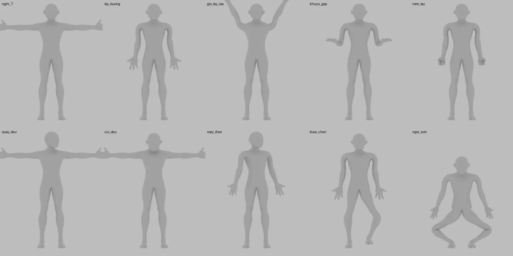

# NAM-003 — khuôn mẫu sạch từ Hyper3D (rig thân, chưa có mặt)

Khuôn mẫu cho Nam, Người Kia, Tùng và nhân vật phụ (chủ repo chốt hướng này 15/11/2026, bỏ hướng modular). Nguồn: [nguon/base_2.glb](nguon/base_2.glb), do chủ repo cung cấp, mô hình sạch từ Hyper3D.



## Mô hình gốc (đo ngày 15/11/2026)
| Mục | Giá trị |
|---|---|
| Kích thước | cao 1,824 m; sải tay 1,774 m; T-pose, tay chếch lên nhẹ |
| Lưới | tam giác; 47.736 đỉnh → **44.629** sau khi hàn đỉnh trùng ở đường nối UV; một khối kín, 0 cạnh hở, 0 cạnh >2 mặt, thể tích dương |
| Đối xứng | trái–phải lệch 0,0 mm |
| Vật liệu | một vật liệu xám, **không có texture ảnh** |
| Mặt | hốc mắt nông, sống mũi, tai nhỏ; **chưa có mắt, mày, môi/miệng**; đầu trọc |
| Bàn tay | **4 ngón (3 ngón dài + ngón cái)**, hai tay giống nhau. Chủ repo chấp nhận phong cách này |

## Rig
```
blender -b --factory-startup --python rig_nam003.py -- --out nam-003-rig.blend [--glb nam-003-rig.glb] [--anh dir]
```
Dựng trong khoảng 2 phút. Tên xương theo Mixamo; ngón dùng Index, Middle, Ring, Thumb (không có Pinky). Tối đa 4 xương/đỉnh. Script **tái dùng** thuật toán của [../nam-002/rig_nam002.py](../nam-002/rig_nam002.py) (đọc file đó, bỏ dòng gọi `main()`, vá hằng số), nên nếu sửa `rig_nam002.py` thì bản này cũng đổi theo.

**Số đo kéo giãn cạnh (cạnh giãn >2×; max)** trên 11 tư thế của `rig_nam002.py`: nghỉ, tay buông, tay xiên 45°, giơ tay cao, gập khuỷu, nắm tay, quay đầu, cúi đầu, xoay thân, bước chân đều **0 cạnh** (max 1,39–1,78×); ngồi xổm 4 cạnh (max 2,15×). Lưu ý: `nam-002` có rất nhiều cạnh ngắn dưới 3 mm nên con số của hai lưới không so trực tiếp được; theo độ dài thêm tuyệt đối thì hai lưới tương đương.

## Chưa chắc / chưa làm
- **Khuỷu, gối, cổ chân là ước lượng** (tay chân duỗi thẳng nên không có điểm nổi bật); y đặt lệch 1–2 cm để IK gập đúng chiều.
- **Trọng số dùng ánh xạ tọa độ** về khung của `nam-002` (hàm `MAPCO`): mốc ngưỡng của `clean_weights` vẫn là của lưới kia. Đây là xấp xỉ.
- **Cổ:** quay đầu 35° tạo nếp gấp dưới hàm ở góc nghiêng; đo thử dài thêm khoảng 13 mm (so với ~5 mm của `nam-002`). Cần chỉnh trọng số cổ.
- Chưa có: mắt, mày, miệng, biểu cảm, khẩu hình; áo quần; chu kỳ đi bộ; nốt ruồi; chiều cao 1,60 m (Nam) và 1,70 m (Tùng); kiểm các tư thế đi, ngồi sâu.
- Chưa kiểm ngón tay khi nắm trên lưới 4 ngón bằng cận cảnh nhiều góc; chưa đặt góc cuộn riêng cho lưới này.
- File `.blend`/`.glb` đã rig không đưa lên repo (dựng lại bằng lệnh trên).
