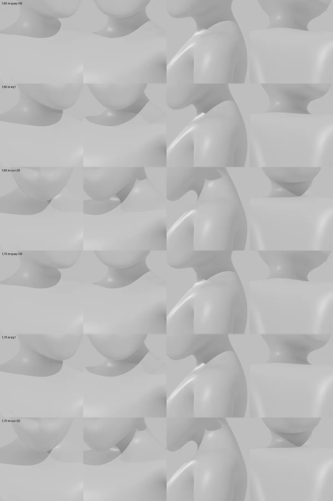

# NAM-003 — khuôn mẫu sạch từ Hyper3D (rig thân, chưa có mặt)

Khuôn mẫu cho Nam, Người Kia, Tùng và nhân vật phụ (chủ repo chốt hướng này 15/11/2026, bỏ hướng modular). Nguồn: [nguon/base_2.glb](nguon/base_2.glb), do chủ repo cung cấp, mô hình sạch từ Hyper3D.


## Mô hình gốc (đo ngày 15/11/2026)
| Mục | Giá trị |
|---|---|
| Kích thước | cao 1,824 m; sải tay 1,774 m; T-pose, tay chếch lên nhẹ |
| Lưới | tam giác; 47.736 đỉnh → **44.629** sau khi hàn đỉnh trùng ở đường nối UV; một khối kín, 0 cạnh hở, 0 cạnh >2 mặt, thể tích dương |
| Đối xứng | trái–phải lệch 0,0 mm |
| Vật liệu | một vật liệu xám, **không có texture ảnh** |
| Mặt | hốc mắt nông, sống mũi, tai nhỏ; **chưa có mắt, mày, môi/miệng**; đầu trọc |
| Bàn tay | **4 ngón (3 ngón dài + ngón cái)**, hai tay giống nhau. Chủ repo chấp nhận phong cách này |

## Rig
```
blender -b --factory-startup --python rig_nam003.py -- --out nam-003-rig.blend [--glb nam-003-rig.glb] [--anh dir]
```
Dựng trong khoảng 2 phút. Tên xương theo Mixamo; ngón dùng Index, Middle, Ring, Thumb (không có Pinky). Tối đa 4 xương/đỉnh. Script **tái dùng** thuật toán của [../nam-002/rig_nam002.py](../nam-002/rig_nam002.py) (đọc file đó, bỏ dòng gọi `main()`, vá hằng số), nên nếu sửa `rig_nam002.py` thì bản này cũng đổi theo.

**Số đo kéo giãn cạnh (cạnh giãn >2×; max)** trên 11 tư thế của `rig_nam002.py` (bản rig v3, 15/11/2026): **0 cạnh giãn >2× ở mọi tư thế**; giãn tối đa 1,35–1,59× ở các tư thế trên người và tay, ngồi xổm 1,80×. Lưu ý: `nam-002` có rất nhiều cạnh ngắn dưới 3 mm nên con số của hai lưới không so trực tiếp được.

## Chưa chắc / chưa làm
- **Cổ chân** chọn bằng đo biến dạng (z 0,08, y 0,05; mục "Cổ và cổ chân"). Khuỷu và gối cũng chọn bằng thử nhiều vị trí rồi đo (mục dưới).
- **Trọng số dùng ánh xạ tọa độ** về khung của `nam-002` (hàm `MAPCO`): mốc ngưỡng của `clean_weights` vẫn là của lưới kia. Đây là xấp xỉ.
- **Cổ** đã làm lại (xương phụ `NeckBlend1/2` + Corrective Smooth riêng, mục "Cổ và cổ chân"); chưa có shape key sửa theo góc, và chỉ chạy trong Blender (GLB không mang ràng buộc).
- Chưa có: mắt, mày, miệng, biểu cảm, khẩu hình; áo quần; chu kỳ đi bộ; nốt ruồi; chiều cao 1,60 m (Nam) và 1,70 m (Tùng); kiểm các tư thế đi, ngồi sâu.
- Chưa kiểm ngón tay khi nắm trên lưới 4 ngón bằng cận cảnh nhiều góc; chưa đặt góc cuộn riêng cho lưới này.
- [nam-003-rig.blend](nam-003-rig.blend) (4 MB, **v3**: khuỷu, gối, cổ chân đã chọn bằng đo; cổ có xương phụ + Corrective Smooth; chưa có mặt) để bên làm mặt có file mở ngay; dựng lại bằng lệnh trên. Giao việc làm mặt: [BAN-GIAO-MAT.md](BAN-GIAO-MAT.md). Chưa đưa `.glb` đã rig lên repo.

## Chọn vị trí khớp bằng đo biến dạng (15/11/2026)
Tay chân duỗi thẳng nên không có điểm khớp rõ trên lưới. Đo hình học chỉ cho gợi ý (gối: chỗ rộng nhất z ≈ 0,46; chỗ hẹp nhất phía trên cổ chân z ≈ 0,17), và gợi ý về khuỷu (chỗ hẹp x ≈ 0,39–0,42) **sai** so với kết quả đo biến dạng. Vì vậy mình dựng rig với nhiều vị trí khớp rồi đo cạnh giãn và cạnh co trên các tư thế (`NAM003_J='{"elbow":[x,y,z]}' python rig_nam003.py ...`). Tiêu chí: số cạnh giãn >1,5× và co <0,6× (cạnh dài hơn 3 mm lúc nghỉ), giá trị lớn nhất.

| Thử | khuỷu gập: giãn >1,5× | ngồi xổm: co <0,6× | ngồi xổm: giãn max |
|---|---|---|---|
| Khuỷu x 0,41 / 0,44 / 0,47 / 0,50 / 0,53 / 0,56 | 163 / 54 / 34 / **20** / 12 / 10 | | |
| Gối y 0,02 (cũ) / 0,03 / 0,04 / 0,056 (kèm hông x 0,105) | | 1716 / 1391 / **915** / 1077 | 2,15 / 2,11 / **1,89** / 2,12 |
| Hông x 0,09 → 0,105 | | tệ hơn (1841) | |
| Gối z 0,46 → 0,50 | | 859 | 2,05 (tệ hơn) |

Chọn **khuỷu x = 0,50, gối y = 0,04 (z = 0,46), hông giữ x = 0,09**. Khuỷu tiếp tục tốt hơn một chút khi dời xa vai (0,53, 0,56) nhưng quá 0,50 không hợp giải phẫu (cẳng tay chỉ còn 16 cm so với cánh tay trên 29 cm), nên dừng ở 0,50. Kết quả bản chọn: ngồi xổm 0 cạnh giãn >2× (trước đó 4), giãn tối đa 1,89×; mọi tư thế khác 0 cạnh giãn >2×. Ảnh: [khop-thu.webp](khop-thu.webp).
**Hạn chế:** chỉ đo trên dáng của `rig_nam002.py` (11 tư thế); chưa thử áo quần; cổ chân chỉ đo bằng cạnh giãn/co (xem mục Cổ và cổ chân). Chọn vị trí khớp dựa trên số cạnh giãn/co, không phải đánh giá mắt nhìn đầy đủ.

## Cổ và cổ chân (15/11/2026)
Thiết kế: [spec](../../../docs/superpowers/specs/2026-11-15-nam003-co-va-co-chan-design.md); kế hoạch: [plan](../../../docs/superpowers/plans/2026-11-15-nam003-co-va-co-chan.md). Yêu cầu của chủ repo: cổ ổn định như người thật, quay cận mặt không tì vết, cảnh xa chỉ cần ổn.

**Cách làm (B + C):**
- Hai xương phụ `NeckBlend1/2` (con của `Neck`, Copy Rotation LOCAL từ `Head`, ảnh hưởng 0,33 và 0,66) chia xoắn dọc cổ. Trọng số `Spine2` → `Neck` → `NeckBlend1` → `NeckBlend2` → `Head` theo gradient z (1,46–1,60, làm mượt 10 vòng), chỉ động tới các nhóm xương (nhóm phụ `cs_*` giữ nguyên). Vùng hàm/cằm (y < −0,05, z ≥ 1,55) cho `Head` đạt 1 sớm hơn 3 cm để cằm gắn chặt vào đầu (từ z 1,565 `Head` ≥ 0,75).
- Corrective Smooth thứ hai `CorrectiveSmoothCo` (nhóm `cs_co`, 150 vòng, hệ số 1,0), tắt hẳn từ z 1,61 và không phủ vùng hàm/cằm, để không làm mềm shape key miệng/cằm của bên làm mặt.
- Xương `Head`, trọng số đầu (z ≥ 1,60) và vị trí `Head` không đổi (đã kiểm: 0/4026 đỉnh z ≥ 1,60 đổi trọng số so với v2). Mã: `co_nam003.py`; đo: `kiem_co_nam003.py --rig nam-003-rig.blend [--scale S] [--anh dir]` (17 test).

**Số đo (cạnh dài thêm max, mm; vùng cổ z 1,40–1,66):**
| Tư thế | Trước (v2) | Rig v3 |
|---|---|---|
| quay +35° | 12,90 | **2,66** |
| quay −35° | 11,29 | 2,95 |
| cúi +25° | 10,76 | 3,04 |
| quay 35° + cúi 15° | 14,07 | 3,75 |
Mọi tư thế ≤ 3,75 mm (ngưỡng 6 mm; `nam-002` ~5,4 mm) và **0 cạnh giãn >1,5×** (mọi cạnh, đúng chữ thiết kế). Dựng lại hai lần cho số đo giống hệt. Lưu ý: đo ở scale 0,877 và 0,932 luôn ra cùng số vì đo trong toạ độ cục bộ của lưới; chúng chỉ chứng minh scale không phá rig, không phải bằng chứng độc lập.

**Xuất GLB (đã xuất và nhập lại thật bằng `kiem_xuat_nam003.py`):** GLB không mang ràng buộc `NeckBlend` và Corrective Smooth. Đo cạnh dài thêm max ở vùng cổ trong GLB nhập lại: chỉ xoay `Head`: quay +35° **9,70 mm**, cúi +25° 6,65 mm, quay 35° + cúi 15° 9,24 mm; xoay `Head` kèm `NeckBlend1/2` theo 33 %/66 % (engine tái tạo ràng buộc hoặc bake animation): 9,12 / 6,80 / 10,18 mm. So với rig cũ trước khi làm cổ (12,90 / 10,76 / 14,07 mm) vẫn tốt hơn, nhưng không đạt mức 3,75 mm của Blender: **trong engine khác cổ sẽ kém sạch hơn trong Blender** và xương phụ gần như không giúp thêm. Đã xử lý lỗi bản đầu (khi tắt mọi Corrective Smooth và giữ ràng buộc cho 20,8 mm, theo reviewer): nhóm phụ không còn bị chuẩn hóa, vùng hàm xử lý bằng dịch z. Tắt mọi Corrective Smooth trong Blender: quay +35° 8,97 mm. Chưa thử trong một engine thật.

**Tốc độ:** đổi tư thế rồi tính biến dạng lưới thân (44,6 nghìn đỉnh) mất **303 ms** khi bật hết Corrective Smooth, 64 ms khi tắt riêng `CorrectiveSmoothCo` (cổ, 150 vòng), 2,5 ms khi tắt mọi Corrective Smooth (đo trên CPU của máy dựng này, một thread). Nghĩa là Corrective Smooth cổ tốn khoảng 240 ms mỗi lần đổi tư thế: không đáng kể khi render (mỗi khung mất hàng giây) nhưng làm xem tư thế trong viewport chậm (khoảng 3 khung/giây).

**Shape key mặt dưới Corrective Smooth cổ:** thử bằng một shape key hàm/cằm giả (dịch tới 8 mm ở y < −0,05, z 1,58–1,72): bật/tắt Corrective Smooth sai khác < 0,2 mm (`test_shape_key_survives_cs`); đối chứng trên rig cũ (Corrective Smooth phủ tới z 1,64) test này FAIL. Chưa thử với shape key miệng thật của bên làm mặt.



**Ảnh cận:** cổ liền mạch ở cả 1,60 m và 1,70 m, không thấy rách hay thắt; mặt dưới cằm khi cúi mịn hơn v2. Dải sáng ở đường nối cổ-vai (ảnh bên) có ở cả v2, không do rig mới. Hai chiều cao là cùng một lưới scale đều nên không phải hai bằng chứng độc lập. Chưa khẳng định "không tì vết": chủ repo duyệt ảnh.

**Cổ chân:** 12 tổ hợp z 0,08–0,14 × y 0,04–0,06 qua buoc_chan, ngoi_xom, nhac_chan_IK, mui_chan (`chon_co_chan_nam003.py`, chạy lại trên rig hiện tại ngày 15/11): tổng cạnh giãn+co 1907–2527. Quy tắc chọn: tổng nhỏ nhất **trong các tổ hợp thỏa ngồi xổm giãn tối đa ≤ 1,89×** (ràng buộc của thiết kế; 7/12 tổ hợp thỏa). Kết quả **z 0,08, y 0,05** (tổng 1922; ngồi xổm 1,88×). Trước đó mình dùng z 0,14, y 0,04 (tổng 2154) — chọn thủ công trên rig cũ trước khi sửa trọng số cổ, nay script cho kết quả khác nên đã đổi theo script. Chênh giữa các tổ hợp tốt nhất nhỏ (vài phần trăm), nên đây là lựa chọn hợp lý chứ không phải tối ưu tuyệt đối. Biên lưới thử: z 0,08 và 0,14.
**Hồi quy 11 tư thế (rig hiện tại):** 0 cạnh giãn >2× ở mọi tư thế; ngồi xổm max 1,88× (sát ngưỡng 1,89×).

**Hạn chế còn lại:** chỉ đo trên mô hình trơn; chưa thử áo quần cổ cao, tóc, mặt (shape key mặt thật dưới `CorrectiveSmoothCo` chưa kiểm, mới thử bằng shape key giả); chưa thử GLB trong một engine thật; chọn cổ chân dựa trên số cạnh giãn/co, chưa xem ảnh cận bàn chân; kq4 xoay riêng `Neck` + `Head` (xoay `Spine` làm cả thân trên xoay cứng nên không thử được cổ).

## Mặc đồ (15/11/2026)
`mac_do_nam003.py` có `chuyen_trong_so(ob, body, arm, loai, che_do='tho')` và bài đo (`<bpy-python> mac_do_nam003.py --rig nam-003-rig.blend`). Đo trên áo phông và quần dài thử qua 8 tư thế: tổng đỉnh xuyên mới so với dáng nghỉ: Data Transfer thô 358, thêm làm mượt chọn lọc 365, cách 1B của phiên thử quần áo độc lập 369: **không cách nào hơn rõ rệt, nên dùng thô**. Còn xuyên: áo ở khuỷu gập (107 đỉnh, sâu 7,5 mm); quần khi nhấc chân (49) và ngồi xổm (193, sâu 7,8 mm). Cùng cách đo, `nam-002` cho quần nhấc chân 856 và ngồi xổm 1669, tức rig v3 của `nam-003` tốt hơn nhiều cho áo quần. Chưa thử áo quần thật; hướng dẫn chung ở [../nam-002/HUONG-DAN-MAC-DO.md](../nam-002/HUONG-DAN-MAC-DO.md) (tên xương và tư thế giống).

## Chuyển động thử và sửa gối IK (15/11/2026, tối)
Chủ repo thấy dáng đi bị méo ("bẹo hình bẹo dạng") và yêu cầu thử đủ tư thế: bò, trườn, ngồi, nằm, lăn, đi bộ, chạy bộ. Mã: `chuyen_dong_nam003.py` (đi_bo, chay_bo, ngoi_ghe, nam_lan, bo, truot; `--luoi` đo biến dạng, `--vitri` chỉ ra bộ phận bị giãn, `--anh` render) và `ghep_video_nam003.py`. Video xem nhanh trong [chuyen-dong/](chuyen-dong/) (400×400 mỗi góc, mẫu thấp nên có nhiễu hạt).

**Lỗi tìm ra (do mình gây ra trước đó):** ở các lần trước mình báo "đi bộ trông tự nhiên", **sai**: khi đo, gối lệch ngang tới **19 cm** và nằm **sau** đường hông–mắt cá (chân vòng kiềng). Nguyên nhân: (1) mốc gối y = 0,04 chọn chỉ bằng số cạnh giãn nằm sau đường nối, và x = 0,132 lệch ngang 1,2 cm; hàm `calibrate_poles` của `rig_nam002.py` giả định gối "lệch về phía pole" nên chọn mặt phẳng gập nghiêng (log đã in cos = −0,322 mà bị bỏ qua); (2) kịch bản đi bộ cũ giữ mắt cá ở x = ±0,148, dạng chân quá rộng. Sửa: hông (0,09, **0,04**, 0,88), gối (**0,1205**, **0,035**, 0,46) nằm trên đường nối theo x và lệch hẳn về phía trước, góc pole 90,00°, cos = 1,000; thêm `test_ik_goi_ve_truoc` (RED→GREEN). Khi đi, gối lệch ngang tối đa **1,7 cm** (trước 19 cm), không còn gối nằm sau đường nối. Bàn chân khi đi đặt gần trục giữa (x ±0,095).

**Kết quả đo (Corrective Smooth bật như lúc render; cạnh dài >3 mm; "co" = cạnh co dưới 0,4×):**
| Chuyển động | Cạnh giãn >2× nhiều nhất mỗi khung | Giãn max | Ghi chú |
|---|---|---|---|
| Đi bộ (2 chu kỳ) | **0** | 1,80× | gối lệch ngang ≤ 1,7 cm; điểm thấp nhất lưới −0,3 cm |
| Chạy bộ (3 chu kỳ) | 15 | 3,02× | cả 15 cạnh ở ngón tay (nắm); gối lệch ngang ≤ 2,7 cm |
| Ngồi ghế rồi đứng dậy | 3 | 2,02× | 3 cạnh ở ngón tay |
| Nằm ngửa → lăn 360° → nằm ngửa | 3 | 2,02× | xuyên sàn 0 |
| Bò bốn chi (2 chu kỳ) | 7 | 2,11× | |
| Trườn sấp (2 chu kỳ) | 21 | 2,16× | hông 9, cẳng–bàn chân 9, tay 3 |
Cạnh co <0,4× (nếp gấp): đi bộ 122, chạy 401, ngồi 596, bò 743, trườn 745, lăn 0; **chưa xem kỹ các nếp này bằng ảnh cận**.

**Cách đo từng lỗi phát hiện:** nếu tắt Corrective Smooth khi đo (cho nhanh), ngay cả tư thế tay buông 78° cũng cho 25 cạnh giãn >2× ở đỉnh vai, trong khi bảng đo của rig (bật) cho 0; vì thế các số đo ban đầu (27, 45, 188, 257 cạnh) phóng đại và đã đo lại ở trên. Bò: bàn chân duỗi thẳng hàng cẳng chân cho 116 cạnh giãn >2×; chúi mũi chân xuống (pitch 120°, mũi chạm sàn) còn 5. Trườn: giảm độ dạng chân và kéo gối từ 165 xuống 21 cạnh.

**Hạn chế (chưa làm / chưa chắc):** đây là chuyển động **để thử rig**, không phải hoạt hình đã trau chuốt (tay đánh, nhịp, trọng tâm còn đơn giản; chạy bộ chưa có pha bay đúng nghĩa); chưa đo trượt chân đứng; chưa xem ảnh cận hông/bẹn/nách ở các tư thế nằm, trườn; ngón tay khi nắm còn cạnh giãn (15 cạnh ở chạy bộ) do mình đặt độ nắm; chưa thử ngồi sàn, quỳ, nằm nghiêng giữ yên, tay IK cầm đồ vật, leo; chiều cao 1,60/1,70 m chưa thử riêng cho các chuyển động (chỉ thử ở 1,824 m gốc).

## Biên độ khớp (ROM) — `kiem_rom_nam003.py` (15/11/2026)

Quét từng khớp, đo cạnh lưới giãn >2× / co <0,35× và mặt cắt quanh khớp (Corrective Smooth bật). Chạy: `python kiem_rom_nam003.py --rig nam-003-rig.blend [--khop wrist,finger,ankle,hip,knee,elbow] [--anh thư_mục]`.

| Khớp | Kết quả đo | Kết luận |
|---|---|---|
| Háng gập | quá ~−90° (tới −130°) có 22–41 cạnh >2× (tối đa 2,26×) | Biên độ an toàn ≈ 90°; sâu hơn (ngồi xổm sát, lên gối) méo ở bẹn |
| Cổ chân gập mu/duỗi | duỗi ≥55° có 7 cạnh >2×, mặt cắt còn 78% | An toàn tới ~45°; ngón chân chúi sâu hơn cần sửa |
| Gối | gập ≥60° có ~60–140 cạnh co mạnh, mặt cắt 71% ở 145° | Co nếp khoeo; cần ảnh cận trước khi chấp nhận gập sâu |
| Khuỷu | mặt cắt 72% ở −150° | Co nếp, chưa thấy giãn |
| Cổ tay | gập −80° có 23 cạnh co; số mặt cắt gồm cả bàn tay nên chưa đáng tin | Trong biên độ người thường: ổn; chưa soi ảnh |
| Ngón tay | gập ≥0,5 bắt đầu giãn >2× quanh khớp gốc ngón (Index 2,2×, Middle 2,5×); nắm hết cỡ 8,5×, 90 cạnh >2× | **Có méo thật**: ảnh cận ở độ gập 0,5 có hố ở lòng bàn tay/kẽ ngón cái; nắm hết cỡ ra hình nắm đấm chấp nhận được |

**Đính chính lỗi bài đo:** thuộc tính tuỳ biến (`nam`, `nam_tro`…) đặt bằng script không tự kích driver; phải gọi `arm.update_tag()` trước `view_layer.update()`. Trước 15/11 `Ctx.upd()` thiếu dòng này nên **ngón tay đứng yên trong các video chuyển động thử và các số đo ngón cũ** (không phải lỗi rig). Đã sửa trong `chuyen_dong_nam003.py`; video cũ chưa dựng lại.

**Chưa sửa:** trọng số háng/bẹn, cổ chân, bàn tay chỉ mới được đo, chưa chỉnh. Chưa soi ảnh cận cho háng, gối, cổ chân.
