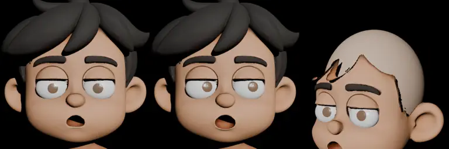

# Nam — bản thử tách bộ phận

Bản sao từ [nhân vật gốc 001](../nhan-vat-goc/README.md) (chỉ LOD0), dùng để thử tách bộ phận và điều khiển mặt. **Đây là bản thử để duyệt hướng, chưa phải asset nghiệm thu.** Bản này không sửa file gốc, cũng không thay rig hay asset đã duyệt của các tập.



## Có gì

| Object | Việc |
|---|---|
| `NAM_DAU_THAN` | Lưới đầu và thân gốc, đã khoét hốc mắt và bỏ phần tóc |
| `NAM_TOC` | Tóc tách thành object riêng, có thể ẩn hoặc thay |
| `NAM_DA_DAU_TAM` | Da đầu lấp kín lỗ tóc: mép khớp chân tóc, vòm nằm dưới tóc, dùng chung vật liệu và màu da trán |
| `NAM_LONG_TRANG.L/R` | Lòng trắng mắt cố định |
| `NAM_CON_NGUOI.L/R` | Con ngươi riêng, bám trên bề mặt lòng trắng (Shrinkwrap) |
| `NAM_TRUC_MAT.L/R` | Trục xoay của từng mắt, tự hướng về `DK_NHIN` |
| `NAM_NOT_RUOI` | Nốt ruồi riêng, đặt ngoài đuôi mày bên trái ảnh chính diện (−X), theo [quy chuẩn 3D](../../../docs/QUY-CHUAN-3D.md) |

Quy ước: nhân vật nhìn về −Y; `.L` là bên trái nhân vật (+X).

## Điều khiển

- **`DK_NHIN`**: di chuyển empty này để hai con ngươi cùng nhìn theo.
- **`DK_MUI`**: di chuyển, xoay hoặc co giãn để chỉnh mũi (Hook, trọng số mềm trong nhóm đỉnh `MUI`).
- **`DK_MIENG`**: tương tự cho vùng miệng (nhóm `MIENG`); co giãn để mở rộng hoặc thu miệng.
- **`NAM_NOT_RUOI`**, **`NAM_TOC`**: chọn rồi di chuyển hoặc ẩn trực tiếp.

## Dựng lại

Chạy trong thư mục này:

```powershell
D:/blender/blender.exe -b --factory-startup --python tao_ban_tach.py
```

Script đọc `../nhan-vat-goc/nhan-vat-goc.blend`. Vị trí mắt, mũi, miệng và chân tóc được dò theo màu texture. Script tự kiểm: đủ object, nốt ruồi nằm ở −X, con ngươi đi theo `DK_NHIN`. Texture trỏ sang `../nhan-vat-goc/nguon/`, không đóng gói lại; muốn mở file thì cần giữ nguyên hai thư mục cạnh nhau. Muốn chụp ảnh kiểm tra thay vì lưu file thì đặt `SOI_DIR=<thư mục>`.

## Giới hạn đã biết

- Tóc được tách theo màu texture, rồi nới thêm 4 vòng lưới để không sót vệt tóc ở chân tóc. Phần trán dưới mái được cắt thẳng ngang.
- Da đầu được dựng tự động. Để không lộ da qua kẽ tóc, vòm bị hạ xuống, nên đầu trọc hơi thấp và dẹt ở sau gáy. Chỗ nối với gáy và đường cắt ngang trán vẫn còn thấy một gờ mảnh. Cảnh nào cần quay cận đầu trọc thì vẫn phải nặn lại.
- Mép hốc mắt chưa có mí riêng: mí trên vẫn liền với mặt và mép cắt hơi răng cưa. Con ngươi chỉ là hình đĩa một màu, chưa có mống mắt hay điểm sáng.
- Mũi và miệng mới đổi được vị trí và kích thước. Chưa có shape key biểu cảm, viseme hay hàm mở; muốn làm phải retopology vùng mặt trước.
- Chưa có rig thân, chưa nghiệm thu chuyển động.
