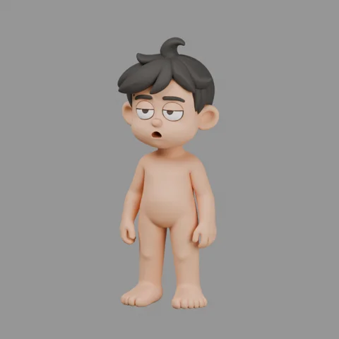

# Nhân vật gốc 001

Mốc nguồn do chủ repo chọn ngày 14/11/2026 để phát triển mô hình nền dùng chung cho các nhân vật sau này. Đây là **mẫu tĩnh nguyên trạng, còn tóc**. Chưa phải bản đầu trọc, bộ rig hay nhân vật đã sẵn sàng diễn hoạt.



## Mở và dùng

Mở `nhan-vat-goc.blend` bằng Blender 5.2.3 hoặc phiên bản tương thích. Bốn texture mà vật liệu FBX sử dụng đã đóng gói trong file; không phụ thuộc đường dẫn máy nhập. Chỉ `model_LOD0` hiển thị mặc định. Các collection LOD1–LOD4 chứa mức chi tiết thay thế. Để đổi LOD, bật biểu tượng mắt và camera của object `model_LOD<n>` trong Outliner, đồng thời tắt cả hai biểu tượng của LOD đang dùng để tránh chồng mặt; chỉ bật collection chưa đủ.

Tạo bản sao riêng khi phát triển nhân vật. Giữ mốc nguồn này để đối chiếu hình khối, cằm và tỷ lệ. Không tự thay thế nhân vật/rig đã duyệt của từng tập bằng nguồn này.

| Mức | Đỉnh | Tam giác |
|---|---:|---:|
| LOD0 | 220.517 | 441.034 |
| LOD1 | 110.258 | 220.516 |
| LOD2 | 55.129 | 110.258 |
| LOD3 | 27.564 | 55.128 |
| LOD4 | 13.782 | 27.564 |

Kích thước nhập khoảng 0,648 × 0,586 × 1,723 m. Có UV và texture 2048 × 2048. LOD0 là một thành phần lưới liên thông: tóc, đầu và thân chưa tách riêng. Chưa có armature, vertex group, animation hoặc shape key.

## Tệp nguồn và truy vết

- ZIP do chủ repo cung cấp: `10349138-1e95-4c55-b7d6-0080f58fc6f9.zip`.
- `nguon/lod_basic_pbr.fbx`: bản PBR nguyên byte từ ZIP, đủ năm LOD.
- `nguon/texture_*.png`: năm bản texture nguyên byte; vật liệu FBX dùng diffuse, metallic, normal và roughness. `texture_pbr.png` được giữ để tham chiếu, chưa tự suy diễn cách đóng kênh.
- `nguon.json`: SHA-256 của ZIP và từng tệp được lưu, cùng danh sách các biến thể khác trong ZIP.
- Các biến thể `lod.fbx`, `lod_basic_shaded.fbx` và `shaded.png` vẫn nằm trong ZIP gốc của chủ repo; không nhân đôi trong repo.
- Tác giả/dịch vụ tạo và giấy phép chưa có trong gói ZIP. Việc lưu nguồn lên repo theo yêu cầu chủ repo không tự xác nhận giấy phép phân phối lại hoặc thương mại; không áp giấy phép code của repo cho mô hình.

Dựng lại file Blender từ FBX và texture, chạy trong thư mục này:

```powershell
D:/blender/blender.exe -b --factory-startup --python tao_file_goc.py
```

Script giữ hình khối/UV/vật liệu nguồn, bố trí collection theo LOD và đóng gói texture; có kiểm số LOD, đỉnh, texture và trạng thái chưa rig trước khi lưu.

## Trạng thái và bước kế tiếp

- Đã nhập bản PBR trong Blender 5.2.3, kiểm texture và render ảnh tĩnh một LOD.
- Đã chọn làm nguồn phát triển mô hình nền chung. Chưa nghiệm thu biến dạng/chuyển động.
- Việc tiếp theo: trên bản sao, bỏ tóc liền lưới và dựng da đầu kín; kiểm hình khối đầu trọc trước khi làm lại topology và rig.
- Sau đó mới tách/chuẩn hóa mắt, miệng, tóc, quần áo và các biến thể nhân vật. Các bước này chưa được thực hiện trong mốc nguồn hiện tại.
