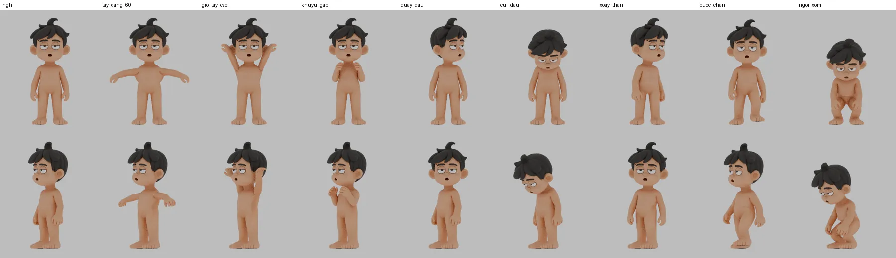

# Rig thử — NHAN-VAT-GOC-001

Đây là **bản thử rig thân** cho [nhân vật gốc 001](../README.md), dựng ngày 14/11/2026. Mục đích là kiểm xem mô hình mới có biến dạng được hay không. Bản này **chưa nghiệm thu diễn hoạt** và không thay rig đã duyệt của tập nào.



Hàng trên chụp chính diện, hàng dưới chụp chéo. Thứ tự: nghỉ · dạng tay 60° · giơ tay cao · gập khuỷu · quay đầu · cúi đầu · xoay thân · bước chân (IK) · ngồi xổm (IK chân). Ảnh render bằng Cycles 12 mẫu, không khử nhiễu, chỉ dùng để soi.

## Tạo file rig

Chạy trong thư mục này. Mất khoảng một phút, thêm vài phút nếu render ảnh:

```powershell
D:/blender/blender.exe -b --factory-startup --python rig_goc.py -- --out nhan-vat-goc-rig-thu.blend --anh xem-thu
```

Script chỉ đọc `../nhan-vat-goc.blend` và không sửa file nguồn. File `.blend` tạo ra nặng khoảng 21 MB nên không đưa lên Git; có thể tạo lại từ script. Bỏ `--anh` nếu không cần ảnh.

## Có gì

- Armature `Goc_Rig` theo quy ước của `rig_nam.py` (Hồ sơ 02): đơn vị mét, mặt hướng −Y, bên trái nhân vật là +X và mang đuôi `.L`.
- Các xương biến dạng gồm `pelvis → spine1 → spine2 → chest → neck → head`, `clavicle → upper_arm → forearm → hand` và `thigh → shin → foot → toe`.
- IK chân dùng `ik_foot.L/R` và hướng gối bằng `pole_knee.L/R`.
- Tay chạy FK theo mặc định. Muốn dùng IK thì đặt thuộc tính `ik` trên xương `ik_hand.L/R` từ 0 lên 1, kéo `ik_hand` và hướng khuỷu bằng `pole_elbow`.
- Góc pole được script tự dò để dáng nghỉ không xoắn. Sau khi gắn rig, lưới ở dáng nghỉ lệch tối đa **0,13 mm** so với lưới gốc.
- Bone collections gồm `Than`, `Tay_FK`, `Tay_IK`, `Chan_IK` và `Chan_deform`.
- Chỉ giữ `model_LOD0`. Các LOD khác bị bỏ khỏi file rig.

## Cách gán trọng số

1. Chạy bone heat trên `model_LOD3`. Lưới này có cùng hình khối, khoảng 27 nghìn đỉnh, rồi dùng Data Transfer chuyển trọng số sang LOD0 (220 nghìn đỉnh).
2. Xác định vùng tay bằng cách **loang theo cạnh lưới** từ đầu ngón tay. Vùng loang không đi qua `|x| < 0,17` hoặc `z > 0,86`. Tay dưới nách tách khỏi thân nên bàn tay buông cạnh đùi không kéo theo đùi, và đùi hay thân cũng không kéo theo tay.
3. Mọi đỉnh trên `z = 1,035` và phần cằm đi cứng 100% theo `head`. Cổ được pha dần `chest → neck → head`.
4. Làm mượt Laplace, làm mượt thêm ở háng và nách–vai, rồi thêm Corrective Smooth nhẹ (8 vòng).

Mốc khớp được đo bằng lát cắt lưới LOD0 và ghi trong bảng `J` ở đầu script.

## Kết quả đo

Bảng dưới đếm số cạnh lưới bị kéo dài hơn 2 lần so với dáng nghỉ. Số này chỉ giúp so các lần chạy với nhau, không thay cho việc xem ảnh.

| Dáng | Cạnh giãn > 2× | Tối đa |
|---|---:|---:|
| nghỉ | 0 | 1,00× |
| dạng tay 60° | 801 | 4,81× |
| giơ tay cao 140° | 3.421 | 8,33× |
| gập khuỷu | 36 | 2,71× |
| quay đầu | 119 | 2,98× |
| cúi đầu | 0 | 1,82× |
| xoay thân | 141 | 3,36× |
| bước chân | 79 | 2,79× |
| ngồi xổm | 1.794 | 7,75× |

Khi soi bằng mắt, thân, đầu, khuỷu và chân biến dạng gọn. Khi dạng hoặc giơ tay có nếp gấp nhỏ ở nách và sau vai. Khi ngồi xổm, háng bị giãn.

Đã thử cho xương đòn tự nâng theo góc dạng tay (driver, 25%). Cách này làm giãn tăng lên (6,6× khi dạng 60°, 11,4× khi giơ cao) nên đã bỏ.

## Chưa làm

- Chưa có xương ngón tay. Bàn tay hiện đi cứng theo một xương `hand`.
- Chưa có xương hàm, mắt, mí hay shape key biểu cảm và viseme. Mắt, miệng và lông mày đang liền với lưới đầu.
- Tóc còn liền lưới nên đi cứng theo đầu. Tóc chưa có xương hoặc mô phỏng riêng.
- Lưới nguồn chưa retopology. Vòng lưới ở vai, háng và mặt chưa được chuẩn hóa cho diễn hoạt, nên nếp gấp còn lại chủ yếu đến từ đây.
- Tay IK ở dáng nghỉ còn lệch nhẹ khi bật `ik = 1`. Sai lệch ma trận là 0,013 vì cánh tay gần như thẳng; hãy kiểm khi dùng.
