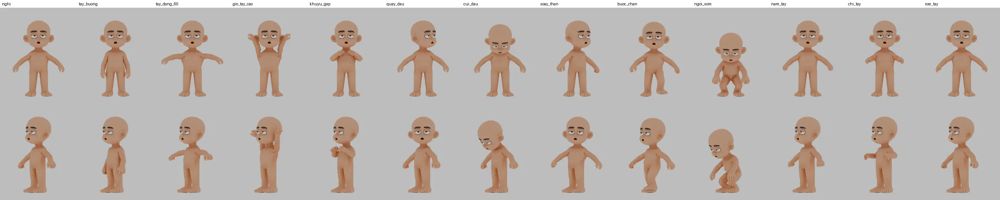

# Rig thử — NHAN-VAT-GOC-001

Đây là **bản thử rig thân và ngón tay trên lưới nền đầu trọc** cho [nhân vật gốc 001](../README.md), dựng ngày 14/11/2026. Mục đích là kiểm xem mô hình mới có biến dạng được hay không. Bản này **chưa nghiệm thu diễn hoạt** và không thay rig đã duyệt của tập nào.



Hàng trên chụp chính diện, hàng dưới chụp chéo. Thứ tự: nghỉ · dạng tay 60° · giơ tay cao · gập khuỷu · quay đầu · cúi đầu · xoay thân · bước chân (IK) · ngồi xổm (IK chân). Ảnh render bằng Cycles 12 mẫu, không khử nhiễu, chỉ dùng để soi.

## Tạo file

Chạy trong thư mục này, mỗi lệnh khoảng 1–2 phút. File `.blend` tạo ra không đưa lên Git.

```powershell
D:/blender/blender.exe -b --factory-startup --python dau_troc.py -- --out nhan-vat-goc-troc.blend
D:/blender/blender.exe -b --factory-startup --python rig_goc.py -- --src nhan-vat-goc-troc.blend --out nhan-vat-goc-rig-thu.blend --chu-a 80 --anh xem-thu
```

`dau_troc.py` tạo lưới nền đầu trọc ([ảnh](dau-troc.webp)). Script bỏ tóc theo màu texture, rồi ghép hộp sọ theo khuôn `../nguon/dau-troc-tham-chieu.fbx`, căn bằng ICP lệch trung vị 5,5 mm. Đường nối được làm mượt và có dải pha màu da (thuộc tính đỉnh `pha_da`). Nốt ruồi vẫn giữ. Trên lông mày trái còn một gờ rất nhỏ. Thiếu `--src` thì `rig_goc.py` rig bản gốc còn tóc.

## Có gì

- Armature `Goc_Rig`: mặt hướng −Y, bên trái nhân vật là +X và mang đuôi `.L`. Xương thân, tay, chân như bản trước. IK chân dùng `ik_foot`/`pole_knee`. Tay chạy FK, muốn IK thì đặt `ik` = 1 trên `ik_hand`.
- **Ngón tay** (bone collection `Ngon`): `index/middle/ring/pinky/thumb` 1–3, mỗi ngón ba đốt. Đường tâm từng ngón được đo tự động trên lưới. Trên `hand.L/R` có thuộc tính `nam` (nắm cả bàn tay) và `nam_tro`, `nam_giua`, `nam_ap`, `nam_ut`, `nam_cai` (nắm từng ngón), mỗi thuộc tính từ 0 đến 1. Ví dụ chỉ tay: đặt bốn ngón kia = 1. [Ảnh bàn tay](ban-tay.webp), từ trái sang: nghỉ, nắm, nửa nắm, chỉ, xòe.
- **Vai**: xương phụ `vai_phu.L/R` theo 50% góc xoay của bắp tay, cộng thêm làm mượt rộng ở nách và vai. [Ảnh giơ tay 90° và 140°](vai-gio-tay.webp).
- **Dáng nghỉ chữ A** (`--chu-a 80`, mặc định): script rig một lượt ở dáng tay buông, dang hai tay 35° rồi cố định dáng đó vào lưới. Sau đó làm mượt Taubin vùng nách–vai và rig lại từ dáng mới. Vùng tay và đường tâm ngón vẫn lấy theo lưới tay buông. Các dáng thử tính góc so với tay buông: `tay_buong` = 0°, `tay_dang_60`, `gio_tay_cao` = 140°. Bỏ `--chu-a` thì rig ở dáng tay buông như bản trước.
- Lưới sau khi gắn rig khớp với lưới nền chữ A, lệch tối đa 0,13 mm.

## Cách gán trọng số

1. Chạy bone heat trên `model_LOD3`. Lưới này có cùng hình khối, khoảng 27 nghìn đỉnh, rồi dùng Data Transfer chuyển trọng số sang LOD0 (220 nghìn đỉnh).
2. Xác định vùng tay bằng cách **loang theo cạnh lưới** từ đầu ngón tay. Vùng loang không đi qua `|x| < 0,17` hoặc `z > 0,86`. Tay dưới nách tách khỏi thân nên bàn tay buông cạnh đùi không kéo theo đùi, và đùi hay thân cũng không kéo theo tay.
3. Mọi đỉnh trên `z = 1,035` và phần cằm đi cứng 100% theo `head`. Cổ được pha dần `chest → neck → head`.
4. Làm mượt Laplace, làm mượt thêm ở háng và nách–vai, rồi thêm Corrective Smooth nhẹ (8 vòng).

Mốc khớp được đo bằng lát cắt lưới LOD0 và ghi trong bảng `J` ở đầu script.

## Kết quả đo (bản đầu trọc)

Bảng dưới đếm số cạnh lưới bị kéo dài hơn 2 lần so với dáng nghỉ. Số này dùng để so các lần chạy, không thay cho việc xem ảnh.

| Dáng | Cạnh giãn > 2× (chữ A 35°) | Tối đa | Tay buông, bản trước |
|---|---:|---:|---|
| tay buông (về 0°) | 0 | 1,25× | — |
| dạng tay 60° | 0 | 1,50× | 190 / 4,08× |
| giơ tay cao 140° | 509 | 2,72× | 2.326 / 7,06× |
| gập khuỷu | 0 | 1,77× | 15 / 2,33× |
| quay đầu | 54 | 5,11× | 55 / 5,11× |
| ngồi xổm | 819 | 3,64× | 1.235 / 6,12× |
| nắm tay | 4.306 | 12,08× | 4.336 / 12,07× |
| xòe tay | 339 | 5,21× | 375 / 3,81× |

Số đo của bản chữ A tính so với dáng nghỉ chữ A, nên không so ngang được hoàn toàn với bản trước. Các ảnh dáng thử vẫn chụp đúng góc so với tay buông.

- **Vai (bản chữ A):** giơ tay 90° và 140° không còn bị ép hay gập ở mặt trên và sau vai. Ngay hõm nách còn một nếp nhỏ, khi người thật giơ tay cũng có nếp ở đây. Ghi chú bản tay buông trước đó: giơ tay 90° đã gọn. Giơ tay 140° vẫn còn nếp ở hõm nách, và trên sườn thân lộ ra một đường kẻ dọc ở vùng nằm khuất dưới cánh tay khi đứng nghỉ. Trong lưới gốc, cánh tay dính vào thân từ z ≈ 0,70 trở lên, đây là giới hạn của lưới chứ không riêng của rig. Đã thử thêm shape key sửa dáng tự tính (làm mượt Taubin rồi quy về dáng nghỉ): độ dời tới 30 mm nhưng ảnh chỉ đỡ chút ít, nên đã bỏ. Xương đòn tự nâng cũng đã thử và bỏ.
- **Nắm tay:** độ giãn cao nằm ở kẽ ngón, vì các ngón trong lưới gốc dính liền nhau. Nhìn ảnh thì nắm tay gọn. Mu bàn tay còn một vệt ngang mờ ở dải pha giữa vùng cổ tay và vùng ngón.
- **Quay đầu:** giá trị tối đa tăng ở vài cạnh vá gần gáy. Số cạnh vượt ngưỡng vẫn giảm.

## Chưa làm

- Chưa có xương hàm, mắt, mí hay shape key biểu cảm và viseme. Mắt, miệng và lông mày đang liền với lưới đầu.
- Chưa có tóc. Lưới nền đã trọc, tóc sẽ làm riêng cho từng nhân vật.
- Lưới nguồn chưa retopology. Vòng lưới ở vai, háng và mặt chưa được chuẩn hóa cho diễn hoạt, nên nếp gấp còn lại chủ yếu đến từ đây.
- Tay IK ở dáng nghỉ còn lệch nhẹ khi bật `ik = 1`. Sai lệch ma trận là 0,013 vì cánh tay gần như thẳng; hãy kiểm khi dùng.

## Tên xương Mixamo và chép động tác

- `rig_goc.py --ten-mixamo` đổi tên xương biến dạng sang chuẩn Mixamo (`Hips`, `Spine`, `LeftArm`, `LeftHandIndex1`…). Nhóm đỉnh, ràng buộc và driver đi theo tên mới. Xương điều khiển giữ tên cũ (`root`, `ik_foot`, `pole_knee`, `ik_hand`, `vai_phu`).
- `chep_dong.py` chép một động tác từ file rig chuẩn Mixamo (GLB/FBX) sang `Goc_Rig`: lấy độ xoay thế giới của từng xương nguồn so với dáng nghỉ rồi áp lên dáng nghỉ xương cùng tên, nên không phụ thuộc trục riêng của hai rig. Hông dời theo tỉ lệ chiều cao. Chân đặt qua IK theo bàn chân và gối FK.

```powershell
D:/blender/blender.exe -b --factory-startup --python chep_dong.py -- --rig nhan-vat-goc-rig-thu.blend --nguon base.glb --out co-dong.blend --buoc 3 --anh xem-dong
```

[Ảnh 6 khung đoạn bò](chep-dong-bo.webp): đoạn `human_000070` (123 khung) trong file `base.glb` của chủ repo, chép bước 3 khung. Chưa kiểm xuyên lưới, trượt chân hay chạm sàn từng khung. File `base.glb` không đưa lên repo vì lưới và rig là bản khác.

## Cắt dính nách và dáng nghỉ 80°

Lưới gốc nối tay vào thân bằng một dải da hẹp ở nách nên giơ tay là nứt hoặc gập thành nếp tối. Cách xử lý sau cùng: **dang tay 80° trước khi cắt** để khe nách lộ rõ. Sau đó tìm các đỉnh tay và thân cách nhau dưới 28 mm *và* có pháp tuyến ngược chiều (tức hai mặt áp vào nhau, tránh cắt nhầm ranh giới liền kề), bỏ các đỉnh đó, và vá mỗi bên thành mặt riêng, chia mịn rồi làm mượt Laplace, phủ màu da qua `pha_da`. Khe giữa tay và thân là khe thật, không còn màng dính.

[Ảnh](vai-nach-80.webp): trái là dáng nghỉ 80°, phải là giơ tay 105°. Giơ tay 105° và 140° chỉ còn nếp tự nhiên ở hõm nách. Số đo (so với dáng nghỉ 80°): tay buông 0 cạnh giãn >2× (tối đa 1,87×), dạng tay 60° tối đa 1,18×, giơ tay cao 140° còn 16 cạnh giãn >2× (tối đa 3,08×). Thử trước đó ở dáng 35° bị hỏng (tay giãn 19×), nên đã bỏ.

Dáng nghỉ của file rig là tay dang 80°. Các dáng thử vẫn tính góc so với tay buông.

## Đi bộ

`walk.py` tạo action `di_bo`: chu kỳ 28 khung ở 24 fps (≈ 1,17 s), đi tại chỗ hướng −Y, bước 0,40 m.

```powershell
D:/blender/blender.exe -b --factory-startup --python walk.py -- --rig nhan-vat-goc-rig-thu.blend --out di-bo.blend --anh xem-di
```

Chân đặt bằng IK: chân đứng trượt ngược ra sau đúng tốc độ thân, chân vung nhấc 7 cm. Hông nhún và đảo, vai quay ngược hông, tay đánh ngược chân (kiểm bằng số: khi chân trái ra trước tối đa thì tay trái ra sau). [Ảnh 8 khung nhìn bên](di-bo.webp). Mắt cá thấp nhất 0,102 m. Chưa kiểm trượt chân đứng bằng số cho từng khung, chưa có bước tiến thật (đi tại chỗ), chưa có xoay bàn chân lúc gót chạm/mũi nhấc.

## Tay đầy hơn

Sau khi cắt nách, bắp tay chỉ còn khoảng 0,90–0,96 độ dày gốc (đo bán kính theo 10 đoạn từ vai tới cổ tay, cùng chỉ số đỉnh giữa lưới tay buông và lưới dang 80°). `thicken_arm()` trong `rig_goc.py` đắp lại bán kính gốc rồi **phình cả cánh tay thêm 5%** (`TAY_PHINH`), giảm dần về 0 gần vai và gần cổ tay, không đụng bàn tay. Phần sửa được tăng dần từ vai tới 30% chiều dài để không có mép thẳng ở chỗ gắn vai. Làm mượt chỉ chạy sau khi đắp, tập trung ở vùng tiếp xúc nách (cả vùng vai chỉ còn 15% thay vì 35%). Lớp vá chia mịn hơn (cạnh 3 mm), vùng cắt nới thêm 8 mm ở mặt trước nách và lên tới z = 0,95.

[Ảnh](tay-day.webp): trái trên là dáng nghỉ dang 80°, phải trên giơ 105°, trái dưới giơ 140°, phải dưới tay buông. Số đo sau đắp: bán kính tay mới/gốc = 1,05 ở các đoạn giữa và 1,03 ở cổ tay. Số cạnh giãn quá 2× ở giơ 140° là 41 (tối đa 2,58×), nhiều hơn mức 16 của bản trước, do lưới tay dày thêm; dáng tay buông 1 cạnh (1,98×), khuỷu gập 2 cạnh.

Còn lại: một nếp mảnh ở mặt thân sát nách khi tay buông và một vết nhỏ ở đỉnh vai.
