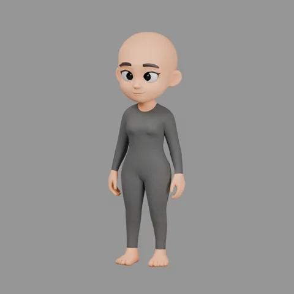
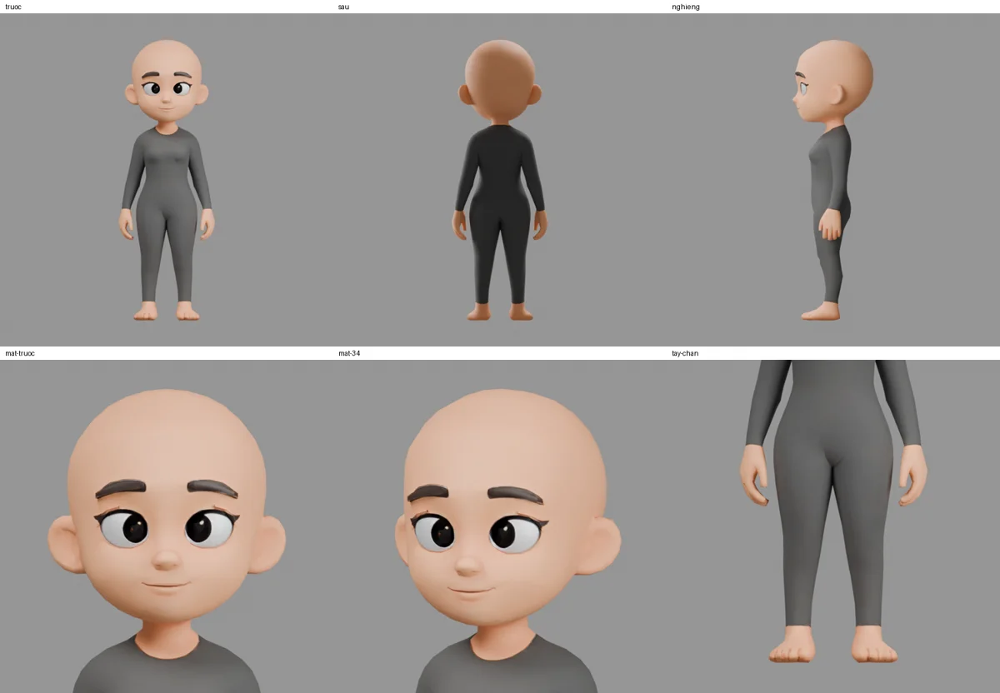

# Nhân vật nữ gốc 001 — base nữ chính thức

Chủ repo cung cấp mẫu và yêu cầu rà soát, làm base cho nhân vật nữ ngày 14/11/2026. File làm việc là **`nhan-vat-nu-goc.blend`**, mã `NHAN-VAT-NU-GOC-001`. Đây là **base hình khối tĩnh đã đầu trọc**, chưa phải bộ rig hoặc nhân vật đã nghiệm thu diễn hoạt.



## Mở và phát triển nhân vật

Mở file bằng Blender 5.2.3 hoặc phiên bản tương thích. File chỉ có **LOD0** (`Base_Nu_LOD0`) với 2.043 đỉnh, 2.170 mặt, 4.082 tam giác và một UVMap. Bốn texture PBR 2048×2048 đã đóng gói; đường dẫn dự phòng là `//nguon/`. Kích thước khoảng 0,593 × 0,498 × 1,727 m. Giữ tỷ lệ thiết kế nguồn khi tạo các biến thể.

Tạo bản sao trước khi đổi khuôn mặt, vóc dáng, tóc hoặc trang phục. Base nam vẫn là [Nhân vật gốc 001](../nhan-vat-goc/README.md); base nữ này là nguồn riêng cho các nhân vật nữ về sau. Các nhân vật/rig đã dùng ở từng tập không bị thay thế tự động.

Nguồn là **một lưới liên thông**, một vật liệu: mắt, môi và phần thân màu tối chưa phải các bộ phận/áo quần tách rời. Không coi vùng thân tối là một bộ quần áo có thể cởi độc lập. Cần chuẩn hóa phần thân và texture khi thiết kế phục trang khác.

## Kết quả rà soát

Đã kiểm cả ba biến thể FBX, năm LOD và render sáu góc/vùng: trước, sau, nghiêng, cận mặt trước/3⁄4, tay–chân. Số liệu đầy đủ nằm trong `ra-soat-nguon.json`; vị trí giao mặt LOD1 được lưu trong `loi-lod1.json`.

| Hạng mục | Kết quả và giới hạn |
|---|---|
| Lưới LOD0 | PASS: kín, không cạnh non-manifold/cạnh rời, không mặt diện tích bằng 0 hoặc cạnh ngắn dưới 0,1 µm; hướng mặt nhất quán |
| Tự giao ở tư thế nguồn | PASS LOD0: không cặp tam giác không chung đỉnh bị BVH báo giao; chưa kiểm tư thế biến dạng |
| UV LOD0 | PASS: có UVMap, không UV ngoài 0–1, không tam giác UV suy biến; chưa kiểm UV chồng giữa các đảo |
| Vật liệu | PASS: diffuse sRGB; metallic/normal/roughness Non-Color; đủ ảnh 2048×2048 |
| **LOD1 nguồn** | **FAIL: 8 cặp tam giác tự giao tại bàn tay phía +X**, xác minh lại bằng giao đoạn–tam giác; không đưa LOD1 vào file base làm việc |
| LOD2–4 nguồn | Không bị các kiểm cấu trúc trên báo lỗi; quá thô để làm chuẩn cận mặt hoặc mặc định làm rig |
| Rig/shape key/chuyển động | **CHƯA CÓ / CHƯA KIỂM**: không armature, vertex group, animation hoặc shape key |

### Điểm cần xử lý trước diễn hoạt

- Đầu trọc thấy cạnh đa giác ở đường bao khi quay cận; giữ làm mốc hình khối, làm lại topology/độ mịn phù hợp trước cảnh cận. Thêm Subdivision trực tiếp chưa chứng minh giữ đúng mắt/miệng và thể tích.
- Ngón tay/ngón chân ít chi tiết hình học; chưa chứng minh có thể điều khiển từng ngón. Cần kiểm lại khi nắm, chỉ và cầm đồ.
- Mắt, miệng chưa có điều khiển riêng; chưa có bằng chứng nhắm mắt, nhìn quanh, mở hàm hoặc nói chuyện đạt. Cần tách/chuẩn hóa lưới và phần trong miệng theo yêu cầu diễn xuất.
- Vai, nách, háng, khuỷu và đầu gối mới kiểm ở tư thế đứng nguồn. Không kết luận biến dạng tốt chỉ vì lưới kín.



## Nguồn và cách dựng lại

- ZIP: `67b8ee32-d50e-4aca-b0f0-05a6b5664af6.zip`, do chủ repo cung cấp. `nguon.json` lưu SHA-256 của ZIP và từng tệp giữ lại.
- `nguon/lod_basic_pbr.fbx` và năm `texture_*.png` giữ nguyên byte nguồn. FBX vẫn chứa đủ LOD0–4 để truy vết; lỗi LOD1 được giữ nguyên trong nguồn, không tuyên bố đã sửa.
- `texture_pbr.png` là bản tham chiếu; chưa tự suy diễn cách đóng kênh, không thêm chồng vào bốn texture vật liệu đã dùng.
- `lod.fbx`, `lod_basic_shaded.fbx`, `shaded.png` còn trong ZIP gốc; không nhân đôi trong repo. Ba FBX có cùng số đỉnh/mặt và kết quả kiểm cấu trúc từng LOD.
- Gói ZIP chưa có tên tác giả/dịch vụ tạo hoặc giấy phép. Lưu nguồn theo yêu cầu chủ repo không tự xác nhận quyền phân phối lại/thương mại; không áp giấy phép code cho mô hình.

Chạy trong thư mục này:

```powershell
D:/blender/blender.exe -b --factory-startup --python tao_base_nu.py
D:/blender/blender.exe -b nhan-vat-nu-goc.blend --python kiem_tra_base_nu.py
```

Script tạo base chỉ lấy LOD0, giữ nguyên hình khối/UV/vật liệu và đóng gói texture. Bộ kiểm áp dụng cho file đã lưu/mở lại, không thay thế kiểm rig và chuyển động.
