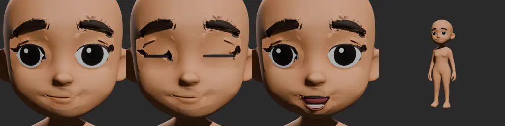

# Base nữ — rig thân, mặt diễn xuất, da liền màu

Rig cho [base nữ 001](../nhan-vat-nu-goc/README.md), mã `NHAN-VAT-NU-RIG-001`. Rig được dựng theo [thiết kế](../../../docs/superpowers/specs/2026-11-14-rig-mat-nu-design.md) và [kế hoạch](../../../docs/superpowers/plans/2026-11-14-rig-mat-nu.md). File base gốc không bị sửa. **Đây là bản để duyệt, chưa nghiệm thu chuyển động.**



## Mở file

Mở `nhan-vat-nu-rig.blend`. Texture da liền màu nằm trong `texture/` (đường dẫn tương đối). Các object chính:

| Object | Vai trò |
|---|---|
| `Nu_Rig` | Armature |
| `Nu_Than` | Lưới thân: Armature → Subdivision (viewport 1, render 2) |
| `Nu_LongTrang.L/R`, `Nu_ConNguoi.L/R` | Lòng trắng (cố định theo đầu), đĩa mống mắt (bám lòng trắng, xoay theo `eye`) |
| `Nu_MiTren/Duoi.L/R` | Mí trên, mí dưới |
| `Nu_May.L/R` | Lông mày tách riêng |
| `Nu_KhoangMieng`, `Nu_RangTren`, `Nu_RangDuoi`, `Nu_Luoi` | Bên trong miệng; răng dưới và lưỡi theo hàm |

Nhân vật nhìn về −Y. `.L` là bên trái nhân vật (+X).

## Điều khiển

| Muốn | Làm |
|---|---|
| Nhìn | Kéo `look` (trước mặt). Hai mắt nhìn theo `look.L/R`; chỉnh riêng từng mắt bằng `look.L`/`look.R` |
| Chớp / nheo | Thuộc tính `blink_L`, `blink_R`, `squint_L`, `squint_R` (0–1) trên xương `head` |
| Lông mày | Xương `brow_in`, `brow_mid`, `brow_out` (.L/.R): dời lên/xuống, vào trong |
| Mở hàm | Xương `jaw`, xoay X+ |
| Biểu cảm miệng | Shape key `cuoi`, `meu`, `chu_moi`, `mim_moi`, `keo_khoe.L/R`, `ha_khoe.L/R`, `nhech.L/R` |
| Khẩu hình nói | Shape key `vs_*` kết hợp với độ mở hàm gợi ý (bảng dưới, cũng có trong `khau-hinh.json`) |
| Tay IK / FK | Thuộc tính `ik_fk` trên `hand.L/R` (mặc định 0 = FK). Khi IK: kéo `ik_hand`, `pole_elbow` chỉnh khuỷu |
| Chân IK / FK | `ik_fk` trên `foot.L/R` (mặc định 1 = IK). Kéo `ik_foot`, `pole_knee` chỉnh gối |
| Ngón tay | `thumb/index/middle/ring/pinky` 1–3 (.L/.R), xoay X+ để gập vào lòng bàn tay |
| Nắm cả bàn | Thuộc tính `fist` (0–1) trên `hand.L/R`, cộng dồn với độ xoay riêng của từng ngón |
| Tay / thân FK | `upper_arm` X+ đưa tay ra trước. `forearm` X+ gập khuỷu. Dang tay: trái Z+, phải Z− |

### Khẩu hình tiếng Việt

| Nhóm | Âm | Shape key | Mở hàm gợi ý (°) |
|---|---|---|---:|
| A | a, ă, â | `vs_A` | 18 |
| E | e, ê | `vs_E` | 8 |
| I | i, y | `vs_I` | 5 |
| O | o, ô, ơ | `vs_O` | 14 |
| U | u, ư | `vs_U` | 6 |
| MBP | m, b, p | `vs_MBP` | 0 |
| PHV | ph, v | `vs_PHV` | 3 |
| NT | n, t, đ, d, l | `vs_NT` | 6 |
| CH | ch, tr, s, x, gi | `vs_CH` | 6 |
| KG | c, k, g, ng, nh, kh | `vs_KG` | 12 |
| nghi | ngậm, nghỉ | `vs_nghi` | 0 |

**Chưa có công cụ tự chuyển audio ElevenLabs thành khẩu hình.** Hiện phải đặt key bằng tay theo bảng trên. 18 shape key cảm xúc trong quy chuẩn 3D sẽ làm ở bước sau, ghép từ các điều khiển nền này.

## Dựng lại và kiểm tra

Chạy trong thư mục này:

```powershell
py -I da_lien_mau.py                                                   # texture da liền màu → texture/
D:/blender/blender.exe -b --factory-startup --python rig_nu.py         # dựng nhan-vat-nu-rig.blend
py -I test_da_lien_mau.py                                               # kiểm texture
D:/blender/blender.exe -b nhan-vat-nu-rig.blend --python kiem_rig_nu.py # 26 kiểm trên file đã lưu
D:/blender/blender.exe -b nhan-vat-nu-rig.blend --python chup_duyet.py -- <thư mục ảnh>
```

`kiem_rig_nu.py` kiểm các nhóm sau:

- **File giao:** file đang ở dáng nghỉ; thân có Subdivision.
- **Texture:** vật liệu dùng texture da.
- **Ngón tay:** từng ngón cong riêng; tay trái và phải gập như nhau; nắm tay có tác dụng, kể cả khi đang bật IK.
- **IK:** cổ tay bám `ik_hand`; bật IK không làm lệch dáng nghỉ; tắt IK thì FK chạy.
- **Mắt:** nhìn theo `look`; chớp che kín lòng trắng, kể cả khi đang nhìn lên.
- **Mày:** tách khỏi thân và nâng được; trán liền, không hở.
- **Miệng:** vùng lưới dày, không có viền hở; mở hàm kéo theo môi dưới, răng dưới, lưỡi; khi mở hàm 20° và cười, 135 tia quanh miệng (bật Subdivision) không thấy răng hay khoang miệng xuyên da. Màu vùng miệng mới chỉ duyệt bằng mắt, chưa có kiểm tự động.
- **Shape key:** đủ tên; chỉ dời vùng miệng; các khẩu hình khác nhau; kéo khóe hai bên đối xứng; bảng âm đầy đủ.

Đường nối UV (`duong-noi-uv.json`) được xuất bằng `xuat_duong_noi_uv.py` từ base gốc. `da_lien_mau.py` dùng file này để chuyển màu hai phía đường nối ở cổ tay và cổ chân.

## Giới hạn đã biết

- **Quanh mắt và mày:** còn mảnh vạt mi cũ màu đen ở khóe trên ngoài, và mép rách ở chỗ khoét. Subdivision làm các chỗ này lộ rõ hơn khi quay cận. Cần nặn tay vùng mí trước khi quay cận mặt.
- **Mắt nhắm:** còn một vệt đen nhỏ ở khóe trong mắt phải.
- **Hai mắt khác hình:** hốc mắt phải khoét hẹp hơn mắt trái, nên lúc nghỉ mắt phải tròn và hẹp, mắt trái hình hạnh nhân (lòng trắng lộ ở mắt phải chỉ bằng khoảng một nửa). Cần nặn lại hốc mắt phải trước khi quay cận.
- **Chưa "mở to" mắt được:** mí mở dừng đúng theo nét mắt vẽ, nên không mở rộng hơn hốc đã khoét. Muốn có, phải nới hốc mắt và thêm shape key `mo_to`.
- **Kiểm mắt và chớp** mới chạy trên mắt trái; mắt phải mới xem bằng ảnh.
- **Dáng nghỉ của mắt:** nhìn thẳng, con ngươi giữa hốc. Ảnh mẫu thì đang liếc sang bên; muốn giống ảnh mẫu thì kéo `look`.
- **Nâng mày cao:** thấy vệt mảnh của dải mày cũ trên trán.
- **Miệng:** bên phải miệng có vệt răng cưa mảnh do đường nối UV gốc chạy qua.
- **Shape key:** độ lớn mới chỉnh sơ bộ, chưa thử với audio thật.
- **Da:** cổ tay hơi chênh sáng (bàn tay giữ vân da gốc); cổ chân còn sợi đường nối rất mờ khi cận.
- **Độ mượt:** Subdivision làm thân mượt hơn nhưng không thêm chi tiết điêu khắc như base Nam (220 nghìn đỉnh). Muốn chi tiết đó phải dựng lại lưới dày rồi làm lại rig.
- **Khác:** chưa có quần áo, tóc, 18 cảm xúc; chưa nghiệm thu chuyển động. Mới duyệt bằng ảnh tĩnh.
