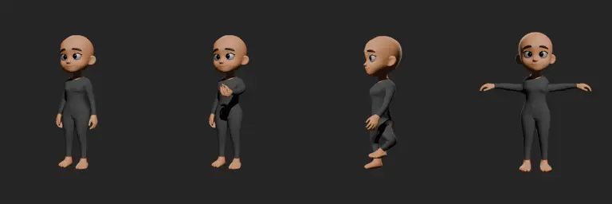

# Base nữ — rig cơ bản

Rig thân cho [base nữ 001](../nhan-vat-nu-goc/README.md) (LOD0, 2.043 đỉnh). Mã `NHAN-VAT-NU-RIG-001`. File base không bị sửa. **Đây là rig cơ bản để thử dáng, chưa nghiệm thu chuyển động.**



## Mở file

Mở `nhan-vat-nu-rig.blend`. Texture được lấy từ `../nhan-vat-nu-goc/nguon/`, nên phải giữ hai thư mục nằm cạnh nhau. Object gồm `Nu_Rig` (armature) và `Nu_Than` (lưới, modifier Armature).

## Xương

Tên xương giống `rig_nam.py` để dùng chung thói quen và script. Nhân vật nhìn về −Y; `.L` là bên trái nhân vật (+X).

- Thân: `root → pelvis → spine1 → spine2 → chest → neck → head`
- Tay: `clavicle → upper_arm → forearm → hand → fingers1 → fingers2`, kèm `thumb`
- Chân: `thigh → shin → foot → toe`
- Điều khiển (không biến dạng lưới): `ik_foot.L/R` kéo cả chân (IK), `pole_knee.L/R` chỉnh hướng gối
- Bone collection: `Than`, `Tay`, `Ngon`, `Chan_IK`, `Chan_deform` (mặc định ẩn)

## Cách tạo dáng

| Muốn | Làm |
|---|---|
| Đưa tay ra trước / ra sau | `upper_arm` xoay X+ / X− |
| Dang tay | `upper_arm.L` xoay Z+, `upper_arm.R` xoay Z− |
| Gập khuỷu | `forearm` xoay X+ |
| Nắm tay | Thuộc tính `fist` (0–1) trên `hand.L/R` |
| Bước chân, ngồi | Di chuyển `ik_foot`, chân tự gập. Gối chỉ gập ra sau |
| Quay đầu, cúi người | Xoay `head`, `neck`, `spine1/2`, `chest` |

## Trọng số

- Ban đầu dùng trọng số tự động (bone heat).
- Tay buông sát hông, nên dưới nách, phần tay và phần thân được tách theo cạnh lưới. Tay không kéo theo hông, đùi không kéo theo tay.
- Ngón tay được gán lại theo khoảng cách dọc bàn tay, để cả bốn ngón cùng cuộn. Ngón cái giữ trọng số riêng.
- Từ cổ trên (z > 1,215 m) trở lên đi 100% theo `head`.

## Dựng lại và tự kiểm

```powershell
D:/blender/blender.exe -b --factory-startup --python rig_nu.py
```

Script tự kiểm ba điều:
- Ở dáng nghỉ, IK không làm lệch chân.
- Nâng tay trái 70° thì vùng hông xê dịch dưới 5 mm.
- Nhấc `ik_foot` thì bàn chân đi theo.

Đặt `SOI_DIR=<thư mục>` để chụp bốn dáng thử thay vì lưu file.

## Giới hạn

- Bốn ngón chỉ cong chung theo hai đốt, chưa điều khiển từng ngón. Lưới tay thưa, nên khi nắm còn thấy góc cạnh.
- Chưa có điều khiển mặt: mắt, mí, miệng, mày vẫn nằm chung trong lưới, chưa có shape key.
- Tay chưa có IK, vai chưa có xương xoắn. Khi dang tay cao hoặc xoay mạnh, vai và nách có thể bị móp. Mới soi bằng ảnh tĩnh bốn dáng, chưa render chuyển động.
- Chưa có quần áo. Vùng thân màu tối là texture của lưới gốc, không phải quần áo tách được.
