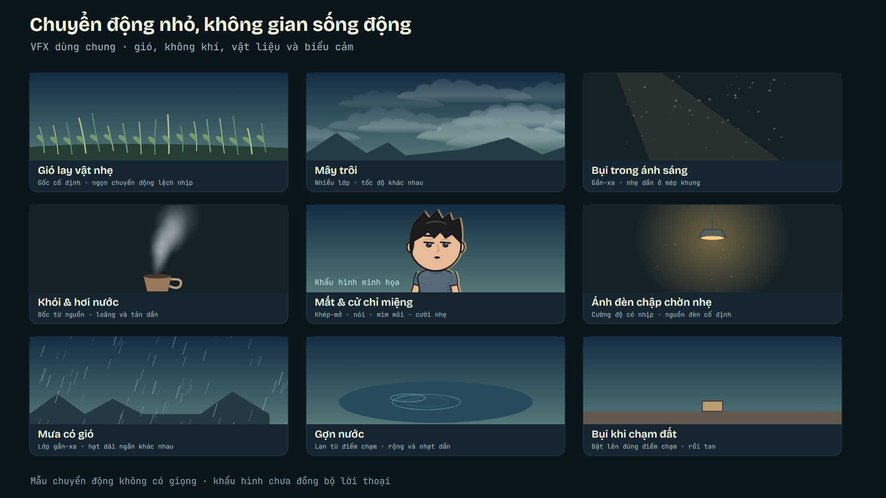
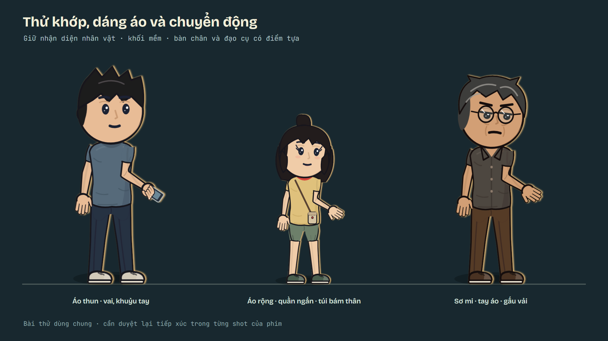

# Asset chuyển động dùng chung

Cập nhật 08/11/2026. Mã SVG/React được viết và sửa trong repo, không dùng stock hoặc dịch vụ sinh media cho bộ này. Giữ attribution và giấy phép gốc của engine; ảnh giải phẫu do chủ repo gửi là **tư liệu tham khảo riêng**, không phải asset có quyền tái sử dụng trong phim.

## Danh mục và cách mở

Chạy `npm run studio` trong `what-if-studio/`, chọn composition dưới đây. Đồng hồ `t` của engine tính theo **frame ở 30 fps**; trong composition dùng `frame * 30 / fps`. Cùng thời gian/seed cho cùng kết quả, không dùng CSS animation hoặc `Math.random()` lúc render.

| ID | Loại / mã nguồn | Tác dụng và điểm cần đặt | Composition |
|---|---|---|---|
| VFX-WIND | [vfx.tsx](../what-if-studio/src/engine/vfx.tsx), `windAt`, `WindSway` | Gió nhiều nhịp, gốc cỏ/cành/dây treo cố định; không xoay cả người đang đứng | `VFX-Wind` |
| VFX-CLOUD | `CloudBank`, cùng file | Mây nhiều lớp, viền mềm, tốc độ khác nhau; đặt vùng phủ đủ đường máy | `VFX-Clouds` |
| VFX-DUST | [light.tsx](../what-if-studio/src/engine/light.tsx), `Dust` | Bụi nhỏ gần–xa, mờ và nhạt ở mép vùng; cần truyền `seed` | `VFX-Dust` |
| VFX-SMOKE | `SmokePlume` | Khói/hơi bốc lên từ miệng cốc hoặc ống khói; loãng dần, trôi theo gió | `VFX-Smoke` |
| VFX-FACE | [rig.tsx](../what-if-studio/src/engine/rig.tsx), [mouth.tsx](../what-if-studio/src/engine/mouth.tsx) | Chớp mắt khép–giữ–mở, các vai lệch nhịp; khẩu hình có khoảng khép và nhịp nghỉ | `VFX-Face` |
| VFX-LIGHT | `lightFlickerAt` | Đổi nhẹ cường độ nguồn sáng; không dịch đèn hoặc nhấp nháy toàn màn hình | `VFX-Light` |
| VFX-RAIN | `RainSheet` | Mưa có hướng gió, nhiều cỡ và tốc độ; tự cắt trong vùng đã khai báo | `VFX-Rain` |
| VFX-RIPPLE | `WaterRipple` | Gợn lan từ một điểm tiếp xúc, tan sau `life`; truyền `t = thời gian hiện tại - mốc chạm` | `VFX-Ripple` |
| VFX-IMPACT | `ImpactBurst` | Bụi bật lên đúng mặt đất lúc chạm; không tự lặp nếu không được chủ động yêu cầu | `VFX-Impact` |
| RIG-SOFT | [anatomy.tsx](../what-if-studio/src/engine/anatomy.tsx) + `Hero` | Đường vai mềm, chi thuôn cong, nếp vải nhỏ, khối hông nối đùi, chân/quần đầy hơn | `RigMotionLab` |

Phiên bản đầu của các module mới: **1**; các helper cũ giữ tên/API. `VfxLab` tổng hợp 9 mẫu trong 12 giây; `RigMotionLab` thử 8 giây với cầm điện thoại, đổi cử chỉ, các vai nói ở thời điểm khác nhau.





## Rig, quần áo và miệng

- Theo quyết định mới nhất của chủ repo, **giữ tỉ lệ cartoon cũ**, không dùng tỉ lệ người thật 7–8 đầu. Sửa vai, hông, độ đầy của chân và cách nối các mảng; không đổi thành phong cách giải phẫu hiện thực. [Ba ảnh tham khảo](tham-khao/hinh-the-nguoi/README.md) chỉ giúp kiểm tra tư thế, khớp và che khuất.
- `SoftLimb` dùng chung điểm xương với bàn tay; đường bao cong liên tục, không đặt vòng tròn lên từng khớp. Tay áo mở nét ở chỗ gắn vai, có nếp nhỏ ở gấu. Hông nối hai gốc đùi và co theo góc đùi khi ngồi, tránh tạo một mảng quần treo dưới ghế.
- `standPose` mở một khoảng nhỏ giữa tay buông và thân áo, chân tách vừa phải. Tư thế chủ ý ôm ngực/cross-body vẫn cần đặt đúng lớp theo cảnh. Không thể tự suy ra mọi che khuất từ một rig nhìn ba phần tư.
- `gestureAt(base, gesture, t, from, duration)` đưa cử chỉ vào mềm, đầu trễ nhẹ, gấu vải có chuyển động phụ. Thời lượng phải theo diễn xuất. `breatheAt` không làm chân trượt; `blinkAt` có pha mắt hé.
- Đồ được cầm có thể truyền qua `Hero heldProps={{R: <Phone/>}}`, tọa độ **cục bộ của bàn tay**. Với `handR: 'hold'`/`'pinch'`, vật nằm sau ngón tay và theo đủ biến đổi của rig. Không tiếp tục đặt thêm bản sao vật bằng tọa độ màn hình. Vật đặt xuống bàn cần chuyển điểm gắn đúng mốc.
- `mouthCueAt(t, cues)` cho `mouthShape`, `talk`, `lipTremble`; shape gồm `auto`, `closed`, `a`, `e`, `o`, `u`, `fv`, `pressed`, `smile`. Không có cue thì trở về miệng theo biểu cảm. Môi khép ở khoảng dừng; răng chỉ hiện ngắn ở `fv` hoặc `e` mở rõ, không hiện suốt câu.
- **Khẩu hình trong preview chỉ minh họa**, chưa khớp âm thanh. Phải căn cue vào bản giọng cuối, chỉnh cả hàm/mắt/tư thế nếu lời diễn cần; không chạy một chu kỳ nguyên âm cho mọi câu.

## Cách kiểm tra và phạm vi đã làm

```powershell
npm run typecheck
node tests/shared-assets.cjs
npx remotion render src/index.ts VfxLab out/shared-vfx/vfx-lab.mp4 --scale=0.5 --concurrency=2 --codec=h264
npx remotion render src/index.ts RigMotionLab out/shared-vfx/rig-motion.mp4 --scale=0.5 --concurrency=2 --codec=h264
```

Đã chạy TypeScript và kiểm thử xác định theo frame: gió/đèn/chớp mắt trong miền giá trị; thời điểm bật/tắt hiệu ứng chạm; đường chi không NaN ở góc gập; độ dài xương không đổi khi chuyển cử chỉ; 41 look ở đứng/ngồi và ba hướng yaw; nghỉ miệng và vật trong tay. Đã xuất các clip H.264 960×540, 30 fps: VFX 12 giây, rig 8 giây; đã soi still và các khung trích. Clip local nằm ở các đường dẫn lệnh trên; không commit bản render nặng.

**Chưa duyệt chuyển động toàn tập, chưa căn khẩu hình/audio, chưa mô phỏng vải/cơ vật lý hoặc IK tự tránh xuyên vật.** Bảng ảnh kiểm tra không thay lượt xem animatic và duyệt của chủ repo. Rig dùng chung thay đổi sẽ tác động shot cũ: kiểm tra lại tay–vật, chân–sàn, hông–ghế, phụ kiện và mép hình trong các đoạn sử dụng trước khi dựng cuối. Không coi preview cũ tự động là ảnh của rig mới.

Bối cảnh hoàng hôn và clip có gia đình là tài nguyên riêng của tập, xem [ASSET tập 01](../episodes/hem-co-chuyen/tap-01-tin-nhan-chua-gui/ASSET.md).
