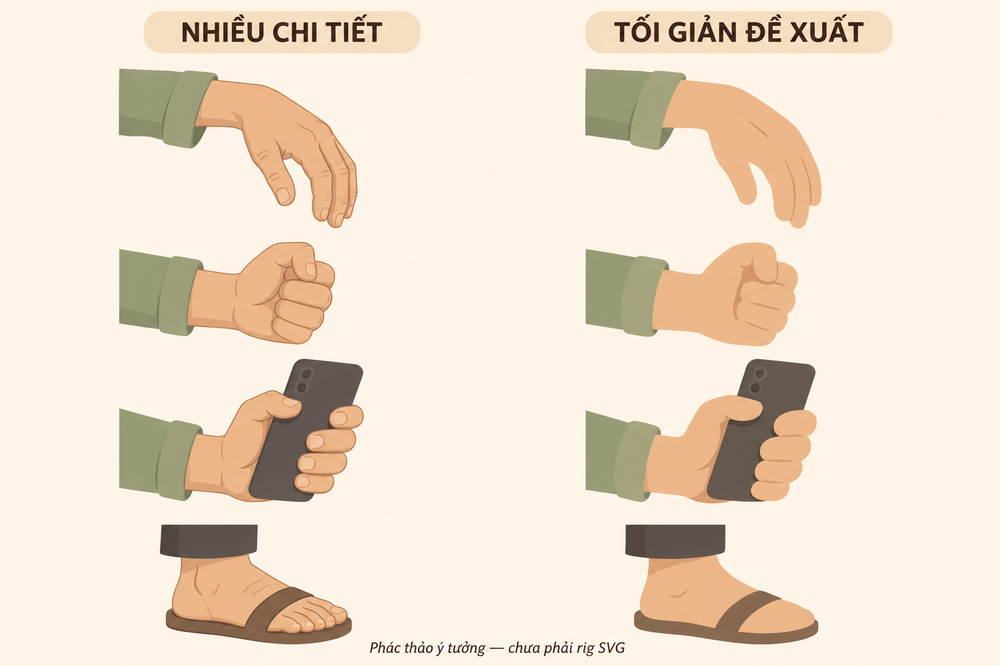

# Phong cách mỹ thuật chung — cartoon mềm, tròn, có chiều sâu

**Cập nhật 11/11/2026 theo lựa chọn của chủ repo.** Style B áp dụng thống nhất cho thiết kế mới và các asset được giao chỉnh sửa: nhân vật, trang phục, đạo cụ, nội thất, kiến trúc, đường phố, cây cối và môi trường. Không chỉ đổi nhân vật rồi để nền theo lối ghép hộp cứng. Đây là quy chuẩn thiết kế, chưa xác nhận toàn bộ asset hiện có đã được vẽ lại.

## Ngôn ngữ hình và nét

- Ưu tiên đường cong mềm, khối tròn đầy và đường bao liền mạch. Nét cong có chủ đích, không rung ngẫu nhiên hoặc uốn méo mọi vật.
- Vai–thân–hông–đùi nối tự nhiên; tay chân có khối, trang phục rủ theo cơ thể. Tóc, mắt, miệng và cử chỉ giữ tính cartoon, không chuyển sang tỉ lệ người thật.
- Nhân vật theo lựa chọn mới: không viền ngoài, giữ nét mắt–mày–miệng và vài nét trong cần thiết. Tách lớp bằng mảng màu và bóng gọn, không bằng quầng sáng hay gradient bóng nhựa. Với asset còn dùng nét, bo tròn đầu/nối và giữ độ dày theo khoảng cách; mực than ấm `#282b2b` là tham chiếu cũ, không bắt buộc viền cho nhân vật mới.
- Nhân vật series The Crack in Reality (từ Hồ sơ 02: Người trong gương): **không viền ngoài; bóng là mảng tự vẽ**, ít và rõ. Không tạo bóng vật liệu bằng bộ lọc, gradient, rim tự động, AO hay thuật toán chiếu sáng. Quy chuẩn hiện hành ở [mục 4.0 Hồ sơ 2](../episodes/hem-co-chuyen/ho-so-02-nguoi-lam-thay/assets/thiet-ke/QUY-CHUAN-THIET-KE-SVG.md#40-bóng-vẽ-tay-không-viền-11112026). Nền cũ có nét kiến trúc chọn lọc vẫn được giữ; không tự xóa mọi nét kết cấu trong kho cũ. Bổ sung 11/11 (bản thử 2.5D, chủ repo chọn): viền sáng/ánh hắt theo kiểu sáng cảnh được phép; mảng tối và bóng đổ giữa lớp được làm mềm chuyển dần về phía sáng, mép ngoài vẫn theo hình bao. Vẫn cấm rim tự sinh bằng filter.
- Mảng màu gọn, sáng/tối có nguồn sáng thống nhất. Tránh nền quá nhiều chi tiết hoặc chất liệu ảnh thật đặt cạnh nhân vật cartoon phẳng.

## Minh họa không viền — tiếp thu ảnh tham chiếu 11/11/2026

Ảnh hướng dẫn do chủ repo cung cấp là tham chiếu kỹ thuật, không phải mẫu nhân vật để sao chép. Ưu tiên hình khối và sáng–tối khi nhìn từ xa hơn độ tinh xảo khi phóng lớn.

1. **Dựng silhouette trước:** dáng nhận ra được ở cỡ nhỏ; đường bao có nhịp lớn–vừa–nhỏ, không thành một khối tròn đơn điệu. Nét phác chỉ để xây hình, không bắt buộc xuất ra hình cuối.
2. **Chốt màu nền trước bóng:** các phần kề nhau tách bằng sắc độ, màu và che khuất. Nhóm xa–giữa–gần riêng cho cả nhân vật, đạo cụ và môi trường; không thêm viền dày để chữa các mảng màu dính nhau.
3. **Giữ nét có chọn lọc:** mắt, miệng, ngón cái, một nếp gấp hay cạnh tiếp xúc cần thiết. Không viền ngoài không có nghĩa xóa mọi đường trong, cũng không dùng nét để mô tả từng đốt/ngấn nhỏ.
4. **Bóng và sáng do người vẽ chọn:** thường chỉ cần 1–3 mảng ở cổ, dưới vạt áo, chỗ chồng hoặc điểm đỡ. Đường mảng cong mềm, cắt trong đúng khối/lớp; không tràn qua quần áo hoặc phủ cả khuôn mặt. Có thể tô màu trực tiếp hoặc dùng clipping mask. Không tự sinh bóng theo hướng đèn, độ sâu hay hình học vật liệu. Bóng tiếp xúc là mảng nhỏ bám điểm đỡ, không phải quầng blur.
**Màu da và khuôn mặt:** đầu, cổ, tay/chân cùng màu da nền; không làm tối nguyên cánh tay để tách lớp. Không thêm dải bóng quanh má/cằm khiến vai không có râu trông như có râu. Tóc phải phủ kín phần da đầu cần che; bàn tay dùng đường bao liền, khung preview phải chứa đủ ngón trước khi đánh giá hình.

5. **Không khóa công thức pha màu:** Multiply/Dodge và các phần trăm trong ảnh là ví dụ thao tác, không phải thông số bắt buộc. Chọn độ đậm theo da, trang phục, cảm xúc và cỡ hình; tránh tối bẩn hoặc sáng nhựa. Lớp màu không khí/vệt sáng là lớp riêng, không thay cho bóng vật liệu.
6. **Texture là tùy chọn cuối:** thật nhẹ, không rung ngẫu nhiên từng frame, không làm mất silhouette, chữ và nét mặt. Xem bản thu nhỏ và nền khác màu trước khi thêm chi tiết.

Mô hình không gian 3D, phối cảnh và camera vẫn được dùng để bố trí đúng; quy tắc trên thay cách **vẽ bóng**. Hiệu ứng kính gợn, ánh đèn, bụi hay khói được đánh giá riêng, không lấy lệnh bỏ bóng render để xóa chúng. Áp dụng cho asset mới/được giao sửa; không tự thay bộ đã duyệt của Hồ sơ 1.

## Tay–chân tối giản — đã chốt 10/11/2026

**Áp dụng hướng bên phải.** Đây là phác thảo AI được chủ repo chọn để định hướng cách vẽ; cột trái chỉ minh họa lối nhiều chi tiết, không phải ảnh chụp rig hiện tại. Bản cập nhật này lưu quy chuẩn và ảnh mẫu, chưa sửa SVG/TSX hoặc xác nhận motion đã đạt. Phạm vi là nhân vật mới và các asset được giao sửa; không tự thay toàn bộ kho cũ.

- **Tay thả:** lòng tay thành khối mềm nối liền cổ tay; ngón cái tách rõ, các ngón còn lại gom nhóm. Chỉ giữ một hoặc hai nét phân ngón khi cần đọc dáng; bỏ móng và các nếp khớp nhỏ. Không cần số đường phân ngón cố định cho mọi góc.
- **Tay nắm:** khối bo tròn với ngón cái ôm ngoài; ít nét trong, không vẽ từng đốt hoặc gân. Giữ đúng bên ngón cái khi đổi hướng.
- **Tay cầm:** khối ngón ôm sát đồ vật và ngón cái ở phía đối diện; thứ tự lớp làm rõ lực nắm. Trong ảnh mẫu, tay cầm điện thoại còn tách nhiều ngón: khi triển khai nên gom thêm, không chép nguyên chi tiết đó. Chỉ tách ngón trỏ khi cần bấm/chỉ hoặc hành động mang thông tin.
- **Bàn chân:** một khối rõ gót–mu–mũi, không vẽ từng ngón; quai dép đơn giản nhưng phải vòng đúng bàn chân. Giữ hướng chân theo tư thế, không xoay chân theo mặt một cách máy móc.
- **Khớp và trang phục:** khuỷu/gối thể hiện bằng đường bao cong liên tục và rất ít nếp gấp; giữ khối chi, không biến thành que. Tay ra đúng cửa tay áo, chân ra đúng gấu quần; không xuyên áo/quần hoặc nổi sai lớp.
- **Màu và bóng:** không viền ngoài, giữ nét trong thiết yếu; vài mảng bóng gọn theo cùng nguồn sáng. Không lấy màu áo/da ở bảng mẫu thành bảng màu bắt buộc của dàn nhân vật.

**Kiểm tra trước khi nhân rộng:** đặt cạnh mẫu nhân vật đã duyệt ở cỡ khung hình cuối; thử tay thả, nắm, cầm điện thoại/bát, chỉ/bấm và chân đứng/ngồi ở góc chính diện, nghiêng, ba phần tư. Đọc được hành động qua silhouette; cổ tay liền cẳng tay, đúng bên ngón cái, vật bám lòng tay, chân có điểm đỡ. Khi được giao dựng, xem animatic cầm–thả và đổi che khuất; ảnh tĩnh không chứng minh tiếp xúc suốt chuyển động. Tối giản hình vẽ không thay cho kiểm tra rig.

## Áp dụng cho cả thế giới trong hình

| Nhóm | Cách thể hiện cần giữ |
|---|---|
| Người và quần áo | Đường bao mềm, vai thả, hông/đùi có thể tích; tay áo, nếp vải và tiếp xúc không đứt đoạn |
| Nội thất | Bàn, ghế, tủ, bồn rửa giữ công năng; bo mép vừa phải, chuyển mặt bằng mảng màu tự vẽ tiết chế; nệm phồng, rèm và vải có độ rủ |
| Nhà, hẻm, đường phố | Giữ phối cảnh, mặt sàn và độ dày cửa; làm mềm cạnh/đường bao và chi tiết mái, tường, biển hiệu. Giảm lặp các hộp chữ nhật giống hệt nhau |
| Đạo cụ | Cùng ngôn ngữ nét/màu với người và nền; điện thoại, bát, cốc, đèn có hình dễ đọc, điểm cầm và mặt tiếp xúc rõ |
| Cây cối, mây, đất, nước | Tán/lá/mây thành mảng cong lớn có nhịp lớn–vừa–nhỏ; đất và bờ nước có đường bao tự nhiên; tránh que thẳng lặp đều hoặc đám tròn giống nhau |

Đường thẳng vẫn cần cho mặt bàn, cột nhà, bản lề, khung cửa và màn hình. Mềm mại không đồng nghĩa biến mọi vật thành viên nang, làm tường chảy hoặc làm mất cấu trúc. Phân biệt gỗ, kim loại, kính và vải qua hình, mảng sáng/tối và vài chi tiết chọn lọc.

## Chiều sâu và chuyển động

Giữ hình 2D có chiều sâu 2.5D bằng phối cảnh, tỉ lệ gần–xa, lớp chồng, bóng tiếp xúc và ánh sáng. Không dùng khối hộp cứng làm phương tiện duy nhất để tạo thể tích. Tách nền xa, khối phòng, đồ cố định, người/đồ cầm và lớp che gần theo [hướng dẫn điện ảnh](NGON-NGU-DIEN-ANH-2-5D.md) và DUNG-CANH của hồ sơ. Đồ nằm trên bàn phải có điểm đỡ; tay cầm bám vật; bóng không tách khỏi nguồn.

## Hòa sắc điện ảnh & Lớp phủ màu (Cinematic Color Grading)

**Cập nhật 11/11/2026:** Để đạt chất phim điện ảnh người đóng (Live-action) và khử cảm giác "hoạt hình vector máy tính", toàn bộ video được xử lý qua quy trình hòa sắc đồng bộ:

1. **Không dùng CSS filter nặng nề trên từng phần tử:** Tránh dùng `filter: hue-rotate(...) contrast(...)` vì làm chậm gấp đôi thời gian render và gây xỉn màu cục bộ.
2. **Lớp phủ hòa sắc duy nhất (Adjustment Grade Overlay):** Sử dụng component `CinematicGradeOverlay` đặt trên đỉnh khung hình (dưới Letterbox 2.39:1).
   - Chế độ hòa trộn: `mix-blend-mode: soft-light` (hoặc `color`).
   - Độ mờ (Opacity) tiết chế: **$8\% - 14\%$** (không vượt quá $20\%$).
   - Ép vùng tối và trung tính vào bảng màu tâm lý (Fincher night `#0d1f18`, Sáng sớm `#1a2b3c`, Cõi gương `#051824`).
3. **Bảo tồn màu da (Skin Tone Protection):** Vùng da mặt nhân vật sống (Nam) luôn giữ sắc hồng cam ấm áp tế bào sống (`#d89c7a`), tương phản sâu sắc với sắc da tái mét lạnh ngắt của Người Trong Gương.
4. **Vignette quang học:** Lớp gradient tròn `radial-gradient` tối nhẹ $30\% - 45\%$ ở 4 góc mép khung (`mix-blend-mode: multiply`), mô phỏng thấu kính Anamorphic cinema cổ điển.

## Cách áp dụng và kiểm tra

Có thể bắt đầu từ [bộ nét mặt tách lớp dùng chung](../what-if-studio/library/expressions/cartoon-soft/README.md): không tóc/đầu, có 3 mức cảm xúc. Giữ nhận diện từng vai, căn lại tỷ lệ/góc nhìn và cắt lớp màu theo da mặt; không mặc định các nét đã khớp mọi nhân vật hoặc rig.

1. Đọc quy chuẩn này cùng mẫu Style B và bảng asset của hồ sơ. Giữ màu/nhận diện riêng của nhân vật; không lấy một bảng màu trang phục làm bảng màu bắt buộc cho mọi tập.
2. Khi được giao sửa hình, ghép người, đạo cụ và nền trong cùng khung trước khi nhân rộng. Kiểm tra độ mềm của nét, mức chi tiết, ánh sáng, tỉ lệ và tiếp xúc ở cỡ xem điện thoại; xem riêng từng asset chưa đủ.
3. Nếu sửa nguồn SVG/TSX, rà các bản preview HTML/PNG và bảng asset phụ thuộc; ghi rõ bản chưa cập nhật. Không để preview cũ được hiểu là mẫu mới đã duyệt.
4. Duyệt storyboard rồi animatic khi được giao dựng. Quy chuẩn hoặc ảnh tĩnh không chứng minh rig, khẩu hình và tương tác đã đạt. Tái sử dụng phần phù hợp, sửa theo phạm vi được giao; không tự vẽ lại cả kho cũ hay chạy media tốn phí.

Tham chiếu cụ thể: [hướng tạo hình Hẻm Có Chuyện](../episodes/hem-co-chuyen/THIET-KE-NHAN-VAT.md), [quy chuẩn nhân vật Style B](../episodes/hem-co-chuyen/ho-so-02-nguoi-lam-thay/assets/thiet-ke/QUY-CHUAN-THIET-KE-SVG.md). Chi tiết nhân vật và bảng màu riêng nằm trong hồ sơ, không chép thành quy tắc dùng chung.

**Thiết kế và tái sử dụng asset 11/11:** [hướng dẫn nguồn, khớp/tay, layer, bóng và biểu cảm ba mức](../episodes/hem-co-chuyen/ho-so-02-nguoi-lam-thay/assets/bo-sung-15p/CACH-THIET-KE-VA-SU-DUNG.md). Dùng bộ nét mặt chung, giữ nhận diện đã duyệt; ảnh tĩnh chưa thay cho kiểm tra chuyển động.
