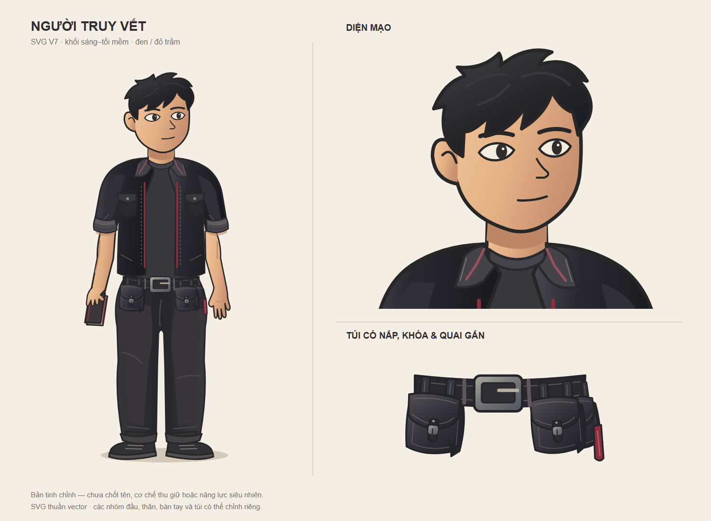
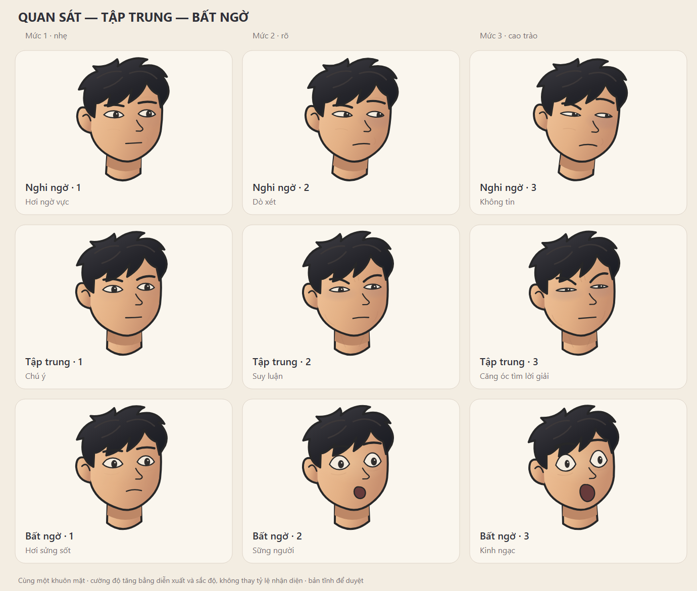
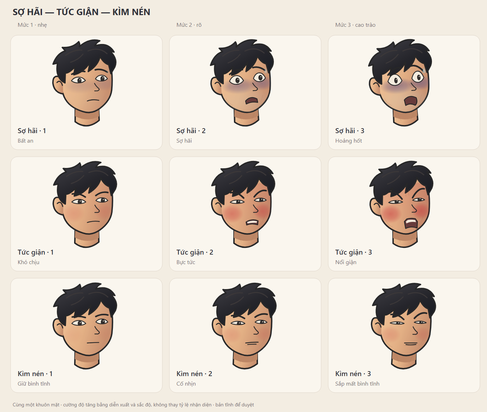
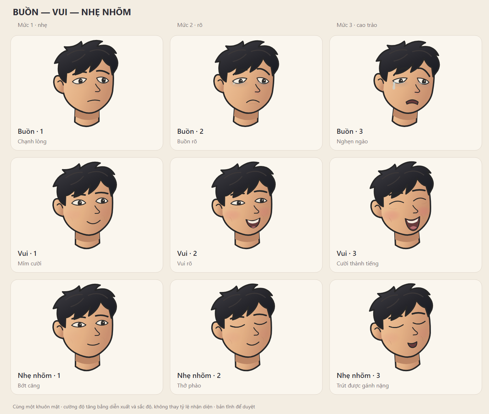

# Nhân vật truy vết — asset dùng chung của The Crack in Reality (Hẻm Có Chuyện)

**Bản nét mặt không tóc/đầu để dùng cho vai khác:** [thư viện EXP-CARTOON-SOFT-01](../../../../what-if-studio/library/expressions/cartoon-soft/README.md). Bộ ở đây giữ nguyên làm mẫu nhận diện của nhân vật truy vết; thư viện chung chỉ chứa các nét và lớp cảm xúc đã tách.

Cập nhật 10/11/2026 theo thiết kế và biểu cảm được chủ repo duyệt trong chat. **“Người truy vết” là nhãn làm việc, chưa phải tên chính thức.** Nhân vật dành cho tuyến xuyên series, không thuộc riêng Hồ sơ 1 hoặc Hồ sơ 2.

## Mẫu hiện hành

- Nam khoảng 20 tuổi, trẻ, không râu, hơi bụi bặm; phong cách cartoon mềm, có khối sáng–tối và chiều sâu 2.5D.
- Trang phục đen/than chủ đạo, điểm đỏ trầm; áo khoác ngoài thân và áo thun, quần hơi rộng, thắt lưng có túi bên hông. Sổ là đạo cụ của bản mẫu, chưa xác lập chức năng siêu nhiên.
- Thế mạnh đã chọn: suy luận và truy vết. Cơ chế thu giữ thực thể, năng lực siêu nhiên, giới hạn, quá khứ và thời điểm ra mắt còn mở; xem [VU-TRU.md](../../VU-TRU.md).
- Mẫu toàn thân V7 đang giữ làm bản hiện hành sau các lượt chỉnh tỷ lệ, cổ áo, tay–cổ tay, thắt lưng và quần. Bộ 9 nhóm × 3 mức biểu cảm đã được chủ repo đồng ý và yêu cầu đưa lên main. Không dùng các bản thử V1–V6 làm nguồn mới.

## Tác dụng từng file

| File | Dùng để làm gì |
|---|---|
| [nhan-vat.svg](nhan-vat.svg) | Nguồn vector hiện hành: toàn thân, cận mặt và chi tiết thắt lưng. Các nhóm đầu, thân, cổ áo và túi chỉnh riêng được |
| [nhan-vat.png](nhan-vat.png) | Ảnh xem nhanh của đúng mẫu toàn thân trên; không phải nguồn chỉnh sửa |
| [bieu-cam/danh-muc.json](bieu-cam/danh-muc.json) | Ánh xạ tên cảm xúc, mức độ và file SVG; dùng để tìm đúng nét mặt |
| `bieu-cam/<cam-xuc>-01.svg` đến `-03.svg` | 27 nét mặt độc lập, tăng từ nhẹ → rõ → cao trào. Tọa độ và viewBox thống nhất; nền trong suốt |
| [bieu-cam/binh-than-00.svg](bieu-cam/binh-than-00.svg) | Mặt trung tính để nghỉ hoặc làm mốc đối chiếu, không có “cao trào bình thản” |
| [bieu-cam/bang-01.svg](bieu-cam/bang-01.svg), [bang-02.svg](bieu-cam/bang-02.svg), [bang-03.svg](bieu-cam/bang-03.svg) | Bảng vector so sánh ba mức cạnh nhau, chia theo 3 nhóm nội dung bên dưới |
| `bieu-cam/bang-01.png` đến `bang-03.png` | Preview cùng phiên bản với bảng SVG; dùng để duyệt hình nhanh |

## Ba bảng biểu cảm

Từ trái sang phải là mức **1 — nhẹ**, **2 — rõ**, **3 — cao trào**. Mỗi mức thay đổi mắt, chân mày, miệng, độ căng hàm/cổ, góc đầu và sắc da; không chỉ tăng opacity của màu. Bất ngờ giữ sắc da sáng tự nhiên; sợ hãi mới có sắc tím lạnh dưới mắt. Nét buồn dùng mi ửng và mắt ướt, chỉ mức nghẹn ngào có giọt lệ nhỏ. Giữ nét đã tiết chế, không quay lại mảng màu đậm của các bản thử cũ.

## Nguồn, trạng thái và cách dùng

| Mã asset | Loại / phiên bản | Nguồn / quyền | Trạng thái |
|---|---|---|---|
| HCC-TRUY-VET-CHAR | SVG toàn thân V7 + PNG | Codex viết SVG từ yêu cầu và phản hồi của chủ repo; bản concept raster AI trước đó chỉ là tham chiếu, không nhúng vào SVG. Không nhập stock hay tài nguyên ngoài vào gói này; không tự gán giấy phép stock hoặc giấy phép engine cho hình | Mẫu hiện hành, đã rà ảnh tĩnh; giữ tạm tỷ lệ theo yêu cầu |
| HCC-TRUY-VET-FACE | 27 biểu cảm + 1 trung tính; bộ mức độ đầu tiên sau bảng V5 | Phát triển từ cùng khuôn mặt nguồn, chữ và vector chỉnh được; không sao chép thiết kế của dàn nhân vật khác | Đã duyệt ảnh tĩnh trong chat |

Mẫu toàn thân là bản hiện hành để phát triển tiếp; chưa có rig, 8 hướng quay, khẩu hình hoặc clip chuyển động cho nhân vật này. Các bảng đã được render và soi ảnh tĩnh; đã kiểm tra XML, ID và tham chiếu SVG. Chưa kiểm tra biểu cảm trên thân, trong bối cảnh hoặc trên timeline. Không tự thay tạo hình Nam–Người Kia–Tùng hoặc các vai Hồ sơ 1 bằng gói này.

Khi dựng: dùng SVG riêng đúng nét/mức trong danh mục, ghép thử với thân ở cùng tỷ lệ và ánh sáng; giữ nhận diện, trục cổ và cỡ đầu. Hướng dẫn ngôn ngữ nét mặt có thể dùng lại, nhưng phải thiết kế riêng theo khuôn mặt, tuổi và cá tính của từng vai. Bảng 27 nét là hình tĩnh; chưa có cam kết nội suy tự động giữa các file. Chỉ tích hợp vào rig khi được giao, rồi kiểm tra đoạn chuyển trung tính → mức nhẹ → mức rõ → trở về nghỉ trước khi nhân rộng.
