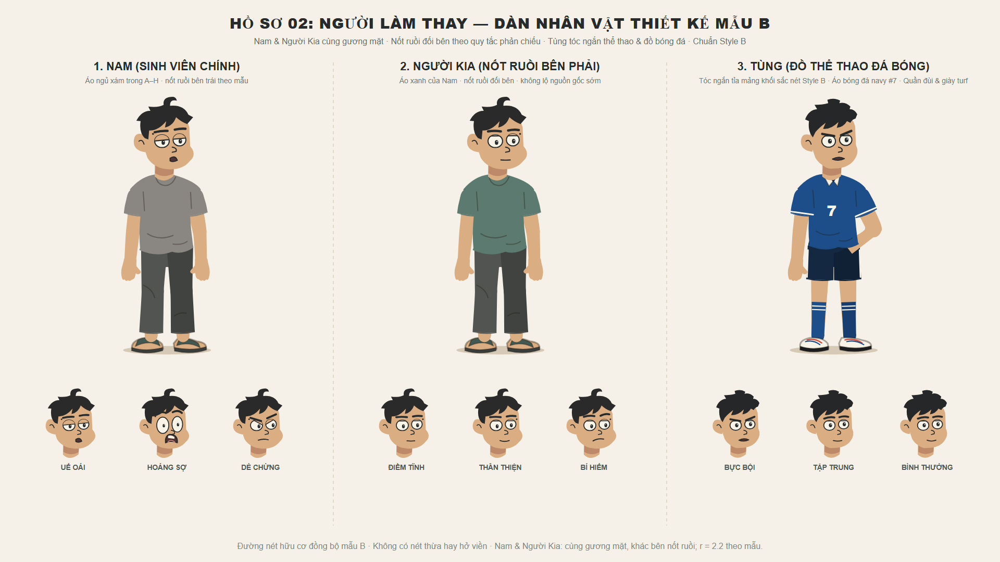
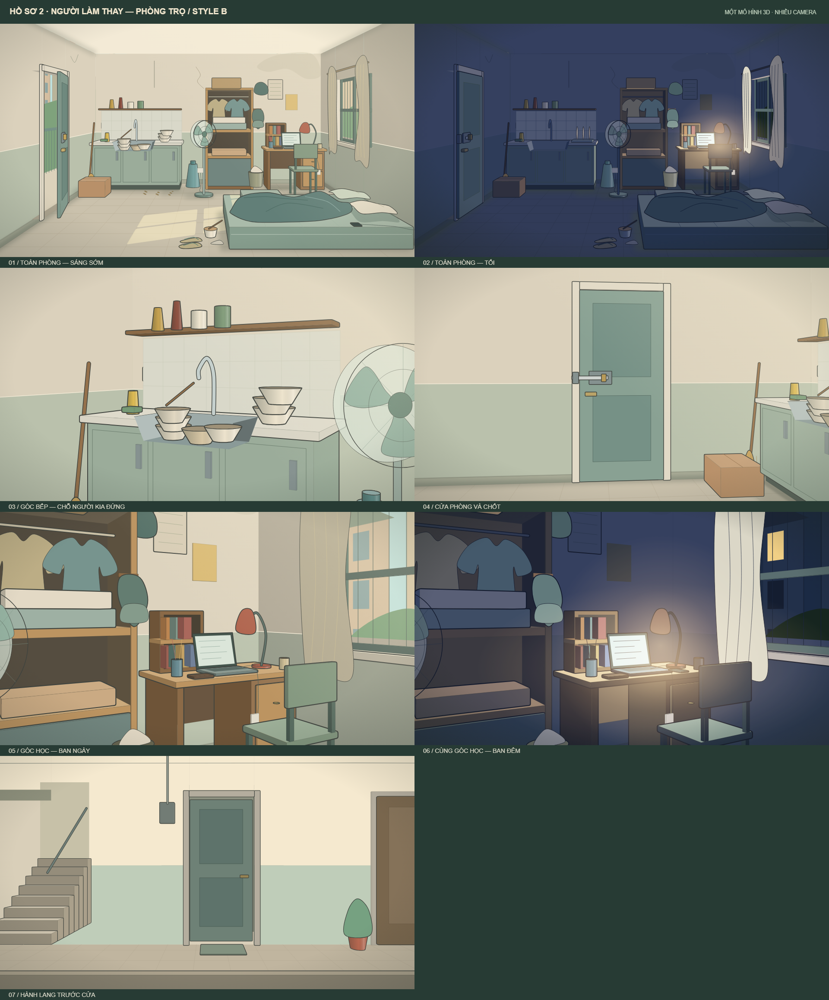

# Asset — Hồ sơ 2: Người làm thay

## Bổ sung theo kịch bản đủ ba phần V1 — chưa tạo/sửa asset

Nguồn lời: [KICH-BAN.md](KICH-BAN.md). Các mục dưới là yêu cầu mới của bản nháp, chưa phải asset đã làm hoặc đã duyệt. Giữ toàn bộ bộ hình/rig đang có.

| Cần chuẩn bị | Cảnh dùng / liên tục |
|---|---|
| Gương đứng khung gỗ khoảng 50 × 120 cm, chèn chân; lớp phản chiếu tách riêng | P1.00 mang về; cạnh hông tủ ở mọi cảnh; P2.07 hình trễ; P3 quay/che/giằng/kéo người; không chặn cửa hoặc đường tới nệm |
| Góc đồ cho tặng ở hành lang và nhãn giấy | O01; quay lại cùng góc ở P3.07, không xây địa điểm mới chỉ cho hồi tưởng |
| Khăn lớn, sổ gáy mềm, giấy ba ý và bút | Khăn chặn mặt kính; sổ được Nam giao từ P2.05; giấy Nam tự viết từ cuối phần 2 đến hình kết |
| UI tin/nhóm, file nháp, ghi âm thử, camera sau, gửi clip và xóa clip local | Mỗi lần biết thông tin có nguồn; clip đã gửi cho Tùng vẫn còn; không đặt dữ liệu thật vào hình |
| Ba nền mới và clip riêng Nam giữa khung | **Đã dựng bằng mã, chờ duyệt:** góc gương, góc đồ cho tặng, hành lang–cầu thang trong [mô hình phòng](assets/boi-canh/BOI-CANH.md#góc-máy). Clip: [TRAILER-NAM-GIUA-KHUNG.md](TRAILER-NAM-GIUA-KHUNG.md), [bảng 13 nhịp](assets/trailer/nam-giua-khung-bang.png) |
| Trường học và sân thể thao | **Đã dựng bằng mã, chờ duyệt:** sân trường ngày/đêm, hành lang lớp, giảng đường, sân bóng ngày/chiều/đêm. Xem [BOI-CANH.md](assets/boi-canh/BOI-CANH.md#trường-học-và-sân-thể-thao--đề-xuất-10112026-chờ-duyệt) |
| Nhân vật không viền ngoài | **Đã cập nhật rig 10/11/2026** theo quyết định tạo hình chung: bỏ đường bao thân/tay/chân/đầu/tóc/giày; giữ nét mặt và nếp áo; chi phía sau tối hơn để tách lớp. Bảng [nhan-vat.png](assets/nhan-vat.png) đã xuất lại. Tay chưa giản lược ngón theo ảnh so sánh |
| Trang phục Nam | `NAM_OUTFITS` trong rig: `xanh`, `ngu`, `xam-tui` (túi ngực cho P3), `dong-phuc`, `the-thao`. [Bảng xem](assets/trailer/trang-phuc-nam.png). Chỉ đổi màu/chi tiết áo trên cùng thân; đồ thể thao chưa có giày riêng |
| Jumpscare trailer O05 | **Đã dựng hình và âm thử, chờ duyệt.** Mở đầu: góc nhìn người kia đi hành lang mở cửa (view `hallway`), sát sau lưng nó khi bước qua cửa (Nam ngủ bên phải), toàn phòng tối với bóng đứng nhìn và mắt lóe; sau đó góc nhìn Nam (camera `pov` trong mô hình phòng), người kia tiến lại gần, cắt phụt vào mặt dọa vẽ riêng (`ScareFace`, đen trắng, hốc mắt sâu, cười toác đầy răng), mí sập. Dùng mẫu nằm `Sleeper` (export từ `canh-01-demo.tsx`) và biểu cảm `stare_grin`. Composition `HoSo02TrailerJumpscare` (khoảng 14 giây). Âm lấy từ thư viện (`room_tone`, `power_hum`, `step`, `crack`, `drone_hit`, `glitch`) chép vào `what-if-studio/public/ho-so-02-nguoi-lam-thay/sfx/`, thư mục Git bỏ qua nên máy khác phải chép lại. Chưa xác minh quyền dùng và chưa nghe duyệt kỹ |
| Áo xanh vắt trên ghế | Trailer O04 cần; mô hình phòng chưa có prop này (nền hiện không vẽ áo trên ghế) |
| Trailer P1.00: nhạc nền, chuông báo thức, chữ lớn/tên phim | Thử âm thư viện trước (`library/sfx`, gói KORBANN chưa xác minh quyền); chữ dựng bằng text Remotion. Không thêm bối cảnh/góc máy, xem ngân sách dựng trong [P1.00](PHAN-01-NGUOI-TRONG-PHONG.md#p1-00) |
| Hộp cơm/đũa/cốc nước, balô | Hồi tưởng đời thường, Tùng mang hai hộp tối ngày 1; tái dùng đạo cụ thư viện nếu có |
| Biến thể áo thường của Nam, túi ngực để giữ điện thoại ở P3 | A–H giữ áo ngủ xám; từ ngày 2 áo xám nhạt có túi, Người Kia xanh rêu. Cần kiểm rig/túi trước dùng, chưa tự đổi thiết kế chính |
| Pose nghe bạn, giảng bài, trao máy, giữ cửa, tránh/thoát, giằng cổ tay/khung gỗ, bám mép gương | Phải thấy liền cổ tay–bàn tay, lực/điểm tựa; thử animatic ngắn khi được giao trước khi dựng đoạn dài |
| Không gian nhìn từ trong gương, hành lang đảo chiều phía sau và hiệu ứng tiếp xúc mặt kính | Chỉ xác nhận nguồn gốc/bắt người ở cuối; âm trong không lọt ra ngoài. Hướng nhìn khác rõ, không đảo chữ trên toàn cảnh |

Nhân vật mới có hình: không thêm vai có mặt. Trưởng nhóm chỉ qua chữ; Tùng là vai đã có. Một đường cửa chính, không thêm cửa sau để tránh giải quyết việc hai Nam tránh gặp Tùng.

**Đại tu không gian 10/11/2026 — chờ duyệt:** [bảng nền mới](assets/boi-canh/boi-canh.png), [ghép Nam kiểm tra tỉ lệ](assets/boi-canh/kiem-tra-ti-le.png), [nguồn và hướng dẫn](assets/boi-canh/BOI-CANH.md). Nệm đôi tách bàn/ghế; không còn áo ghế, căn cước trên bàn, giờ đêm/tin cũ/tên tập gắn vào nền. Căn phòng là một mô hình 3D trong nguồn TSX, mỗi góc máy là một camera thật, có thêm góc cửa/chốt và hành lang; đã xuất SVG/PNG/HTML, chưa dựng phim.

**Sửa tạo hình rig V3 — 10/11/2026:** thân/tay áo hợp thành một viền, giảm nét chồng, tay nghỉ buông gần thẳng; hướng bàn tay bám cẳng tay, sửa bên ngón cái và dáng cầm điện thoại. Xem [soi chỗ nối/bàn tay](assets/rig/chi-tiet-khop.png), [đối chiếu mẫu](assets/rig/doi-chieu-mau-goc.png), [bảng 12 dáng](assets/rig/tu-the-khop.png). Đã cân thêm độ rộng hai chân: [xem bảng chân](assets/rig/can-doi-chan.png). Đã làm đầy cẳng tay/cổ tay và tách dáng ngón khi gõ/giữ bát: [soi bàn tay](assets/rig/ban-tay-ro-net.png). Nguồn/SVG/PNG/HTML đã cập nhật; chờ duyệt, chưa đưa vào phim.

**Rig cũ, chỉ để đối chiếu (rig chính nằm trong `assets/nhan-vat.tsx`) — 10/11/2026:** đã có [bảng 12 tư thế](assets/rig/tu-the-khop.png), [nguồn rig](assets/rig/rig.tsx) và [trình xem khớp](assets/rig/xem-tu-the.html) cho Nam, Người Kia, Tùng, dùng lại đầu/màu của bộ hiện có. Đọc [hướng dẫn và giới hạn](assets/rig/RIG-NHAN-VAT.md) trước khi dựng: bản để duyệt, chưa là chuyển động/tương tác đã duyệt trong phim.

**Quy chuẩn mỹ thuật 10/11/2026:** áp dụng [quy chuẩn chung](../../../docs/PHONG-CACH-MY-THUAT.md) cho nhân vật **và toàn bộ bối cảnh/đạo cụ**: nét cong mềm, khối tròn đầy, phối cảnh và điểm tiếp xúc rõ. Bộ phòng trọ đã có bản đại tu SVG/TSX/PNG theo thông báo đầu file; chờ duyệt mỹ thuật, chưa coi tương tác/chuyển động là hoàn thiện.

**Chốt gương 10/11/2026:** Nam giữ nốt ruồi bên trái theo mẫu; Người Kia bên phải ở cùng góc nhìn. Dùng `NguoiKia` hoặc `identity="nguoi-kia"`, không dùng đầu Nam mặc định cho bản sao. Kích thước nốt giữ nhỏ, không phóng to. Xem [bảng đối chiếu](assets/thiet-ke/doi-chieu-not-ruoi.png) và [quy chuẩn](assets/thiet-ke/QUY-CHUAN-THIET-KE-SVG.md).

## Dàn nhân vật theo mẫu SVG mới (Style B) — 09/11/2026

Toàn bộ nhân vật xuất hiện trong kịch bản **Hồ sơ 2: Người làm thay** đã được thiết kế đồng bộ theo phong cách SVG hữu cơ mới (Style B: nét vẽ mềm, mảng tóc gọn, vai áo rủ tự nhiên, quần có khối, biểu cảm linh hoạt).

**Trạng thái sử dụng:** bộ mới đã được cập nhật từ GitHub tại `593c626`; đây là nguồn thiết kế hiện hành để tham khảo. Style B được chọn từ mẫu thứ 2; chưa coi các pose/biểu cảm mới là đã được duyệt trong từng cảnh hoặc rig đã kiểm tra chuyển động. Nam là sinh viên năm hai theo kịch bản mới.

### Bảng nhân vật hiện có
- **Hình ảnh xem trước:** 
- **Trình xem trực tiếp tương tác (Zoom/Pan):** [`assets/xem-truc-tiep.html`](assets/xem-truc-tiep.html)
- **Tài liệu quy chuẩn thiết kế SVG (Style B):** [`assets/thiet-ke/QUY-CHUAN-THIET-KE-SVG.md`](assets/thiet-ke/QUY-CHUAN-THIET-KE-SVG.md)
- **File vector SVG master:** [`assets/nhan-vat.svg`](assets/nhan-vat.svg) (bảng 1920×1080 gồm dáng toàn thân và các cận cảnh biểu cảm).
- **Mã nguồn React / Remotion:** [`assets/nhan-vat.tsx`](assets/nhan-vat.tsx) (chứa `Nam`, `NguoiKia`, `Tung`, các component đầu và biểu cảm tương ứng).

| Nhân vật | Vai trò trong kịch bản | Đặc điểm nhận diện & Tạo hình | Trang phục & Đạo cụ |
|---|---|---|---|
| **1. Nam** | Sinh viên nhân vật chính, lười nhác, ngủ nướng, trễ deadline bài nhóm, sợ hãi khi gặp bản sao | **Nốt ruồi sát đuôi mày trái theo mẫu nhìn từ máy** (chi tiết then chốt từ kịch bản), tóc mảng gọn có lọn xoăn trên đỉnh theo Mẫu B, vai mềm buông lơi, hai tay đầy đặn rõ ràng buông tự nhiên ngoài thân áo. | A–H: áo ngủ xám (`#8a8783`); áo thường xanh rêu (`#5c7a70`), quần dài xám có khối (`#515451`), dép lê quai ngang (`#425850`). |
| **2. Người Kia (Bản sao)** | Sinh vật từ gương, thay thế Nam; nguồn gốc chỉ lộ cuối truyện | Khuôn mặt, **nốt ruồi đuôi mày đối bên với Nam**, gương mặt/kiểu tóc/vóc dáng tương đồng, dáng tay đầy đặn rõ ràng như Nam, ánh mắt điềm tĩnh / bí hiểm. | Mặc chiếc **áo thun xanh rêu (`#5c7a70`) của Nam** (chiếc áo Nam bỏ trên ghế tối qua), quần dài xám (`#515451`), dép lê quai ngang (`#425850`). |
| **3. Tùng** | Bạn cùng phòng chăm chỉ, dậy sớm đi học lúc 7h, nghe máy gạt đi vì tưởng Nam ngủ mơ ("Mày xàm hả?") | Sinh viên năng động, gương mặt sáng sủa, cằm gọn, **tóc ngắn tỉa mảng khối layer sắc nét Style B**, không đeo kính, dáng đứng thể thao tự tin. | **Đồ thể thao đá bóng**: Áo jersey xanh navy số 7 (`#1d4e89`) cổ viền trắng, quần đùi thể thao sọc hông (`#142842`), vớ cao cổ sọc trắng, giày turf ôm chân. |

---

## Các biểu cảm chi tiết (Moods)

1. **Nam:**
   - `sleepy`: Mí mắt sụp uể oải, miệng trễ hé mở ngái ngủ.
   - `shocked`: Mắt mở trừng to, con ngươi thu nhỏ, miệng há hốc thấy hàm răng trên, co rúm thủ thế.
   - `suspicious`: Mày nhíu bất đối xứng, mắt liếc ngang, môi bặm dò xét qua khe cửa.
   - `hesitant`: Đắn đo, tự đấu tranh tư tưởng khi nghe bản sao gợi ý làm bài hộ.
   - `annoyed`: Mày hạ ở đầu trong, mí sụp nhẹ, miệng trễ xuống khi bực.
   - `scared`: Mắt mở to, đầu trong lông mày nhướn, miệng mím hé răng.
   - `agitated`: Mày dựng, miệng mở lớn khi gắt.

2. **Người Kia (Bản sao):**
   - `calm`: Mắt mở đều, ánh nhìn kiên định, thản nhiên lạ thường.
   - `neutral_smile`: Nụ cười nhẹ lịch sự, giảm cảm giác đe dọa.
   - `eerie_smirk`: Nụ cười nhếch nhẹ sắc lạnh, toan tính khi Nam bắt đầu cắn câu giao việc.

3. **Tùng:**
   - `annoyed`: Mày cau bực bội khi bị Nam gọi nhảm giữa giờ học giảng đường ("Mày xàm hả?").
   - `focused`: Nghiêm túc, tập trung vào bài giảng.
   - `normal`: Vẻ mặt sinh viên bình thường.

---

**Khi đưa vào đoạn đầu:** Người Kia ưu tiên `calm`/`neutral_smile` theo hướng thân thiện, chủ động mời giúp; `eerie_smirk` là mẫu biểu cảm có sẵn, không tự áp để tiết lộ bản chất săn mồi sớm. Tùng hiện chưa chứng kiến hai người giống hệt nhau. Nam có thêm nhịp bí bài, mải game, ngủ quên và tự mãn ở bản thảo mới; các pose đó mới là nhu cầu diễn xuất, chưa được coi là asset đã hoàn thiện.

## File thiết kế tham chiếu ban đầu
- [`assets/thiet-ke/character-svg-v1.png`](assets/thiet-ke/character-svg-v1.png): Bảng đối chiếu ban đầu giữa Rig cũ và Mẫu thử B.
- [`assets/thiet-ke/character-svg-v1.tsx`](assets/thiet-ke/character-svg-v1.tsx): File thử nghiệm ban đầu của mẫu B.

---

## Hệ thống bối cảnh môi trường theo kịch bản (Style B) — 09/11/2026

Bản nền ngày–tối dùng chung mặt bằng; giờ và nội dung màn hình là trạng thái theo shot, không phải thông tin đóng cứng vào ảnh:

- **Hình ảnh tổng quan:** 
- **Tài liệu chi tiết bối cảnh:** [`assets/boi-canh/BOI-CANH.md`](assets/boi-canh/BOI-CANH.md)
- **Trình xem tương tác độc lập (Zoom/Pan):** [`assets/boi-canh/xem-truc-tiep-boi-canh.html`](assets/boi-canh/xem-truc-tiep-boi-canh.html)
- **Master Board SVG 4K:** [`assets/boi-canh/boi-canh.svg`](assets/boi-canh/boi-canh.svg)
- **Mã nguồn React / Remotion:** [`assets/boi-canh/boi-canh.tsx`](assets/boi-canh/boi-canh.tsx)

| STT | Bối cảnh | File SVG | Phạm vi và trạng thái |
|---|---|---|---|
| 1 | Phòng trọ sáng sớm | [Toàn phòng](assets/boi-canh/phong-tro-sang-som.svg) | Cửa trái, bếp sau–trái, tủ giữa, bàn sau–phải; nệm đôi tiền cảnh phải có khoảng sàn tách bàn/ghế. Điện thoại trên nệm tắt màn hình; báo thức là lớp theo shot |
| 2 | Bếp và bồn rửa | [Góc bếp](assets/boi-canh/goc-bep-bon-rua.svg) | Cùng bếp hai ngăn, vòi không chảy cố định; camera riêng trên cùng mô hình; `kitchen` chuyển messy/clean theo nhịp |
| 3 | Bàn học ngày | [Góc bàn sáng](assets/boi-canh/goc-ban-hoc-sang.svg) | Tủ cạnh bàn, ghế bốn chân không áo; căn cước còn trong ngăn tủ trước D02. Không gắn giờ hoặc tin nhắn cố định |
| 4 | Bàn học tối | [Góc bàn đêm](assets/boi-canh/ban-hoc-laptop-dem.svg) | Cùng mẫu bàn/ghế và cùng khung ngày; đèn ấm/laptop sáng, điện thoại tắt. Nội dung bài, tin và mốc giờ phải theo cue |
| 5 | Toàn phòng tối | [Toàn phòng tối](assets/boi-canh/phong-tro-toi.svg) | Cùng camera với toàn phòng sáng; đèn bàn và laptop là nguồn sáng |
| 6 | Cửa và chốt | [Góc cửa](assets/boi-canh/goc-cua-va-chot.svg) | Bốn trạng thái cửa: khép hờ, mở, khép chưa gài, gài chốt |
| 7 | Hành lang | [Hành lang](assets/boi-canh/hanh-lang-cua-phong.svg) | Góc B: cầu thang bên trái, cửa giữa, phía đối diện bên phải |
| 8 | Góc nệm | [Góc nệm](assets/boi-canh/goc-nem.svg) | Chỗ Nam, chỗ Tùng và ghế cạnh nệm cho cú va A05 |

**Khi đưa nền vào cảnh:** bảng thiết kế thể hiện hình tĩnh; trạng thái cửa/chốt và vị trí chiếc ghế làm việc theo [bảng máy 10/11](DUNG-CANH.md). Có hình chốt gài hoặc ghế trước cửa không có nghĩa mọi thời điểm truyện đều khóa/chặn. Khi sửa nền, sửa nguồn TSX rồi xuất lại bộ ảnh.

## Nhu cầu theo góc máy — 10/11/2026

Đã đối chiếu bảng các góc máy; dùng [DUNG-CANH.md](DUNG-CANH.md) để chọn cỡ/góc theo diễn biến. Giữ hai chỗ ngủ trên cùng nệm đôi, bồn rửa sát góc, bàn Nam/đèn đỏ đồng bộ ban ngày–đêm. Chuẩn bị bổ sung pose/cận còn thiếu khi được giao dựng; việc có nền tĩnh chưa chứng minh chuyển động hoặc mọi hướng nhìn đã có.

**Trạng thái dùng trong phim:** một mẫu ghế bốn chân theo chuỗi cạnh nệm → đối diện cửa → bàn; không đổi thành ghế xoay hoặc tự thêm ghế chắn cửa. Cần thấy chốt gài khi Nam khóa và chốt rút sau lúc quên gài khi về; nền tối không được giữ trạng thái khóa như một quy luật bất biến. Đối chiếu các trạng thái của nguồn bối cảnh; đường di chuyển và cú va A05 vẫn cần kiểm tra animatic.

Kiểm tra pose ngủ/bật dậy, nhìn ba phần tư, cầm điện thoại/căn cước, gõ bài/game, tay chạm chốt, đặt chén và người kia ngồi bàn. Những pose/góc chưa có mới là yêu cầu bổ sung, chưa tạo hay chạy thử. Giữ nội tâm là suy nghĩ của Nam; Người Kia không đọc được suy nghĩ hoặc màn hình từ ngoài cửa.

## Tách lớp để quay — 10/11/2026

Đối chiếu [quay layer](DUNG-CANH.md#quay-layer) trước khi dựng: nhóm nền xa qua cửa sổ/hành lang, khối phòng, đồ cố định, người/vật, lớp che gần, ánh sáng và chữ bám mặt thiết bị. SVG hiện có nhóm/clip hữu ích nhưng chưa đồng nghĩa đã có mask người đi qua, tay giữ đồ hoặc camera parallax. Ưu tiên tách phần bồn che thân/tay cầm bát, cửa/bản lề/chốt, bàn/thân ngồi/tay/phím/điện thoại; giữ mẫu Style B và bố cục đang dùng. Các việc tách và kiểm tra chuyển động còn chờ bước dựng, chưa thực hiện ở lượt tài liệu này.

## Rig khớp — 10/11/2026

`assets/nhan-vat.tsx` đã chuyển thân Nam, Người Kia và Tùng sang khung xương có khớp vai–khuỷu–cổ tay, hông–gối–cổ chân, cổ và từng đốt ngón. Góc bị chặn theo `LIMIT` (khuỷu/gối không gập ngược); bàn chân tự chạm sàn khi `planted`. Tay/chân đặt tên theo giải phẫu: R ở phía trái màn hình, L ở phía phải.

Dùng `pose` trên `StudentTwinBody`/`TungSoccer`, trộn từ `STAND_POSE` hoặc `TWIN_POSES`. Xem trong studio bằng composition `HoSo02RigSheet` (đứng ↔ 7 tư thế), `HoSo02CastBoard` (bảng dàn nhân vật); kiểm tra hình học: `node tests/ho-so-02-rig.cjs` trong `what-if-studio/`.

Cả ba nhân vật có đủ chính diện, 3/4, nghiêng, 1/4 (chéo từ sau), sau lưng và quay trái qua `view`/`facing` trong `pose` (xem composition `HoSo02Turnaround`, `HoSo02Spin`). Có `talk` cho khẩu hình, `blink` cho chớp mắt, `turnAt` để xoay dần, 11 dáng trong `TWIN_POSES`, `sampleWalk` cho vòng bước và `prop` cho điện thoại, bát đi theo bàn tay. Nam mặc áo ngủ xám bằng `shirt={PALETTE.nam.sleepShirt}` khi Người Kia đang mặc áo xanh.
