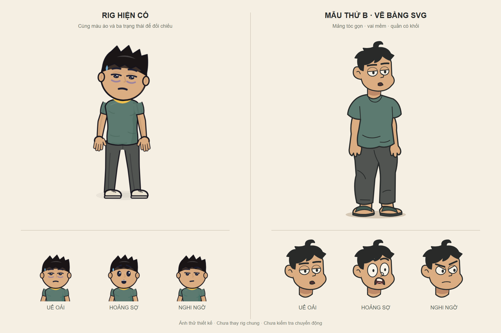

# Asset — Hồ sơ 2: Người làm thay

## Thiết kế nhân vật đã chọn — 09/11/2026

Chủ repo chọn **cách vẽ thứ 2, phía phải bảng SVG** làm hướng thiết kế chính. Đây là mẫu thử cậu sinh viên, không phải nhân vật đã hoàn thiện rig. Tên và tuổi cụ thể vẫn chưa chốt.

| Mã / tệp | Công dụng | Trạng thái |
|---|---|---|
| CHAR-STUDENT-SVG-v1 / [PNG](assets/thiet-ke/character-svg-v1.png) | Xem nhanh: bên trái rig hiện có, bên phải mẫu mới; ba biểu cảm uể oải, hoảng sợ, nghi ngờ | Đã xuất và xem ảnh; chủ repo chọn hướng bên phải |
| [SVG](assets/thiet-ke/character-svg-v1.svg) | Bảng vector có thể phóng to, tham khảo hình khối và nét | Đã có tệp; ảnh tĩnh |
| [Nguồn React/SVG](assets/thiet-ke/character-svg-v1.tsx) | `StudentHead` nhận mood/id; `Student` là dáng toàn thân; `Board` là bảng so sánh. Dùng React và rig từ studio qua đường dẫn tương đối | Mã mẫu, chưa nối timeline/khẩu hình/khớp chuyển động |

Nguồn: mẫu bên phải được viết bằng mã SVG trong lượt làm việc này; bên trái dùng `Hero`/`LOOKS.nam` của repo để đối chiếu, đổi màu và kiểu tóc trong bảng thử. Giữ attribution/giấy phép của mã kế thừa. Đây không phải bản sao nhân vật The Simpsons và không phải PNG sinh ảnh AI được giả làm đầu ra SVG. Bảng so sánh chụp từ mã React/SVG; không đưa bundle hoặc cache vào Git.

Quy ước chung và phần đã chọn nằm ở [thiết kế nhân vật của series](../THIET-KE-NHAN-VAT.md). Tệp này giữ asset riêng của Hồ sơ 2.

## Bước tiếp theo

- Đề xuất chưa duyệt riêng: vai hơi buông, đầu chúi nhẹ, trọng lượng lệch một chân để làm rõ tính lười.
- Hoàn thiện bàn tay, tư thế/góc nhìn và chuyển động sau khi chốt mẫu; ảnh tĩnh chưa chứng minh chuyển động mượt hoặc cầm nắm đúng.
- Bản sao dùng cùng diện mạo; khác biệt diễn xuất giữa hai người còn chờ chốt trong kịch bản.
- Chưa thay rig dùng chung, chưa đổi nhân vật Hồ sơ 1; chưa tạo giọng hoặc video Hồ sơ 2. Claude dựng khi được giao.
