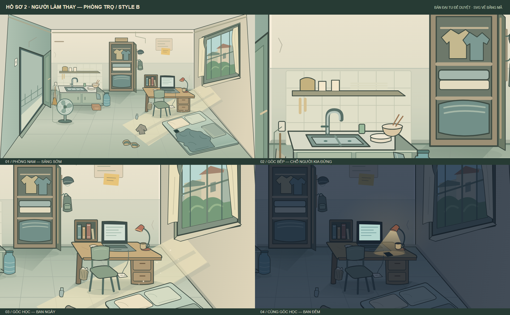

# Bối cảnh — Hồ sơ 2: Người làm thay

**Đại tu 10/11/2026, trên bản Anti `09e7616`. Bản hình để duyệt, thay bộ nền cũ theo yêu cầu chủ repo; chưa dựng chuyển động.** Áp dụng [Style B chung](../../../../../docs/PHONG-CACH-MY-THUAT.md). Tất cả nền và bản xem được xuất từ **một nguồn** [boi-canh.tsx](boi-canh.tsx), không chỉnh SVG/PNG độc lập rồi bỏ quên nguồn dựng.

## Mặt bằng và chiều sâu

- Một cửa chính trên tường trái, bồn rửa sau–trái; tủ quần áo sau–giữa; bàn học sau–phải; cửa sổ tường phải. Không thêm cửa cạnh bàn.
- **Nệm đôi**, thiết kế theo ý đồ 160 × 200 cm, hai gối và hai phần chăn. Đây là kích thước thiết kế tham chiếu, không phải số đo suy ra từ pixel. Nệm nằm ở tiền cảnh phải, tách khỏi bàn/ghế bằng một dải sàn nhìn thấy. Đường Nam ra cửa đi qua khoảng giữa phòng.
- Nam dùng phía gối kem/chăn xộc xệch gần lối đi; chỗ Tùng là gối xanh/chăn gấp phía tường. H01 nhìn vào chỗ trống ngay bên cạnh, không tự tạo nệm thứ hai.
- Phân biệt sáng tối của ba mặt tường, sàn chuyển sắc theo chiều sâu; hốc cửa sổ có bề dày và bậu; tủ có mặt bên, bàn có khung/ngăn kéo, nệm có cạnh dày. Bóng tiếp xúc và bóng đổ từ nguồn phải neo đồ vào sàn.
- Một mẫu ghế bốn chân, không bánh, dùng xuyên ngày/đêm. Không có áo vắt trên ghế: áo đã được Người Kia mặc từ lúc Nam nhìn thấy.
- Màu nền giảm tương phản so với nhân vật. [Ảnh ghép kiểm tra tỉ lệ](kiem-tra-ti-le.png) dùng rig hiện có; đây là thử mỹ thuật, không phải vị trí/pose đã duyệt cho một shot.

## File và tác dụng

| File | Dùng để làm gì |
|---|---|
| [boi-canh.tsx](boi-canh.tsx) | Nguồn React/SVG duy nhất, có trạng thái cửa, ghế, điện thoại và đồng hồ tùy cảnh |
| [render-previews.cjs](render-previews.cjs) | Xuất lại SVG, PNG và trang xem bằng các thư viện đã có trong studio; chỉ ảnh tĩnh, không gọi AI/TTS/video |
| [boi-canh.svg](boi-canh.svg), [boi-canh.png](boi-canh.png) | Bảng 4 khung để đối chiếu; SVG 3840 × 2370, PNG 1920 × 1185 |
| [phong-tro-sang-som.svg](phong-tro-sang-som.svg) | Toàn cảnh sáng, kiểm tra đường đi và nệm đôi |
| [goc-bep-bon-rua.svg](goc-bep-bon-rua.svg) | Khung cắt khu bếp từ cùng bản vẽ; không tạo phối cảnh mới |
| [goc-ban-hoc-sang.svg](goc-ban-hoc-sang.svg) | Góc bàn/tủ ban ngày, cùng tọa độ khung với góc đêm |
| [ban-hoc-laptop-dem.svg](ban-hoc-laptop-dem.svg) | Góc bàn/tủ ban đêm; đèn và laptop sáng, điện thoại tắt |
| [hanh-lang-cua-phong.svg](hanh-lang-cua-phong.svg) | Tên cũ được giữ để không đứt link; nội dung giống góc bàn sáng. **Không phải nền ngoài hành lang** |
| [kiem-tra-ti-le.svg](kiem-tra-ti-le.svg), [PNG](kiem-tra-ti-le.png) | Đặt Nam vào nền kiểm tra phong cách và tương quan người–đồ |
| [xem-truc-tiep-boi-canh.html](xem-truc-tiep-boi-canh.html) | Xem từng nền và phóng to ngay trên máy |
| `archive-old-layout/` | Lịch sử bố cục cũ, không dùng làm nguồn dựng hiện hành |

## Trạng thái theo kịch bản — không đóng cứng vào nền

| Chi tiết | Quy tắc |
|---|---|
| Căn cước | Mặc định nằm trong ngăn tủ giấy tờ. Không có thẻ sẵn trên bàn. D02 mới lấy ra; sau D03 có thể nằm trên bàn theo thao tác nguồn. Dùng prop ở shot, không vẽ cố định vào nền |
| Ví | Nguồn có ví trên bàn ở cảnh kiểm đồ; bổ sung đúng cảnh như prop riêng. Không coi việc bỏ thẻ khỏi nền là xóa thao tác kiểm ví |
| Điện thoại | `phone='mat'` đầu sáng; Nam cầm thì `hidden`; đặt cạnh laptop thì `desk`. Cả hai hình mặc định tắt màn hình. Báo thức/tin nhắn là lớp riêng theo cue, không mang tin cũ sang cảnh mới |
| Đồng hồ | `clockMinutes=null` mặc định: không đưa đồng hồ vào hình nền. Khi shot cần mốc giờ đã chốt, truyền số phút từ 00:00 và giữ nhất quán các shot kế tiếp. Không tự mặc định 23:45 cho cảnh chỉ nói “buổi tối” |
| Laptop | Màn hình giấy làm bài trung tính, không tên tập hay dữ liệu truyện. Nội dung bài/tin cần đọc phải thay bằng lớp màn hình theo shot. Chữ trang trí không chứng minh bài đã được viết xong |
| Cửa | `open`, `closed` (khép nhưng chưa gài), `latched` (gài). Nền đêm mặc định `closed`, phù hợp việc Nam quên gài; phải căn trạng thái đầu sáng khép hờ trong storyboard |
| Ghế | `desk` hoặc `door`. Biến thể vị trí là mẫu tĩnh; đường kéo, cú va đầu gối và khoảng quét cửa cần kiểm tra animatic. Sau dời nệm, dựng lại cú va A05 với ghế tách khỏi nệm, không kéo nệm xuyên bàn để giữ pose cũ |
| Nước, khói, bụi | Nước không chảy cố định sau câu thoại đã tắt vòi. Không gắn khói cốc mặc định. Hạt bụi trong hình sáng chỉ là mẫu tĩnh, chưa có diễn hoạt |

## Dùng trong dựng

Các export: `RoomScene`, `RoomMorning`, `KitchenSink`, `StudyCornerMorning`, `StudyDeskNight`, `HoSo02EnvironmentMasterBoard`. `HallwayDoor` là alias cũ của góc bàn để tương thích, không mang nghĩa đã có hành lang.

Các nền riêng xuất 1920 × 1080. Ba khung cắt chỉ thay phạm vi nhìn trên cùng hình 2D; không phải camera xoay hay giả lập tiêu cự. Những góc ngược, góc ngoài hành lang và cận tay vẫn phải dựng theo [DUNG-CANH](../../DUNG-CANH.md).

Mã có nhóm `data-layer` cho phòng, sàn, cửa, tủ, bếp, bàn, ghế và nệm; ID SVG được tách theo instance. `children` là lớp trên cùng cho kiểm tra bố cục, **chưa tự giải quyết người bị mép bàn/bồn rửa che**. Khi diễn tương tác, tách mặt trước/sau theo shot và gắn vật vào tay. Bản này đã kiểm tra ảnh tĩnh, chưa xác nhận parallax, tiếp xúc đang chuyển động hoặc thời lượng.

Để xuất lại: chạy `node render-previews.cjs` trong thư mục này sau khi studio có dependencies. Không sửa riêng ảnh bảng tổng hợp. Nếu nguồn nhân vật thay đổi, xuất lại ảnh kiểm tra tỉ lệ cùng lượt.
