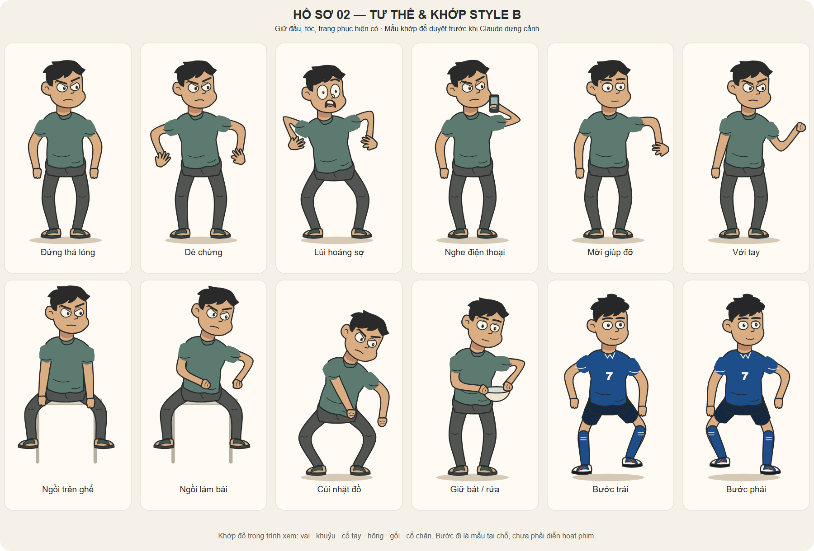

# Tư thế và khớp — bộ nhân vật hiện có, Style B

**10/11/2026 — bản bổ sung để duyệt.** Dùng lại trực tiếp `StudentTwinHead`, `TungHead` và `PALETTE` từ [nhan-vat.tsx](../nhan-vat.tsx). Không thay dàn nhân vật, bảng thiết kế cũ hoặc kịch bản. Nam và Người Kia dùng chung cấu trúc/hình thể/trang phục; khác nhau qua biểu cảm và cách chọn tư thế. Tùng giữ tóc ngắn, áo bóng đá số 7, quần đùi, vớ và giày.

## Tệp và tác dụng

| Tệp | Tác dụng |
|---|---|
| [rig.tsx](rig.tsx) | `StudentRig`, 12 preset, bộ giải tay/chân hai đoạn, đường bao liền, tọa độ khớp và hàm lấy pha bước |
| [tu-the-khop.svg](tu-the-khop.svg) / [PNG](tu-the-khop.png) | Bảng tĩnh 12 tư thế để duyệt nét, dáng và trang phục; sinh từ cùng nguồn rig |
| [xem-tu-the.html](xem-tu-the.html) | Trình xem chạy độc lập, không cần CDN; chọn ba nhân vật, tư thế, bật khớp; kéo pha bước hoặc mức đứng → dè chừng. Tải về/mở local; GitHub không chạy HTML tương tác trong trang xem mã |
| [preview.tsx](preview.tsx) | Nguồn giao diện thử rig; không phải composition của phim |
| [build-preview.mjs](build-preview.mjs) | Tạo lại SVG và HTML từ nguồn bằng các thư viện đã cài trong `what-if-studio/node_modules`; PNG cần chụp/xuất lại từ SVG |
| [verify-rig.mjs](verify-rig.mjs) | Kiểm tra chiều dài xương, dữ liệu hữu hạn, vòng bước và hướng đầu gối khi ngồi |

## Các tư thế có sẵn

`stand` đứng thả lỏng; `wary` dè chừng; `recoil` lùi hoảng sợ; `phone` nghe điện thoại; `offer` mời giúp; `reach` với tay; `sit` ngồi ghế; `type` ngồi làm bài; `bend` cúi nhặt; `wash` giữ bát; `stepLeft` và `stepRight` hai pha bước. Mỗi preset dùng được cho cả ba người. Các tên thao tác là tư thế chuẩn bị, không có nghĩa hành động đã được diễn đủ từ đầu đến cuối.

## Khớp và cách điều khiển

- Hệ tọa độ thiết kế cao khoảng 600 đơn vị. `x`, `y`, `scale` đặt cả rig vào cảnh; các đích bàn tay/bàn chân dùng tọa độ trong rig trước phép đặt này. `left`/`right` là trái/phải màn hình trong góc vẽ hiện có, tránh hiểu nhầm thành giải phẫu khi đổi hướng.
- `root` dịch hông/thân; `lean` nghiêng thân quanh hông; `head` nghiêng đầu quanh chân cổ. Vai theo thân, gốc đùi theo hông. Hệ đầu–cổ kế thừa nguyên mẫu đã có.
- `leftHand`, `rightHand`, `leftFoot`, `rightFoot` là đích cổ tay/cổ chân. Bộ giải tính khuỷu/gối với chiều dài xương cố định; điểm ngoài tầm bị giới hạn thay vì kéo dài chi. Dáng ngồi dùng chiều dài chiếu riêng để gợi đùi hướng ra trước trong tranh 2D.
- `leftBend`/`rightBend` chọn phía gập khuỷu; `leftKnee`/`rightKnee` chọn phía gập gối. Không đổi dấu đột ngột giữa cùng một động tác. `leftPalm`/`rightPalm` chỉnh hướng bàn tay; `leftShape`/`rightShape` chọn thả, xòe hoặc nắm.
- Mỗi tay/chân có đường bao cong liên tục qua khớp. Vai nối vào áo, hông phủ gốc đùi; tay đang diễn ở lớp trước thân. Điện thoại và bát đi theo điểm tay, không đặt trôi độc lập trên màn hình. Đây là mô hình cầm đồ đơn giản, chưa phải bộ ngón tay chi tiết cho mọi góc cận.
- `debug` hiện 14 điểm neo và đường xương. `showSupport` hiện bóng sàn hoặc ghế thử; khi dùng ghế/bối cảnh thật, tắt hỗ trợ thử và căn lại điểm tựa/đích chân. Không đặt thêm ghế thử đè lên ghế của cảnh.

## Giao cho Claude khi dựng

Import `StudentRig`, `POSES`, `blendPose`, `sampleWalk` từ tệp rig này. Đặt rig trong SVG của cảnh; chọn `cast="nam"`, `cast="nguoi-kia"` hoặc `cast="tung"`. Khớp/tư thế là dữ liệu số nên có thể điều khiển theo frame của Remotion; trình xem HTML chỉ dùng để duyệt, không lấy đồng hồ của trình xem làm thời gian phim.

`blendPose(a,b,t)` nội suy vị trí và góc, **giữ trạng thái rời rạc của a** (đạo cụ, kiểu tay, phía gập, mặt đỡ). Dùng cho hai dáng cùng cấu trúc; không nội suy thẳng đứng → ngồi hoặc tay không → có điện thoại rồi mong có tiếp xúc đúng. Tách nhịp chuẩn bị → chạm → giữ → buông, đặt trạng thái ở mốc tương ứng; riêng thao tác kéo chốt/cầm bát/gõ phím phải căn vào tọa độ đạo cụ thật.

`sampleWalk(phase)` cung cấp vòng bước tại chỗ để soi chân/tay. Chưa có đường đi, khóa chân xuống mặt đất của cảnh, bước qua cửa hoặc tránh va chạm. Khi cho nhân vật đi qua phòng, phải phối hợp dịch gốc và chân trụ để tránh trượt; không gọi mẫu tại chỗ là chu kỳ đi hoàn thiện.

Chỉ hỗ trợ góc chính diện hơi ba phần tư như mẫu gốc. Chưa có turnaround nghiêng/lưng; không lật ngang cả người có số áo/chữ hay chi tiết nhận diện rồi xem là góc mới. Chưa gắn khẩu hình/giọng hoặc diễn hoạt kịch bản. Biểu cảm dùng đúng nhóm `NamMood` cho Nam/Người Kia và `TungMood` cho Tùng.

## Đã kiểm tra và phần còn duyệt

- Bộ giải qua 254 tư thế/pha thử: chiều dài xương ổn định, đường bao không NaN, vòng bước khép, gối ngồi không chéo tâm, xử lý đích trùng/ngoài tầm.
- Kiểm tra kiểu dữ liệu riêng nguồn rig; SVG/HTML được build thành công. Trình xem đã thử trong Chromium: đổi sang Tùng, chọn ngồi, bật đủ 14 điểm khớp, mở điều khiển pha bước. Bảng SVG được xem và sửa đường nối khuỷu, dáng ngồi và hướng khuỷu khi cầm điện thoại.
- Chờ chủ repo duyệt tạo hình. Chưa xác nhận các động tác hoặc tương tác đã đạt trong phim; vẫn cần storyboard rồi animatic có bối cảnh/đạo cụ và nhịp thoại thực khi được giao dựng.

Tuân theo [quy chuẩn mỹ thuật chung](../../../../../docs/PHONG-CACH-MY-THUAT.md) và [kế hoạch quay layer](../../DUNG-CANH.md#quay-layer). Không đổi kịch bản hoặc tự bắt đầu dựng phim từ lần bổ sung asset này.
