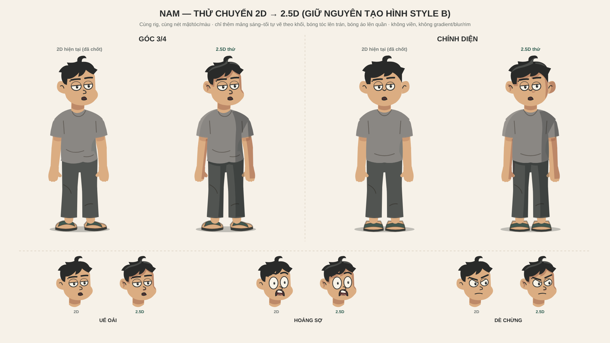

# Thử chuyển Nam 2D → 2.5D (11/11/2026)



**Trạng thái: bản thử để chủ repo duyệt hướng.** Chưa thay bộ Nam đã chốt, chưa áp vào shot/timeline, chưa xem chuyển động.

## Cách làm — giữ nguyên nhân vật

- Không vẽ lại Nam. `Nam25D` render y nguyên `StudentTwinBody`/`StudentTwinHead` từ [`../../nhan-vat.tsx`](../../nhan-vat.tsx) (cùng rig, tóc, nét mặt, màu, nốt ruồi), rồi phủ một lớp mảng sáng–tối **tự vẽ** lên trên.
- Mảng được cắt bằng mask silhouette của chính nhân vật và theo đúng khối: tóc, da mặt (trừ tóc), thân áo, tay áo, da tay, ống quần (trừ áo). Không tràn ra nền hay sang khối khác.
- Mảng tối dùng `mix-blend-mode: multiply` (phép hoà màu, không phải filter) để nét mắt/mày/nếp áo phía dưới vẫn giữ mực, và một mảng dùng được cho mọi màu áo. Màu da tối chọn để ra đúng `PALETTE.skinShadow`.
- Hướng sáng thiết kế cố định trái–trên, cùng phía mảng `drawn-side` có sẵn. Không tính theo đèn, không gradient, blur, rim hay AO — đúng [mục 4.0](../QUY-CHUAN-THIET-KE-SVG.md#40-bóng-vẽ-tay-không-viền-11112026).

## Cái tạo ra cảm giác 2.5D

1. **Mặt sáng/mặt tối trên từng khối tròn:** thân áo tối phía xa, vành sáng theo vai gần; tay và ống quần có dải tối cong qua ba khớp (hẹp ở chi gần, rộng ở chi xa) → đọc thành khối trụ.
2. **Bóng đổ giữa các lớp:** tóc đổ xuống trán (chính mảng tóc lệch theo hướng sáng), vạt áo đổ xuống quần → đọc được lớp nào nằm trên.
3. **Mảng sáng tóc** theo vòm sọ, mặt thái dương phía xa, bóng dưới mũi, hốc tai. Mảng mặt dừng trên gò má, không chạy quanh cằm để khỏi giống râu.

## Giới hạn

- Chỉ vẽ mảng cho tư thế đứng, góc 3/4 và chính diện. Pose khác: dải tay/chân bám khớp nên đi theo dáng, nhưng mảng thân/đầu là hình cố định — cần vẽ thêm cho nghiêng, 1/4, sau lưng và pose gập.
- Hình học đầu/tóc/thân được chép trong file chỉ để làm vùng cắt; nếu sửa đầu/tóc/thân trong `nhan-vat.tsx` thì phải sửa theo.
- Mask render lại nhân vật một lần nữa cho mỗi lớp cắt → tốn thời gian render hơn bản 2D. Chưa đo trên Remotion.
- Bảng tĩnh không chứng minh chuyển động. Muốn dùng trong phim cần xem animatic quay đầu/đi/cầm đồ.

## Dùng và xuất lại

```tsx
import { Nam25D, Nam25DHead } from './thiet-ke/thu-2-5d/nam-2-5d';
<Nam25D view="three" mood="sleepy" shirt={PALETTE.nam.sleepShirt} />
<Nam25D view="front" volume={false} />   // tắt lớp thể tích = Nam 2D gốc
```

Bảng `nam-2-5d.svg/png` xuất từ `Nam25DBoard` (1920×1080). Chưa tạo audio/video.
