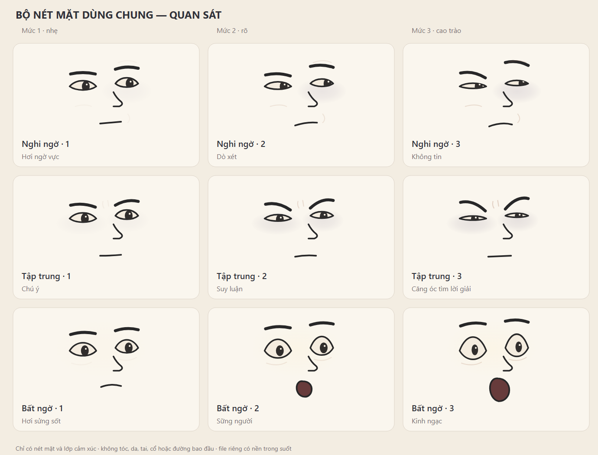
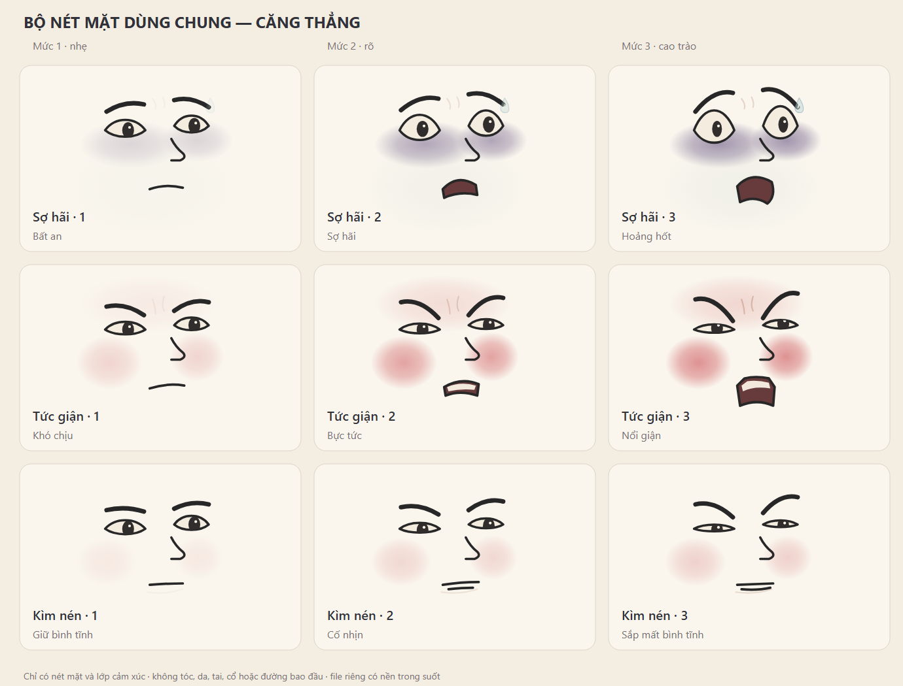
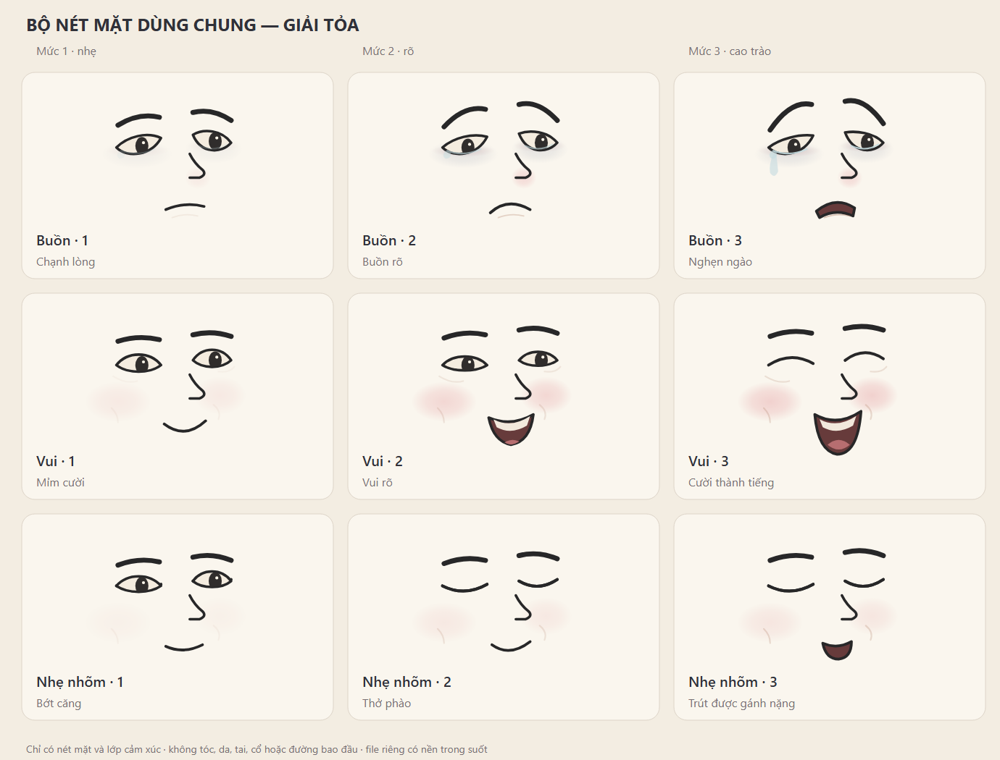

# Bộ nét mặt cartoon mềm — dùng chung

Phiên bản 1, 10/11/2026. Tách từ bộ biểu cảm đã duyệt của [nhân vật truy vết](../../../../episodes/hem-co-chuyen/assets/nguoi-truy-vet/README.md), theo yêu cầu giữ **chỉ nét mặt, không tóc, sọ/đường bao đầu, da nền, tai hoặc cổ**. Đây là thư viện mới; bộ nhân vật nguồn vẫn được giữ để đối chiếu.

## Có gì và mỗi file dùng làm gì

| File / thư mục | Tác dụng |
|---|---|
| [danh-muc.json](danh-muc.json) | Tên cảm xúc, 3 mức độ, file, mốc căn chỉnh và góc đầu gợi ý của mẫu nguồn |
| `svg/<cam-xuc>-01.svg` đến `-03.svg` | 27 nét mặt, 9 nhóm × 3 mức; nền trong suốt, cùng hệ tọa độ |
| [svg/binh-than-00.svg](svg/binh-than-00.svg) | Trạng thái nghỉ để đối chiếu vị trí và tỷ lệ |
| [bang-01.svg](bang-01.svg) / [PNG](bang-01.png) | Nghi ngờ, tập trung, bất ngờ; 3 cột tăng mức từ trái sang phải |
| [bang-02.svg](bang-02.svg) / [PNG](bang-02.png) | Sợ hãi, tức giận, kìm nén |
| [bang-03.svg](bang-03.svg) / [PNG](bang-03.png) | Buồn, vui, nhẹ nhõm |
| [net-mat.ts](net-mat.ts) | Cùng 28 nét mặt dưới dạng chuỗi SVG theo lớp để rig React ghép trực tiếp. Tự sinh, không sửa tay |
| [tools/to-ts.cjs](tools/to-ts.cjs) | Sinh lại `net-mat.ts` từ `svg/` (chạy sau export.py) |
| [tools/export.py](tools/export.py) | Xuất lại SVG và bảng từ mẫu nguồn, kiểm tra số lượng, ID và tham chiếu; không tạo PNG, rig, giọng hoặc video |

## Sáu lớp chỉnh riêng

Mỗi SVG có nhóm mang `data-layer` và ID riêng theo tên file:

| Lớp | Chứa gì / cách dùng |
|---|---|
| `color` | Tím lạnh, má hồng, đỏ nhẹ khi giận; thay màu/độ đậm theo da và ánh sáng, cắt theo vùng da của nhân vật nhận |
| `eyes` | Mắt, mí, đồng tử, điểm sáng; clip đồng tử đi theo đường mắt tương ứng |
| `brows` | Chân mày riêng, chỉnh độ cao/độ dày/độ cong theo tính cách |
| `nose` | Mũi tham chiếu; có thể ẩn để giữ nguyên mũi đặc trưng của nhân vật |
| `mouth` | Miệng và phần răng/lưỡi khi có; chi tiết được cắt theo lòng miệng |
| `details` | Mắt ướt, lệ, mồ hôi, nếp má/trán nhỏ; chỉ bật đúng mức và hoàn cảnh |

Không tô màu da nền vào file nét mặt. Không thêm lại tóc/khung sọ vào thư viện này; các phần đó thuộc thiết kế nhân vật. Nền kem và khung thẻ chỉ có trong bảng xem, không có trong 28 SVG riêng. Các ID định nghĩa được thêm tiền tố theo file để ghép nhiều nét trong cùng tài liệu mà không đụng clip/gradient.

## Căn vào nhân vật khác

1. Chọn nét và mức theo diễn biến; dùng mặt trung tính để căn trước. Hệ tọa độ của SVG là `viewBox="-65 -50 130 120"`; gốc `(0, 0)` nằm gần giữa hai mắt. Mốc trung tính tham chiếu: mắt trái trên hình `(-23, 2)`, mắt phải `(23, -1)`, vùng giữa miệng `(6, 41)`. Đây là mốc thiết kế, không phải dữ liệu landmark được đo riêng cho mọi biểu cảm.
2. Đặt các nét lên mặt nhân vật nhận; chỉnh khoảng cách mắt, vị trí miệng, chiều rộng nét và độ dày viền. Giữ lớp mũi cũ nếu đã có thiết kế riêng. Phối hợp má/hàm và đầu của nhân vật nhận; thư viện đã bỏ góc nghiêng đầu, chỉ ghi lại gợi ý trong danh mục.
3. Cắt lớp màu theo biên da mặt của nhân vật nhận, đặt sau mắt–mày–miệng; không dùng màu đỏ/tím để thay cả diễn xuất hoặc tự biến thành vết thương. Tránh kéo giãn cả nhóm quá mức làm méo răng, đồng tử và độ dày viền.
4. Kiểm tra cạnh nhau trung tính → nhẹ → rõ → cao trào ở cỡ xem cuối. Với trẻ em, người già hoặc nhân vật ít bộc lộ, chỉnh tỷ lệ và dấu hiệu riêng; không buộc mọi người có cùng mặt hoặc cùng cách giận.

Hình nguồn ở hướng gần chính diện hơi chếch; **chưa có bộ riêng cho nghiêng hẳn, nhìn từ sau, góc ngửa/cúi sâu**. Chỉ tách lớp không tự giải quyết phối cảnh hoặc làm biểu cảm tự khớp mọi rig. Đã kiểm tra SVG và bảng tĩnh, chưa ghép thử trên toàn bộ dàn nhân vật, chưa có lip-sync hoặc chuyển động nội suy. Khi được giao dựng, thử một nhân vật và một đoạn đổi nét trước, rồi mới nhân rộng.

## Đã gắn vào rig

Hồ sơ 2: `StudentTwinHead`/`StudentTwinBody` nhận `face="so-hai-02"` (chính diện và 3/4). Gốc thư viện đặt vào giữa hai mắt nhân vật, giữ mũi và nốt ruồi của nhân vật, bỏ lớp mũi thư viện; chớp mắt và khẩu hình nói vẫn dùng của rig. Góc nghiêng chưa có bộ riêng nên vẫn dùng `mood`.

## Nguồn và xuất lại

Mã asset: **EXP-CARTOON-SOFT-01**. Vector do Codex viết từ yêu cầu/phản hồi của chủ repo, tách từ mẫu gốc trong repo; không nhập stock, font nhúng hoặc ảnh raster ngoài vào file SVG. Không tự áp giấy phép media của bên khác. Giữ tác giả/nguồn này khi dùng lại trong repo.

Chạy từ gốc repo bằng Python 3: `python what-if-studio/library/expressions/cartoon-soft/tools/export.py`. Script đọc mẫu nguồn ở `episodes/hem-co-chuyen/assets/nguoi-truy-vet/bieu-cam/`, ghi đè SVG thư viện và danh mục tương ứng; chỉ chạy khi chủ ý cập nhật bộ chung. Sau khi đổi SVG, render lại 3 PNG bảng cùng kích thước 1380×1050 và kiểm tra trước khi push; script không tự xác nhận PNG cũ đã đồng bộ. Nhân vật mới dùng file chung hoặc dẫn tới file này; không rải bản sao ở từng hồ sơ chỉ để lưu cùng một biểu cảm.
