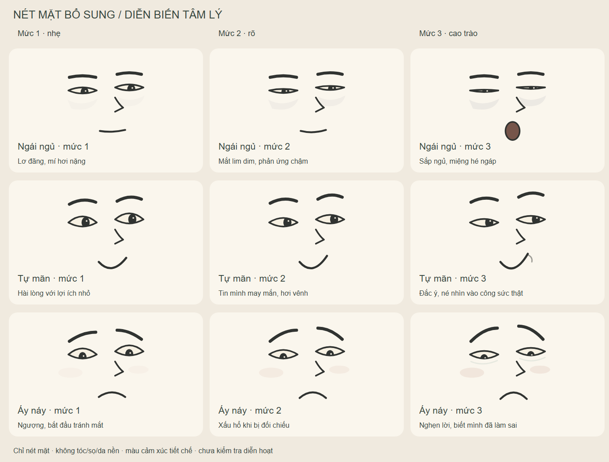
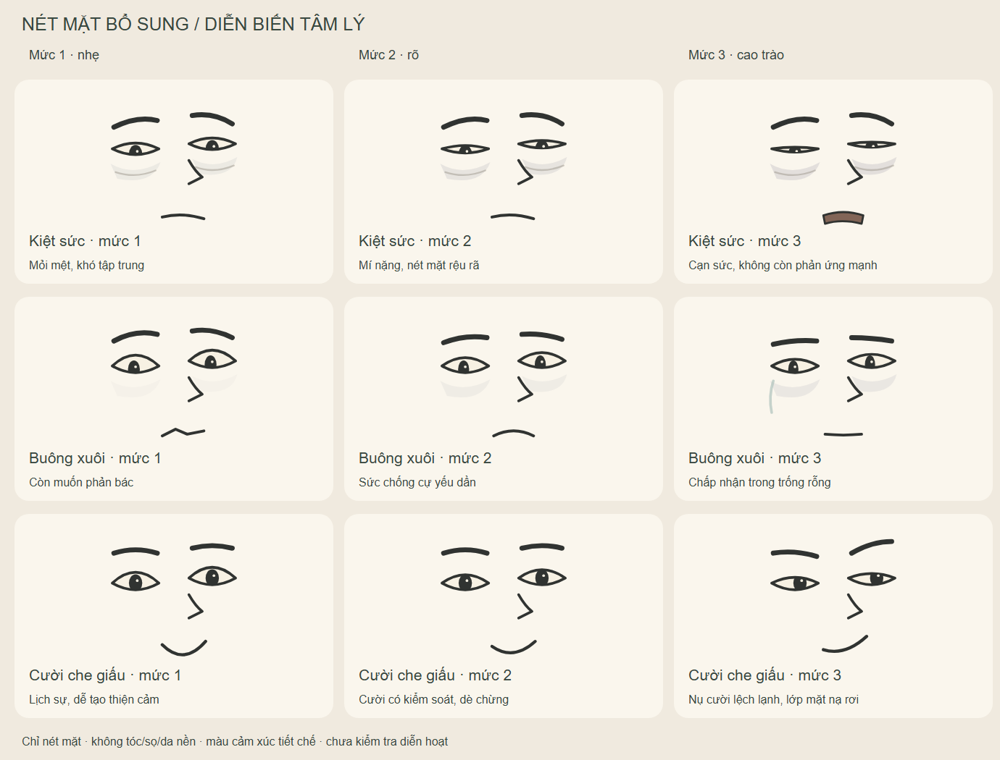

# Nét mặt bổ sung theo cốt truyện — ba mức độ

18 nét mặt mới, sáu nhóm × ba mức, ngày 11/11/2026. Đây là phần mở rộng dùng chung của `cartoon-soft`; giữ nguyên 28 nét mặt gốc. SVG riêng trong suốt, **không tóc, sọ, màu da nền, tai hoặc cổ**. Không thay tóc Nam/Người Kia.

## Chọn nét theo diễn biến

| Key gốc, thêm `-01` / `-02` / `-03` | Mức 1 → mức 2 → mức 3 | Hồ sơ 2 |
|---|---|---|
| `ngai-ngu` | Lơ đãng → lim dim → sắp ngủ/ngáp | Nam chơi muộn, trì hoãn rồi ngủ quên |
| `tu-man` | Hài lòng → tự cho mình may mắn → đắc ý | Nhận bài làm hộ, tự biện hộ cho lựa chọn |
| `toi-loi` | Ngượng → xấu hổ → nghẹn lời | Bị đối chiếu việc mình làm, đối diện Tùng/gia đình |
| `kiet-suc` | Mỏi → rệu rã → cạn sức | Cố tự làm lại, liên tục thất bại |
| `buong-xuoi` | Còn phản bác → sức chống cự yếu → trống rỗng | Đối chất cuối và quyết định chạm kính; không gán lên Nam đầu truyện |
| `cuoi-che-giau` | Lịch sự → kiểm soát → nụ cười lệch lạnh | Người Kia; mức 3 chỉ sau khi bản chất đã lộ |

Mức 3 là cao trào **của từng cảm xúc**, không phải lúc nào cũng mở mắt/miệng lớn hơn: buông xuôi càng nặng càng ít phản ứng. Sợ hãi, bất ngờ, buồn và giận dùng lại [bộ gốc](../README.md). Không dùng màu tím/đỏ thay cho diễn xuất; mảng phụ nhỏ, không thành bầm tím hoặc râu.




## Mỗi file dùng làm gì

| File | Vai trò |
|---|---|
| `svg/<key>-01.svg`…`-03.svg` | Vector tách lớp dùng lại trên nhân vật, nền trong suốt |
| [danh-muc.json](danh-muc.json) | Tên, mức, diễn giải và gợi ý sử dụng |
| [net-mat.ts](net-mat.ts) | `StoryFaceKey`, `STORY_FACES`, `STORY_GROUPS` để ghép trong React |
| [tools/export.cjs](tools/export.cjs) | Nguồn thiết kế; xuất SVG/TS/JSON và hai bảng PNG/SVG |
| `bang-1`, `bang-2` | Bảng so ba mức trên nền trung tính; không đưa nguyên bảng vào phim |

Hệ tọa độ giống bộ gốc: `viewBox="-65 -50 130 120"`, nhóm nét bên trong `translate(-7 -71)`. Sáu lớp `color`, `eyes`, `brows`, `nose`, `mouth`, `details`; vị trí raw của hai mắt gần `(-16,73)` và `(30,70)`. Mỗi mắt có clip riêng cho đồng tử. Màu phụ là mảng phẳng vẽ sẵn, không dùng bóng vật liệu tự sinh.

## Ghép vào rig đang có

```tsx
<StudentTwinBody identity="nam" face="toi-loi-02" pose={pose} />
<StudentTwinBody identity="nguoi-kia" face="cuoi-che-giau-01" pose={pose} />
<StudentTwinHead face="buong-xuoi-03" />
```

Import các component từ nguồn `episodes/hem-co-chuyen/ho-so-02-nguoi-lam-thay/assets/nhan-vat.tsx`. Rig kết hợp key cũ và mới, giữ mũi/nốt ruồi/tóc của nhân vật; không lấy mũi tham chiếu của overlay. `talk` và `blink` ghi đè đúng lớp miệng/mắt khi cần. `faceFrom`/`faceMix` là trộn mờ hai nét, **không phải nội suy cơ mặt**; không kéo dài gây mắt/miệng kép.

Đã ghép kiểm tra tĩnh lên Nam/Người Kia: [bảng 1](../../../../../episodes/hem-co-chuyen/ho-so-02-nguoi-lam-thay/assets/bo-sung-15p/bang-cam-xuc-01.png), [bảng 2](../../../../../episodes/hem-co-chuyen/ho-so-02-nguoi-lam-thay/assets/bo-sung-15p/bang-cam-xuc-02.png). Rig chỉ dùng `face` ở chính diện và ba phần tư. Đầu nghiêng sâu/sau lưng chưa có bộ tương ứng; vẫn dùng `mood`, không kéo phẳng overlay vào góc nghiêng.

Nhân vật khác có thể dùng các SVG/lớp này sau khi căn lại mắt, miệng, nét và cắt màu theo da. `TungHead` hiện chưa nhận `face`; không truyền key rồi mặc định Tùng đã có đủ biểu cảm. Cần adapter riêng nếu được giao. Mỗi actor phải có tiền tố ID riêng cho clip/defs; nhóm mắt được vẽ hai lần để căn hai bên thì bỏ ID nhóm bị lặp. Không lật cả màn hình hoặc đổi bên nốt ruồi khi đổi cảm xúc.

## Thiết kế và xuất lại

Sửa `tools/export.cjs`, chạy từ gốc repo:

```powershell
node what-if-studio/library/expressions/cartoon-soft/bo-sung-cot-truyen/tools/export.cjs
node episodes/hem-co-chuyen/ho-so-02-nguoi-lam-thay/assets/bo-sung-15p/render-previews.cjs
node episodes/hem-co-chuyen/ho-so-02-nguoi-lam-thay/assets/bo-sung-15p/verify.cjs
```

Không sửa tay `net-mat.ts` hoặc chạy exporter bộ cũ để ghi đè phần mở rộng. Khi xuất mới, kiểm tra SVG/XML, tham chiếu clip, ID ghép nhiều người, ba mức ở cỡ điện thoại và bảng trên đầu thật. Chưa kiểm tra lip-sync/đổi nét chuyển động. Không tạo giọng hoặc video trong bước này.

Vector do Codex viết theo phản hồi của chủ repo; tái sử dụng cấu trúc bộ nét mặt nội bộ, không dùng stock/ảnh sinh trả phí. Cách vẽ chi tiết, tay/pose và giới hạn nằm trong [hướng dẫn thiết kế asset](../../../../../episodes/hem-co-chuyen/ho-so-02-nguoi-lam-thay/assets/bo-sung-15p/CACH-THIET-KE-VA-SU-DUNG.md).
